### 1. 클라우드 스토리지 필요성

스마트폰의 확산과 더불어 태블릿을 포함한 다양한 모바일 디바이스를 이용하여 시간과 장소에 구애받지 않고 업무를 하고자 하는 요구도 늘어나고 있다. 이로 인해 클라우드에 필요한 파일을 저장해두고 언제든지 사용할 수 있는 클라우드 스토리지에 대한 사용도 증가하고 있다. 특히 윈도우 태블릿의 확산으로 안드로이드나 iOS 기반의 모바일 디바이스에서는 하기 힘들었던 윈도우 기반의 다양한 업무 프로그램을 사용할 수 있게 되었다.

그런데 현재 보급되고 있는 윈도우 태블릿은 일반적으로 32GB 또는 64GB의 저장공간을 갖고 있는 것이 대부분이며 (물론 서피스프로와 같이 노트북을 능가하는 고급 기종도 있다. 최근에는 16GB 윈도우 태블릿도 출시되었다) 이로 인해 클라우드 스토리지의 사용이 필수적이 되고 있다. 기본적으로 윈도우 태블릿은 Microsoft 계정을 제공함으로써 OneDrive라는 마이크로소프트의 클라우드 스토리지를 손쉽게 사용할 수 있는 반면 기존의 Google Drive, Dropbox 등의 다른 클라우드 스토리지를 사용하던 사용자는 데이터를 OneDrive로 옮기거나 아니면 자신이 사용하는 클라우드 스토리지의 전용 클라이언트를 설치하여 사용하는 것이 보편적이다.

그런데 클라우드 스토리지 특징이라는 글에서도 언급하였듯이 클라우드 스토리지는 서비스에 따라서 네트워크 드라이브 방식 또는 동기화 클라이언트 방식을 제공하는데, 용량이 작은 윈도우 태블릿 사용자는 종종 네트워크 드라이브 방식으로 자신이 사용하던 또는 사용하고자 하는 클라우드 스토리지를 연결하고 싶을 때가 있다. 이 글에서는 이러한 사용자의 요구사항에 따라 저용량 윈도우 태블릿에서 다양한 클라우드 스토리지를 사용할 수 있는 방법에 대해서 알아보고자 한다.

특히 이 글은 32GB 또는 64GB 등 사용자 공간이 충분하지 못하여 동기화 클라이언트를 사용하기에도 부담스러운 사용자를 위해 네트워크 드라이브로 다양한 클라우드 스토리지를 동시에 사용하는 방법에 대해서 알아보고자 한다.

### 2. File Brick  앱을 이용한 클라우드 스토리지 사용

#### 2.1 File Brick 앱 설치 및 설정

필자가 사용하는 메트르용 파일 탐색기로 File Brick이 있는데, 이 앱은 파일 탐색기 기능 뿐만 아니라 다양한 클라우드 스토리지를 지원하는 것으로도 널리 알려져 있다. 이 앱을 이용하여 다양한 클라우드 스토리지를 네트워크 드라이브 형태로 이용하는 방법을 알아보고자 한다.

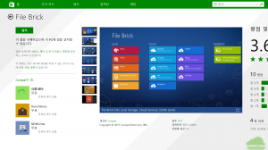

먼저 윈도우 앱스토어에서 위의 그림과 같이 File Brick을 검색한 후 설치한다.

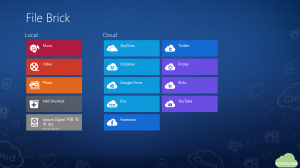

설치가 완료된 후 File Brick을 실행하면 다음의 그림과 같이 왼쪽에는 사용자 태블릿(Local)의 내장 디스크의 폴더가 표시되며 오른쪽 Cloud에는 File Brick에서 사용할 수 있는 클라우드 서비스가 나타난다. 사용자 디스크의 폴더를 Add Shortcut을 이용해 추가할 수 있으며 Cloud 서비스는 계정 로그인을 통해 연결할 수 있다.

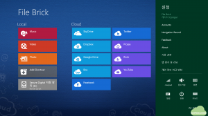

클라우드 중에서 자신이 사용할 클라우드만 표시되게 하려면 위의 그림과 같이 참바를 선택한 후 설정에서 Account를 선택한다.

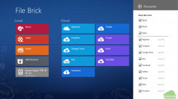

Account를 선택하면 그림과 같이 Local에서 표시할 폴더(Music, Video, Photo)와 클라우드 서비스 중에서 표시할 것을 체크할 수 있다.

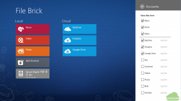

이 글에서는 SkyDrive (OneDrive로 이름이 바뀐 것이 반영이 안되어 있다), Google Drive, Dropbox 등 세 개의 클라우드 스토리지 서비스를 선택한다.

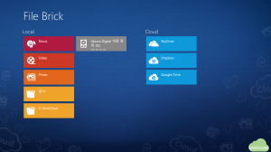

위의 그림과 같이 왼쪽에는 “문서” 폴더와 “4. GotoCloud”라는 로컬 폴더와 오른쪽에는 세 개의 클라우드 스토리지 서비스가 연결되어 있음을 볼 수 있다.

#### 2.2 Microsoft OneDrive 연결

다음으로 File Brick에 Microsoft의 OneDrive를 연결해 보도록 한다. OneDrive는 윈도우 8.1에 기본적으로 내장된 OneDrive 앱을 사용하여도 되나 필자와 같이 마이크로소프트 계정과 윈도우 태블릿의 계정을 다르게 사용하는 사람은 OneDrive 앱을 사용하기가 꺼려질 수 있으므로 File Brick에서 필요한 OneDrive만 연결하는 것이 더 용이할 수 있을 것이다.

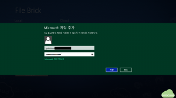

File Brick에서 SkyDrive를 선택하고 위의 그림과 같이 Microsoft 계정 추가 화면이 나타나면 자신의 OneDrive 계정(OneDrive를 사용하고자 하는 마이크로소프트 계정)을 입력한다.

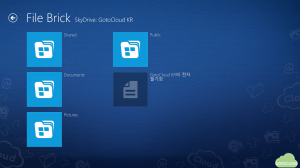

OneDrive 계정 로그인이 성공하면 그림과 같이 OneDrive에 저장된 폴더와 파일이 나타나며 File Brick에서 로컬 탐색기처럼 파일을 사용할 수 있다.

#### 2.3  Google Drive 연결

다음으로 Google Drive를 File Brick에 연결해 보도록 한다.

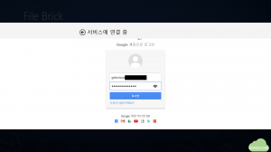

File Brick에서 Google Drive를 선택하면 그림과 같이 자신의 Google 계정을 입력하라는 창이 나타난다. 여기에 Google Drive를 사용할 계정을 입력하고 로그인한다.

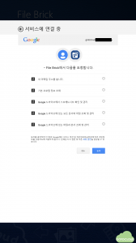

Google 로그인이 성공하면 그림과 같이 File Brick에서 Google Drive 허용 요청이 전달되며 여기에 동의를 누르면 연결이 완료된다. 윈도우 태블릿을 가로로 사용할 경우 동의 버튼이 나타나지 않으므로 위의 화면에서는 태블릿을 세로로 돌려서 동의 버튼을 누르도록 한다.

#### 2.3  Dropbox 연결

Dropbox도 동일한 방식으로 연결할 수 있는데, 현재 필자가 이글을 쓰는 시점에는 Dropbox 연동에 오류가 발생하고 있다. 이 글을 읽은 독자도 자신의 Dropbox 계정에서도 유사한 오류가 발생하는지 확인을 바란다.

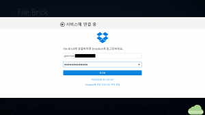

File Brick에서  Dropbox를 선택하면 위의 그림과 같이 Dropbox 계정 입력창이 나타난다. 여기에 자신의 Dropbox 계정 정보를 입력하고 로그인한다.

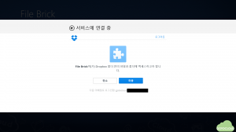

로그인에 성공하면 Dropbox 폴더 접근을 허용할 것인지를 묻는 화면이 나타나며 여기에서 허용을 선택한다.

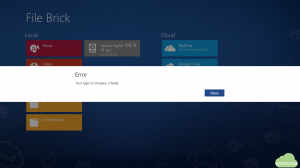

로그인이 성공했음에도 그림과 같이 File Brick에 Dropbox 연결이 실패함을 볼 수 있고 이 부분에 대해서는 추후 확인하고자 한다.

#### 2.4  File Brick에서 클라우드 스토리지 사용

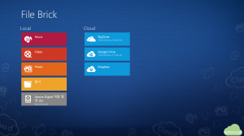

그림과 같이 정상적으로 클라우드 스토리지가 연결되면 제공 용량 및 남은 용량을 확인할 수 있고, File Brick에서 파일을 클라우드 스토리지로 업로드 하거나 다운로드 할 수 있다. 그림에서 볼 수 있듯이 최근에 OneDrive 용량이 30GB로 늘어났고, Google Drive의 경우 15GB의 용량이 제공됨을 알 수 있다.

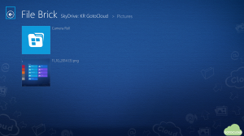

위의 그림과 같이 File Brick을 이용하여 이 글에서 사용된 그림을 OneDrive에 붙여넣기로 올려보았다.

### 3. 맺음말

이글에서는 윈도우 태블릿에서 파일 탐색기로 널리 알려진 File Brick을 이용하여 클라우드 스토리지 서비스를 네트워크 드라이브 방식으로 연결하여 사용하는 방법에 대해서 알아보았다. 내장 디스크 용량이 크지 않은 윈도우 태블릿에서는 자신이 사용하는 클라우드 스토리지를 File Brick을 이용하여 연결하여 사용함으로써 모바일 환경에서 다양한 업무를 손쉽게 할 수 있을 것으로 생각된다.

다음에는 매트로 환경이 아닌 데스크탑 모드에서 네트워크 드라이브 방식으로 클라우드 스토리지를 사용하는 방법에 대해서 알아볼 것이다.
