### 1. 데스크탑에서 클라우드 스토리지 연결하기

클라우드 스토리지 특징에서는 웹인터페이스 방식, 공유 폴더(네트워크 드라이브) 방식 및 동기화 방식으로 클라우드 스토리지의 사용방식이 달라진다는 것이 설명되어 있고,  File Brick으로 클라우드 스토리지 사용이라는 글에는 공유 폴더 방식으로 윈도우 태블릿에서 File Brick이라는 앱을 사용하여 매트로 화면에서 OneDrive, Google Drive 등을 연동하여 클라우드 스토리지를 활용하는 방안이 설명되어 있다.  이 글에서는 PC의 데스크탑에서 네트워크 드라이브로 클라우드 스토리지를 연결하여 사용자 PC의 디스크 드라이브처럼 클라우드 스토리지를 사용하는 방법에 대해서 알아보고자 한다.

윈도우 파일 공유는 다른 컴퓨터의 폴더를 내 PC에서 사용하는 손쉬운 방법인데, 이는 마이크로소프트사와 인텔이 윈도우 시스템이 다른 시스템의 디스크나 프린터와 같은 자원을 공유할 있도록하기 위해 개발된 프로토콜인 SMB(Server Message Block)를 확장하여 유닉스와 윈도우를 동시에 지원하도록 개발된 CIFS(Common Interface File System)를 기반으로 제공되고 있다. 따라서, 윈도우에서 네트워크 드라이브로 공유 폴더를 사용하고자 할 경우 파일서버는 CIFS를 반드시 지원해야 한다는 것이 필수 요건이다. 그런데, 대부분의 클라우드 스토리지는 앞절에서 설명한 세가지 방식의 파일 공유는 지원하지만 CIFS 형태의 파일 공유는 지원하지 않고 있으며 설사 지원한다고 하더라도 대부분의 인터넷 사업자가 CIFS를 위한 네트워크 포트인 139번과 445번 포트를 보안 상의 이유로 차단하고 있어서 클라우드 스토리지를 네트워크 드라이브로 공유한다는 것은 현실적으로 불가능하다. 따라서 클라우드 스토리지를 내 드라이브로 공유하기 위해서는 이를 지원하는 별도의 소프트웨어가 필요하게 된다. 이 글에서는 상용 소프트웨어 중에서 다양한 형태의 네트워크 드라이브 연결을 제공하는 NetDrive를 이용하여 클라우드 스토리지를 데스크탑에서 연결하는 방법을 알아보고자 한다.

### 2. NetDrive 다운로드 및 설치

netdrive는 윈도우에서 OneDrive, Google Drive, Amazon S3, OpenStack 오브젝트 스토리지 등 다양한 클라우드 스토리지 외에도 FTP 서버, WebDAV 및 Synology NAS 등을 네트워크 드라이브 형태로 연결하는 기능을 제공하는 Shareware 소프트웨어로 대당 $40의 가격으로 판매되는 Shareware 소프트웨어로 30일간의 체험 기간이 끝나면 한 개의 네트워크 드라이브만을 사용할 수 있는 버전을 다운로드 페이지 에서 다운로드 할 수 있다.

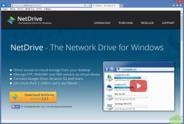

이 글에서는 위의 다운로드 버전이 아닌 이전 버전 중에서 체험 기간이 종료되더라도 두개의 네트워크 드라이브를 사용할 수 있고, 하나의 네트워크 드라이브를 자동으로 연결할 수 있는 2.0.9 버전을 사용하기로 한다. 2.0.9 버전 등 예전 버전은 NetDrive Version History에서 다운로드 가능하다.

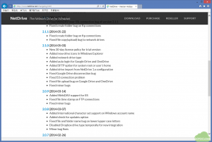

2.0.9 버전을 설치한 후  정보를 보면 다음과 같이 두 개의 드라이브로 연결이 제한되고 하나의 드라이브만 시작 시에 자동으로 연결된다는 정보를 볼 수 있다.  실행 후에 버전 업데이트 메시지는 무시하도록 한다.

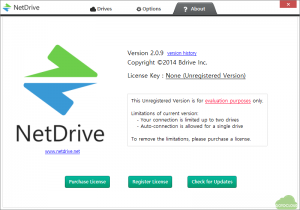

### 3. NetDrive 설정

다음은 OneDrive를 연결하는 과정으로 그림에서와 같이 OneDrive 옆의 Connect를 클릭한 후 Type에 OneDrive, 연결될 PC의 드라이브 문자를 O로 선택하고, 시작시에 자동으로 연결할 것인지를 체크한 후 Save를 눌러 저장한다.

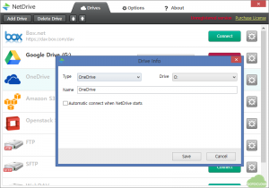

아래의 그림과 같이 Microsoft 계정 정보를 입력하고 NetDrive로부터의 액세스를 허용한다.

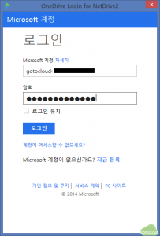

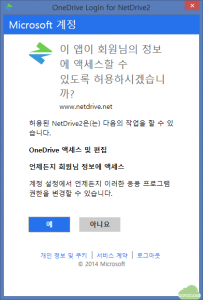

연결이 완료되면 다음과 같이 O: 드라이브에 OneDrive가 연결된다.

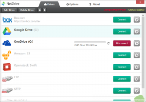

마찬가지 방법으로 Google Drvie 옆의 Connect를 눌러 Google Drive를 연결하면 그림과 같이 구글 계정 정보와 액세스 허용 요청이 나타난다.

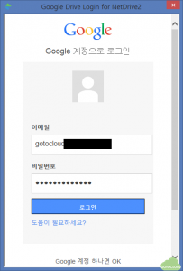

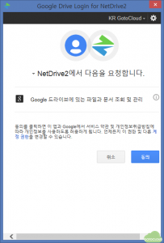

연결이 완료되면 아래와 같이 Google Drive가 정상적으로 연결되었음을 알 수 있다.

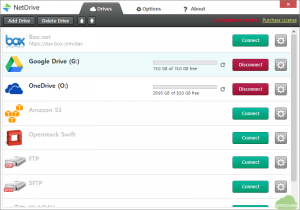

내 컴퓨터의 탐색기를 열어보면 그림과 같이 OneDrive와 Google Drive가 O: 와 G: 드라이브에 연결되고, 내 컴퓨터의 공유폴더로 클라우드 스토리지를 사용할 수 있으며, 클라우드 스토리지에 저장된 파일을 바로 사용할 수 있다.

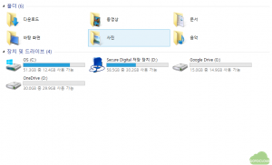

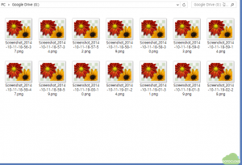

NetDrive는 클라우드 스토리지 이외에도 사용자가 갖고 있는 FTP 서버, NAS 등도 네트워크 공유 폴더 형태로 연결해주는 기능을 제공하고 있어서 다양한 형태의 네트워크 스토리지를 활용할 수 있다는 점에서 아주 만족할 만한 솔루션이라고 생각된다.
