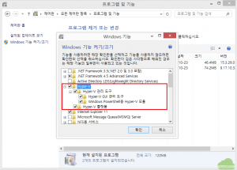
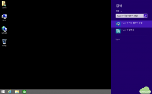
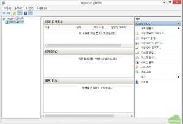
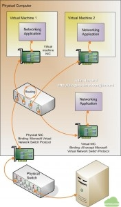
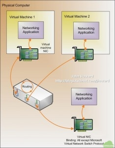
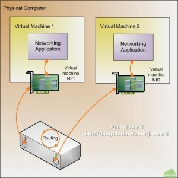
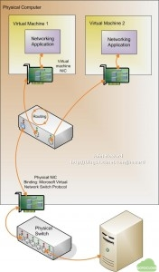
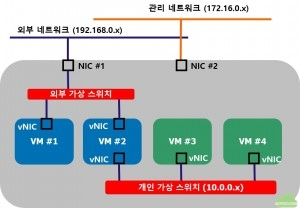
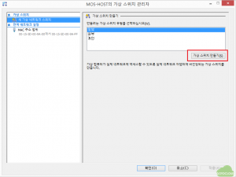
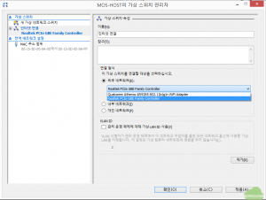

앞의 글에서는 Windows 8 이상의 데스크탑 OS에서 Hyper-V를 사용하기 위한 내용에 대해서 설명하였다. 이 글에서는 실제로 Hyper-V를 활성화하고 가상 머신이 사용할 네트워크인 가상 네트워크를 구성하는 방법에 대해서 설명하고자 한다.

#### 1. Hyper-V 기능 활성화

먼저 윈도우 8.1에서 Hyper-V를 활성화하기 위해서는 제어판의 프로그램 및 기능에서 Windows 기능 켜기/끄기를 실행한 후 Hyper-V 항목을 체크한다. 이 때 마지막의 Hyper-V 플랫폼이 활성화 되지 않은 경우는 BIOS에서 Virtualzation이 활성화 되어 있지 않거나, PC의 프로세서가 SLAT를 지원하지 않기 때문이니 확인이 필요하다.

#### 2. Hyper-V 관리자 실행

Hyper-V 기능을 활성화 한 후 시스템을 재부팅한 후 다음과 같이 참바에서 Hyper-V 관리자 검색하여 실행하거나 virtmgmt.msc 를 실행하면 Hyper-V 관리자가 실행된다.

#### 3. 가상 스위치(Virtual Switch) 만들기

다음으로 Hyper-V에서 사용할 가상 스위치를 생성한다.  가상 스위치는 Hyper-V 호스트에서 가상 머신과 호스트간의 네트워크 및 외부 네트워크와의 연결을 위한 가상 네트워크(Virtual Network) 연결에 사용되는 네트워크 스위치로 사용된다. Hyper-V 에서는 외부(External), 내부(Internal), 개인(Private), 전용(Dedicated)의 네 가지 형태의 가상 네트워크를 구성할 수 있는데 Hyper-V 관리자에서는 외부, 내부, 개인 가상 네트워크를 설정할 수 있고 전용 네트워크는 WMI를 이용하여 생성할 수 있다. 각각의 특징은 다음과 같다. 자세한 내용은 여기에서 참조할 수 있다.

1) 외부(External) 네트워크 연결은 다음의 통신을 지원한다.

- 호스트 PC 내부의 가상 머신간의 통신

- 가상 머신과 호스트 PC의 Parent Partion 간의 통신

- 가상 머신과 호스트 PC 외부와의 통신

- Parent Partion과 외부와의 통신

그림에서와 같이 외부 가상 스위치를 통해 가상 머신과 호스트 PC 및 물리적인 네트워크 카드를 통해 가상머신이 외부의 서버와 통신이 가능하게 된다.

2) 내부 (Internal) 네트워크 연결은 다음의 통신을 지원한다.

- 호스트 PC 내부의 가상 머신간의 통신

- 가상 머신과 호스트 PC의 Parent Partion 간의 통신

그림에서와 같이 내부 가상 스위치를 사용할 경우 가상머신은 외부로 통신할 수는 없으나 호스트 PC와는 통신이 가능하다.

3) 개인 (Private) 네트워크 연결은 다음의 통신을 지원한다.

- 호스트 PC 내부의 가상 머신간의 통신

그림에서와 같이 개인 가상 스위치는 동일한 호스트 PC에 설치된 가상 머신간의 통신만을 지원하므로 주로 가상 머신간의 사설 네트워크 연결에 사용된다. 주로 웹서버와 통신해야 하는 DB 서버 등을 사설 네트워크를 통해 외부와 격리하고자 할 때 사용할 수 있다.

4) 전용(Dedicated) 네트워크는 다음의 통신을 지원한다.

- 호스트 PC 내부의 가상 머신간의 통신

- 가상 머신과 호스트 PC 외부와의 통신

외부 가상 스위치와 달리 전용 가상 스위치는 가상머신과 호스트 PC 간의 통신을 지원하지 않으므로 호스트 PC에서 네트워크를 통해 가상머신에 접근할 수 없다는 점에서 가상 머신의 네트워크 보안에 가장 좋은 구성이라고 볼 수 있으나 이는 WMI를 통해서만 활성화 할 수 있다는 점이 개선의 여지로 생각된다. 이 때 외부에서 호스트 PC에 접근하기 위해서는 별도의 추가 NIC를 장착해야 한다.

가상 스위치는 한 대의 호스트 PC에 여러 개를 생성할 수 있으며 각각의 가상 스위치를 통해 별도의 네트워크를 구성할 수 있어서 실제 물리적인 네트워크 구성과 동일한 형태로 네트워크를 구현할 수 있다.

위의 그림에서와 같이 가상 머신 VM#1과 VM#2는 외부 가상 스위치를 통해 호스트 PC의 NIC#1을 거쳐 외부 네트워크인 192.168.0.x 대역으로 연결되고, VM#2, VM#3, VM#4는 개인 가상 스위치를 통해 서로 내부의 10.0.0.x 대역으로 연결된다. 이 때 VM#3과 VM#4는 외부와는 통신이 되지 않고 호스트 PC 내부에서만 통신이 가능하다. 그리고, 호스트 PC에 접속하여 관리하기 위해서는 NIC#2에 연결되어 있는 172.16.0.x를 통해 연결하게 된다.

가상 네트워크를 어떻게 구성하느냐에 따라서 가상 환경 구축의 성공 여부가 결정된다고 볼 수 있으므로, 사용자는 자신의 용도에 맞는 가상 스위치를 선택하고 적절한 가상 네트워크를 구성하는 방안에 대해서 고민할 필요가 있다.

사용자가 사용할 가상 네트워크가 결정되면 다음과 같이 가상 스위치 유형을 선택한 후 가상 스위치 만들기를 선택한다.

다음으로 이 가상 스위치가 호스트 PC의 어떤 물리적인 네트워크 카드에 연결될 것인지를 지정한다. 다음의 그림에서는 인터넷 연결 이라는 이름으로 생성된 가상 스위치와 호스트 PC의 Realtek PCIe GBE Family Controller를 연결하여 이 가상 스위치에 연결된 가상 머신은 이 네트워크 카드에 연결된 외부 네트워크와 통신하는 것을 나타내고 있다.

유사한 방법으로 여러 개의 네트워크 카드가 장착된 PC라면 각각의 가상 머신이 특정 네트워크 카드를 통해서 외부와 연결되도록 지정할 수 있다.

이상으로 Hyper-V 기능을 활성화하고 Hyper-V 관리자를 이용하여 가상 머신이 사용할 네트워크 환경을 구성하는 방안에 대해서 알아보았다. 다음 글에서는 실제 가상 머신을 생성하고 이를 외부 네트워크와 연결하는 방법에 대해서 설명하고자 한다.
