### 1. 클라우드 컴퓨팅 보안 7대 위협

2010년 Cloud Computing Alliance은 Top Threats to Cloud Computing V1.0에서 클라우드 컴퓨팅 보안 7대 위협을 다음과 같이 정의하고 있는데  (요약 번역은 http://idgk.tistory.com/2 를 참조하기 바란다) 각 위협의 간략한 요약은 다음과 같다.

- Threat #1 Abuse and Nefarious Use of Cloud Computing (클라우드 컴퓨팅 남용 및 불손한 사용)

악의적인 의도를 가진 사람들이 클라우드를 도입하게 되면, 모든 정보가 가상에 있게 되기 때문에 기존의 봇넷보다 더 찾아내기 힘들고 위험한 존재가 될 수 있다.

- Threat #2 Insecure Interfaces and APIs (안전하지 않은 어플리케이션 프로그래밍 인터페이스)

애플리케이션 구축을 서두르기 위해서 기존의 코드를 재사용하거나 합성해서 사용하면 보안에 구멍이 뚫리기 마련이다.

- Threat #3 Malicious Insiders (악의적인 내부 관계자)

클라우드 컴퓨팅이 갑자기 떠오르면서, 관련 경험을 가진 사람을 급하게 채용하면 도덕적으로 적합하지 않은 사람을 고용할 가능성도 높아지게 된다.

- Threat #4 Shared Technology Issues (공유 기술의 취약점)

가상 머신을 적절히 관리하지 못하면, 하나의 작은 구멍으로 전체가 다 위협받을 수 있다.

- Threat #5 Data Loss or Leakage (데이터 유실 및 유출)

데이터를 보호하기 위한 기존의 제어는 새로운 클라우드 환경에서 적합하지 않을 수 있으며, 감시하기가 더 힘들다.

- Threat #6 Account or Service Hijacking (계정, 서비스 하이제킹)

이미 각종 악성 사이트로 유도(redirected) 하는데 사용된 많은 하이재킹 기법에 취약하다

- Threat #7 Unknown Risk Profile (알려지지 않은 위협 프로파일)

서비스 제공업체의 투명성이 떨어져 고객사가 시스템의 구성이나 소프트웨어 패치를 실행해야 하는지 알지 못할 때가 많다.

이 글을 시작하기에 앞서 위의 클라우드 컴퓨팅의 보안 7대 위협을 살펴보면 대부분은 흔히 알려져 있는 IT 서비스에서 발생할 수 있는 문제로 보이나, 클라우드 컴퓨팅이 확산되면서 새롭게 고민해야할 보안 위협인 동시에 기존의 IT 환경에서는 발생하기 힘든 위협이나 클라우드 환경에서는 새롭게 발생할 수 있는 위협 요소가 되는 것들이 있을 수 있다. 특히 Threat #3고 Threat #5의 경우 악의적인 내부 관리자가 가상 머신을 통째로 유출하여 가상 머신에 저장된 데이터를 아무도 모르게 유출할 수 있는 위험이 존재할 수 있다.

예를 들어 클라우드 환경에서 가상 머신에 중요한 고객 정보를 보관하여 서비스를 수행중일 때, 클라우드 관리자는 가상 머신 내부의 관리자 권한이 없으므로, 가상 머신의 데이터를 볼 수 없을 것이라고 사용자는 믿게 된다. 그러나 악의적인 관리자가 다음의 시나리오로 가상 머신에 포함된 고객 정보를 손쉽게 유출할 수 있다.

- 악의적인 클라우드 운영자가 운영 중인 가상 머신의 가상 하드디스크에 대한 온라인 스냅샷을 생성한다. 이 경우 가상 머신의 고객인 사용자는 가상 머신의 온라인 스냅샷 생성를 감지할 수 없다.

- 대부분의 가상화 솔루션은 온라인 스냅샷을 통한 가상 머신 복구를 지원하고 있다. 악의적인 클라우드 운영자는 생성한 스냅샷을 바탕으로 새롭게 가상 디스크를 생성할 수 있다.

- 가상 디스크는 클라우드 내에서는 이미지 파일로 존재하는데 악의적인 클라우드 운영자가 복사한 가상 디스크를 다운로드한다.

- 다운로드한 가상 머신 이미지를 직접 생성한 VM에 연결하여 가상 디스크에 저장된 데이터를 유출한다.

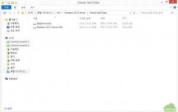

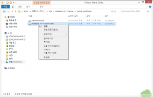

위의 그림은 Windows 8.1에서 Hyper-V 사용 (3)라는 글에서 생성한 가상 머신의 가상 하드 디스크의 내용을 호스트 PC에서 빼내는 예를 나타낸다. 가상 머신의 하드 디스크는 vhdx라는 파일 포맷으로 저장되어 있는데 이는 탐색기에서 손쉽게 “탑재” 명령을 수행하면 디스크내의 내용을 누구나 볼 수 있게 되고, 악의적인 관리자는 가상 머신의 데이터를 바로 유출할 수 있다.

이러한 시나리오는 클라우드를 사용하고 있거나 도입하고자 하는 기업이나 기관에서는 흔히 우려하는 사항으로 이를 방지하기 위해서는 가상 머신을 암호화하는 것이 필요하며, 많은 고객이 자신의 가상 머신을 암호화하여 악의적인 관리자가 가상 머신 내의 데이터 유출 방지를 원하고 있는 실정이다. 이를 위하여 다양한 가상 머신 암호화 솔루션이 개발되어 있거나 클라우드 서비스 업체에서 가상 머신 암호화 서비스를 제공하기도 하나 사용자 입장에서는 직접 자신의 가상 머신을 암호화하여 보호하고자 하는 요구가 확산되고 있다.

이 글에서는 클라우드에서 운영 중인 가상 머신을 사용자가 직접 암호화하여 악의적인 운영자의 가상 머신 탈취를 통한 데이터 유출을 방지하는 방법으로 Microsoft의 디스크 암호화 기술인 BitLocker를 적용하여 자신의 가상 머신을 보호하는 방법을 설명하고자 한다. BitLocker와 유사하게 Linux 운영 체제에서는 파일 시스템 암호화 기능을 제공하고 있는데, 이에 대해서는 다음 기회에 논하고자 한다.

### 2. Microsoft BitLocker 개요

Microsoft BitLocker는 Windows Vista 운영체제부터 도입된 드라이브 암호화 기술로 다른 운영 체제를 부팅하거나 소프트웨어 해킹 도구를 실행하는 절도범이 Windows의 파일 및 시스템 보호를 손상시키거나 보호되는 드라이브에 저장된 파일을 오프라인으로 보는 것을 방지하는 기술이다. BitLocker는 Windows 운영체제와 데이터가 있는 전체 드라이브를 암호화하여 문서에서 암호에 이르기까지 모든 것을 보호하며 BitLocker가 켜지면 해당 드라이브에 저장한 모든 파일을 자동으로 암호화 하게 된다. 주요 기능은 다음과 같이 설명되어 있다.

- 권한이 없는 사용자가 분실, 도난당했거나 부적절하게 서비스가 해제된 컴퓨터에서 Windows 파일 및 시스템 보호를 손상시키지 못하도록 합니다. 여기에는 운영 체제 볼륨 및 고정 데이터 볼륨도 포함됩니다.

- 초기 부팅 구성 요소의 무결성을 검사하여 시스템이 무단으로 변경되지 않았고 암호화된 드라이브가 원래 컴퓨터에 있는지 확인합니다.

- 컴퓨터를 부팅하거나 최대 절전 모드에서 재개하기 전에 키 자료가 포함된 USB 플래시 드라이브 또는 시작 PIN을 제공할 것을 사용자에게 요구하는 방식으로 콜드 부팅 공격으로부터 컴퓨터를 보호합니다.

- Active Directory® 도메인 서비스 통합을 통해 복구 키를 원격으로 위탁하여 사용자가 USB 플래시 드라이브에 저장된 키 자료를 분실하거나 PIN을 잊어버린 경우 현장 복구가 가능하도록 지원합니다.

- 운영 체제 볼륨이 들어 있는 보호된 하드 드라이브를 다른 컴퓨터로 이동하거나 시스템 마더보드를 교체하는 것과 같은 단순하면서도 효율적인 하드웨어 복구 프로세스가 제공됩니다.

요약하자면 Windows의 모든 드라이브 디스크를 암호화하여 허가 받지 않은 사용자가 디스크의 내용을 볼 수 없도록 Windows에서 자체적으로 지원하는 암호화 기능이라고 보면 된다. 따라서 Windows 가상 머신을 BitLocker를 이용해 암호화할 경우 앞에서 설명한 악의적인 클라우드 관리자의 가상 머신 탈취를 방지할 수 있을 것이다.

### 3. BitLocker를 이용한 가상 머신 암호화

먼저 BitLocker를 지원하는 운영 체제는 다음과 같다. 자세한 하드웨어 및 운영 체제 요구 사항은 여기를 참조하기 바란다.

- Windows 7 Ultimate / Enterprise

- Windows 8, 8.1 Pro / Enterprise

- Windows Server 2008 / 2008 R2 / 2012

암호화하고자 하는 운영체제가 위의 OS에 포함되어 있다면 다음의 과정으로 자신의 가상 머신을 암호화할 수 있다. 이 글은 Windows Server 2012가 설치된 가상 머신을 기준으로 설명하고 있는데, Windows 8 또는 Windows 8.1에서도 동일한 과정으로 암호화할 수 있다.

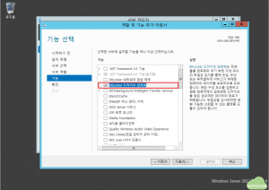

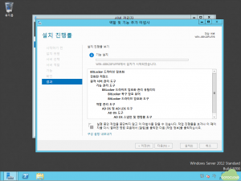

먼저 가상 머신에 로그인(호스트 PC가 아니라 자신이 관리하는 가상 머신에서 수행한다)하여 서버 관리자의 “역할 및 기능 추가 마법사”의 기능 항목에서 BitLocker 드라이브 암호화를 체크하면 관련된 역할과 기능이 추가된다.

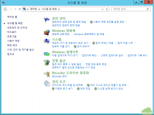

제어판의 시스템 및 보안 항목을 선택하면 그림과 같이 “BitLocker 드라이브 암호화”라는 항목이 나타나는데 이를 선택한다.

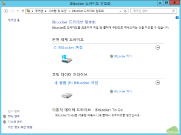

그림과 같이 운영 체제 드라이브인 C:와 고정 데이터 드라이브인 D:가 모두 BitLocker가 꺼져 있는 상태로 나타나며 우측에 BitLocker 켜기 항목이 보인다. 먼저 운영 체제 드라이브인 C: 드라이브의 BitLocker 켜기를 선택한다.

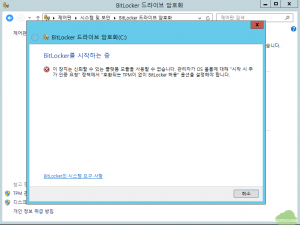

C 드라이브의 BitLocker를 켜면 그림과 같이 “호환되는 TPM이 없이 BitLocker 허용”이라는 오류 메시지가 나면서 더 진행이 되지 않음을 알 수 있다. 그 원인은 BitLocker의 하드웨어 요구 사항인 TPM(Trusted Platform Module)이 가상 머신에서는 지원이 되지 않기 때문이다. BitLocker는 암호화 키를 하드웨어 TPM 모듈에 보관하고 이를 이용하여 추가 보안 기능인 시작 전 시스템 무결성 확인 및 다단계 인증을 제공하기 때문에 TPM이 없는 하드웨어나 가상 머신에서는 정책 관리자를 통해 오류 메시지 나타나 있는 “시작 시 추가 인증 요청” 정책을 변경해줘야 한다.

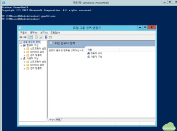

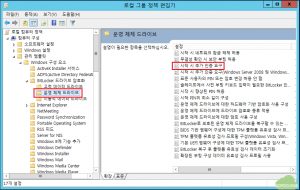

그림에서와 같이 커맨드 창에서 “gpedit.msc”를 입력하여 로컬 그룹 정책 편집기를 실행한 후 “컴퓨터 구성 -> 관리 템플릿 -> BitLocker 드라이브 암호화 -> 운영 체제 드라이브” 탭으로 이동하여 “시작 시 추가 인증 요구”를 선택한다.

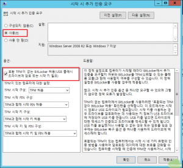

그림과 같이 “시작 시 추가 인증 요구”의 “사용”을 선택하고 옵션에서 “호환 TPM이 없는 BitLocker 허용”을 선택한다. 이렇게 함으로써 TPM이 지원되지 않는 하드웨어나 가상 머신에서는 USB 플래시 드라이브에 암호를 저장하거나 가상 머신의 시작시에 관리자가 암호를 입력하여야만 운영 체제 드라이브의 암호를 풀어 시스템을 시작할 수 있게 된다.

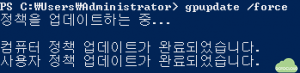

정책 편집기를 종료한 후 커맨드 명령어로 그림과 같이 “gpupdate /force”를 입력하여 변경된 정책을 적용한다.

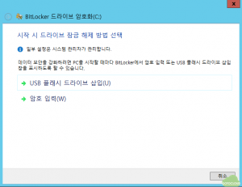

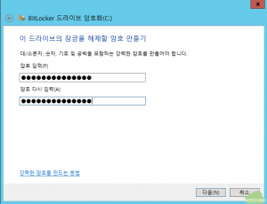

다시 운영 체제 드라이브에 대해 BitLocker 켜기를 선택하면 그림과 같이 시스템 시작시 드라이브 잠금을 해제하는 방법을 선택하게 되는데, 가상 머신의 경우 USB 드라이브를 삽입할 방법이 없으므로 “암호 입력”을 선택한 후 다음으로 진행한다. 여기에서 입력하는 암호는 BitLocker를 해제하여 시스템을 시작하기 위한 것으로 잘 기억해 둔다.

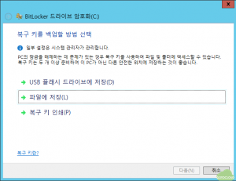

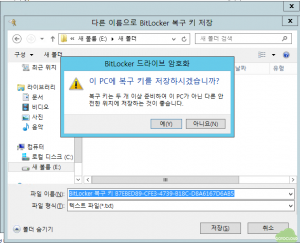

다음으로 암호를 분실했을 때를 대비한 복구 키 백업 방법을 선택한다. 파일에 저장할 경우 C 드라이브의 복구 키는 동일한 드라이브에 저장할 수 없으므로 D 드라이브에 임시로 저장하고 그 파일을 열어 별도로 기록해 둔다. 그리고 가상 머신에서는 이 파일을 삭제하여 서버가 운영 중에 복구키가 탈취될 위험을 제거한다.

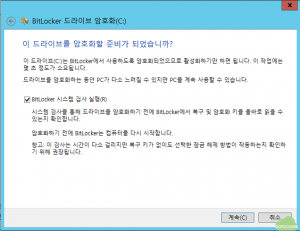

이상의 과정을 거치면 암호화를 시작할 준비가 되며 계속을 누르면 시스템이 재부팅 된 후 암호화를 시작한다.

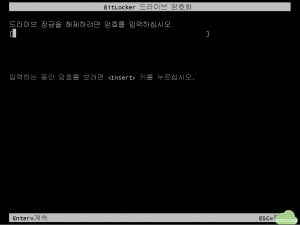

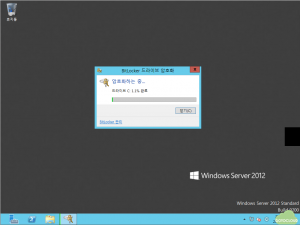

가상 머신을 재시작하면 그림과 같이 드라이브 잠금 해제 암호를 입력하는 화면이 나오고, 여기에 앞에서 입력한 BitLocker 암호를 입력하면 드라이브 암호화가 진행된다. 이상으로 운영체제 암호화가 완료된다.

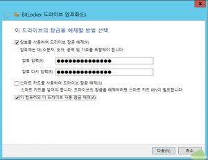

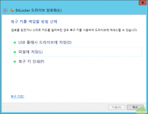

다음으로 데이터 디스크인 E 드라이브의 암호화를 진행한다. 운영 체제 드라이브 암호화화 마찬가지로 잠금 해제 암호를 입력한다. 그리고 아래에 자동 잠금 해제를 선택하게 되면 운영 체제 드라이브의 암호화가 해제될 때 자동으로 데이터 드라이브도 암호화가 해제되게 할 수 있다. 드라이브 자동 잠금 해제는 반드시 운영 체제 드라이브인 C 드라이브가 암호화가 되어 있을 경우에만 활성화 된다. 마찬가지로 복구 키를 적당한 위치에 백업해 둔다. 마찬가지로 가상 머신에서는 이 파일을 삭제하여 서버가 운영 중에 복구키가 탈취될 위험을 제거한다.

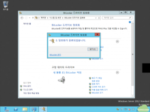

그림과 같이 데이터 드라이브인 E 드라이브도 암호화가 완료된다.

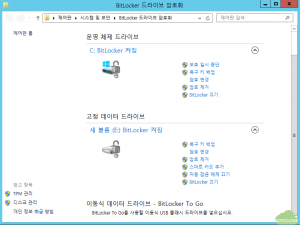

BitLocker 가 적용된 드라이브에 대해서 제어판의 “BitLocker 드라이브 암호화”에 가서 보면 그림과 같이 BitLocker 관리가 가능하다. 여기에서 암호 변경, 암호 제거 및 BitLocker를 끌 수 있으며, 앞에서 설정한 복구 키를 다시 백업할 수 있다.

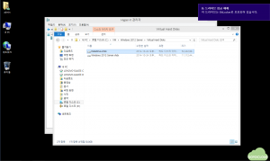

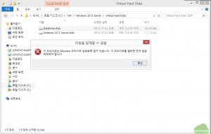

BitLocker 가 적용된 가상 하드 디스크인 vhdx 파일에 대해서 호스트 PC에서 내용을 보고자 할 경우는 그림과 같이 드라이브가 BitLocker로 보호되어 있다는 메시지가 나타나며, 암호를 입력하지 않을 경우 파일 탑재가 불가능하므로, 허가 받지 않은 사람은 가상 머신의 하드 디스크의 내용을 볼 수 없게 보호된다.

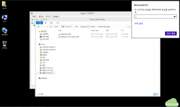

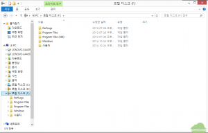

호스트 PC에서 BitLocker 암호를 입력하게 되면 그 내용을 그림과 같이 볼 수 있게 되므로, BitLocker 암호가 탈취되지 않도록 반드시 잘 보관하기 바란다.

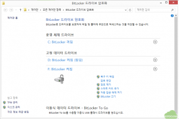

호스트 PC나 다른 PC에서 복구 암호를 입력한 후 마운트하게 되면 그림과 같이 BitLocker 관리를 호스트 PC에서도 수행할 수 있으며, 여기에서도 복구 키를 백업할 수 있다. 클라우드에서는 호스트 PC에 접근할 수 없으므로, 이 과정은 불가능할 수 있다. 호스트 PC에 복구 키를 백업할 경우 이 내용을 별도로 보관하고 역시 파일은 삭제하기를 권장한다.

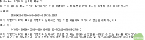

복구 키 파일을 열어 보면 복구 키는 6자리 수 8개로 총 48개의 숫자로 이루어져 있으며, 복구 암호를 분실하였을 경우 이 복구 키를 이용하여 드라이브 암호를 해제할 수도 있다.

### 4. 결론

이상으로 클라우드에 생성한 Windows 가상 머신을 BitLocker를 이용하여 암호화하는 방법을 알아보았다. Windows에서 제공하는 BitLocker는 강력한 디스크 드라이브 암호화 툴로서 이를 가상 머신에 적용할 경우 악의적인 클라우드 운영자의 가상 머신 탈취를 암호화를 통해 방지할 수 있으며 별도의 추가 비용을 들이지 않아도 된다는 점에서 많은 장점이 있다고 볼 수 있다.
