### 1. Japan IT Week

Japan IT Week는 매년 5월과 10월에 개최되는 일본에서 가장 큰 규모의 IT 기술 및 솔루션 전시회로 올해 가을 행사인 2014 Japan IT Week 秋(Autumn)는 지바시의 마쿠하리 멧세에서 2014년 10월 29일~31일에 개최되었다. 이 글에서는 필자가 이 행사에 참가하기 위해 서울에서부터 행사장까지 가는 과정과 행사장 주변에 대한 개괄적인 소개를 하고 다음 글에서는 행사 참여 업체, 솔루션 및 관심을 끌만한 기술적인 내용을 소개하고자 한다.

### 2. 전시회장 가는 길

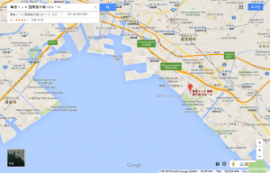

마쿠하리 멧세가 위치한 지바시는 도쿄의 위성도시로 야구팬이라면 잘 아는 지바 롯데 마린스의 연고지이기도 하다. 지도에서 보듯이 도쿄에서 약 40분에서 1시간 정도의 거리면 도착할 수 있는 도시로 김포공항에서 하네다 공항에 도착하여 2014 Japan IT Week Autumn이 개최된 장소인 지바시의 마쿠하리 멧세로 가기 위해서는 하네다 공항에서 마쿠하리 멧세 중앙역으로 공항버스를 타면 쉽게 갈 수 있다. 도쿄에서 전시장으로 가기 위해서는 도쿄역에서 카이인마쿠하리(海浜幕張) 행 JR 케이요선(京葉線) 전철을 이용하면 된다.

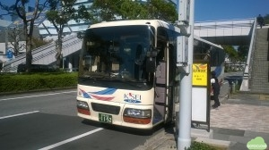

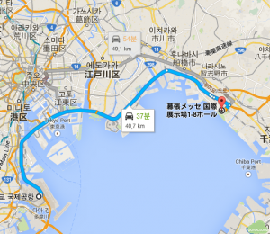

하네다 공항에서 나오자마자 보이는 버스 승차권 판매대에서 마쿠하리 멧세행 공항버스 티켓을 구매하여 매 30분마다 출발하는 공항 버스를 타면 지도에서 보는 경로를 따라서 한시간 정도면 마쿠하리 멧세 중앙(Makuhari Messe Chūō)에 도착한다. 우리나라 공항버스와 달리 4열의 좌석 사이에 승객이 더 타게 되면 접이식 의자를 펴서 총 5명이 빡빡하게 앉아서 간다는 점이며 한 시간 정도 걸리는 버스안에도 화장실이 있다는 점이다.

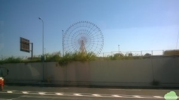

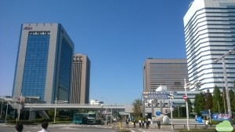

버스를 타고 가다보면 오른편으로 도쿄 디즈니랜드의 관람차를 볼 수 있다. 한 시간 정도 공항버스를 타고 도착하면 마쿠하리 멧세 중앙 정류장에 도착한다. 정류장 주변에 일본에서 꽤 큰 유통업체인 AEON 빌딩과 카이힌 마쿠하리 역을 볼 수 있다.

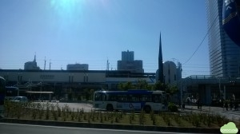

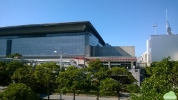

카이힌 마쿠하리 역을 지나서 5분 정도 걸어가면 오른편에 마쿠하리 멧세 전시장이 나타난다.

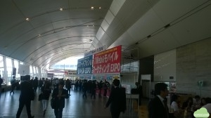

전시회장은 첫날이라 생각보다 한산한데, 등록대에서 참가사(일본에서는 出展社라고 한다) 이름으로 등록을 하거나, 방문객의 경우 Sales, Marketing, IT Manager 등 자신의 직종에 맞는 등록 배지를 받아서 입장할 수 있다.

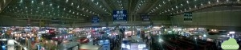

이번 전시회는 Web & Mobile Marketing Expo, Smartphone & Mobile Expo, Direct Commerce Solutions Expo, Cloud Computing Expo Japan, Imformation Security Expo, Big Data Management Expo 및 Data Center Expo 등 7개의 세부 전시회가 한번에 개최되었다. 전시회 및 참가사 정보는 IT_autumn_en_2014_floorplan1027 에서 확인할 수 있다. 전시회 주요 내용은 다음 글에서 설명하고자 한다.

### 3. 전시회장 주변

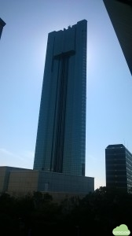

전시회에 바로 건너편에는 필자가 묵은 50층 높이의 Apa 호텔 (APA Hotel & Resort Tokyo Bay Makuhari)이 있다. 특이한 점은 4층에 숙박객이 무료로 이용할 수 있는 온천탕인 ‘겐요노유’가 있어 새벽 2시까지 온천욕을 즐길 수 있다.

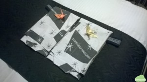

객실에는 투숙객을 위해 일본 전통 의상인 유카타가 마련되어 있는데, 종이학을 접어서 남녀 구분을 해 놓은 듯하다. 밤에 잘 때만 입는게 아니라, 유카타를 입고 투숙객은 남녀노소를 막론하고 아주 당당하게 호텔 로비를 거닐 뿐만 아니라 4층의 온천탕에 자연스럽게 드나들곤 하는 것이 특이한 장면이었다. 참고로 4층의 온천탕을 갈 때 꼭 저걸 입고갈 필요는 없고 편한 복장으로 가도 무방하다. 단 한국과는 달리 온천탕에서 수건은 제공하지 않으므로 객실에 있는 수건을 가지고 가야만 한다. 더 충격적(?)인 장면은 온천탕 탈의실에 청소하는 여자분이 당당하게 청소를 하고 있다는 점이니 놀라지 않기 바란다.

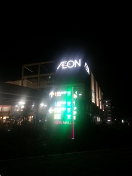

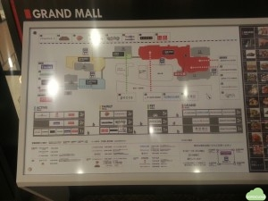

전시장 주변에 AEON 그룹에서 운영하는 쇼핑몰인 AEON 몰이 있어 전시장을 방문한 김에 쇼핑을 하고자 하는 사람들은 들러볼 만한 곳이다. AEON 쇼핑몰은 네 개의 몰이 연결되어 있는데, 정면에 보이는 것이 Grand Mall이고 여기에는 대형 슈퍼마켓, 서점, 푸드코드, 극장 등이 한번에 있어서 다양한 쇼핑이 가능하며 Pet Mall은 애완동물 용품을 판매하는 전문 쇼핑몰이고, 그 다음으로 생활용품 등을 판매하는 Family Mall 및 스포츠 용품을 판매하는 Active Mall이 차례로 연결되어 한번에 쇼핑을 할 수 있도록 되어 있다. AEON 쇼핑몰 건물들 사이에 코스트코가 위치하고 있다. 대략 국내에 있는 코스트코의 규모를 생각한다면 전체 쇼핑몰의 규모를 짐작할 수 있다.

이상으로 Japan IT Week Autumn 2014 행사가 열린 마쿠하리 멧세 전시장으로 가는 과정과 행사장 주변에 대해서 소개하였다. 다음 글에서는 실제 전시된 IT 솔루션과 참여 업체 등에 대해서 소개할 예정이다.
