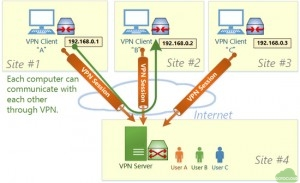
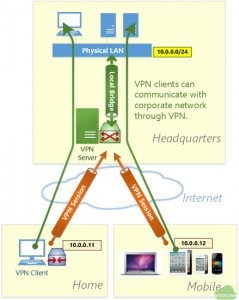
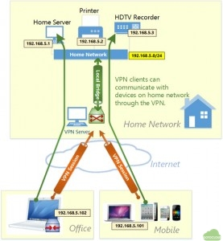
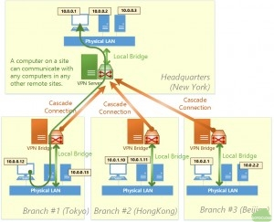
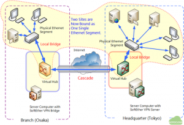
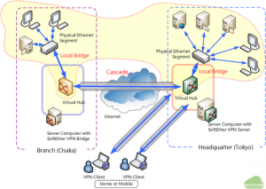

앞선 VPN(Virtual Private Network, 가상 사설망)에 대한 소개글에서 VPN의 기본 개념 및 동작 원리에 대해서 살펴보았다. 요약하자면 VPN은 인터넷과 같은 공중망을 이용하여 전용망처럼 안전한 보안 통신을 제공하기 위한 기술이라고 보면 될 것이다.

이 글에서는 VPN 개념을 이해한 후 실제로 VPN을 어떻게 활용하는지에 대한 사례를 설명하고자 한다. 많은 기업이나 조직에서 재택 근무자나 외부 출장자를 위해서 VPN 접속을 허용하고 있고 실제 이러한 VPN을 사용하여 사내 메일 서버나 업무 서버에 연결하여 업무를 수행하고 있는 사람이 많은데, 실제로는 이러한 접속 시스템이 VPN을 이용하여 어떻게 구현되는지를 알아보는데 도움이 될 것이다.

이 글에서 설명하는 사례는 오픈소스 VPN 프로젝트인  SoftEther VPN 홈페이지의 구현 예를 바탕으로 하고 있으며 사용된 그림은 SoftEther에서 인용했음을 밝혀둔다. SoftEther VPN의 구현 예를 바탕으로 하였음에도 실제 대부분의 상용 VPN 장비나 OpenVPN, Windows Server의 VPN 서비스 등을 이용하여도 이 글에서 설명하는 내용을 구현할 수 있을 것이다.

### 사례 1) Ad-hoc VPN

ad-hoc VPN은 그림과 같이 여러 장소에 흩어져 있는 서로 다른 IP 주소를 가지는 소수의 컴퓨터들을 단일한 네트워크(그림에서는 192.168.0.x  대역)로 연결할 때 사용하는 VPN이다. 예를 들어 서로 다른 세 개의 사무실에 흩어져서 일하는 직원들은 각각의 공유기 등을 사용해서 서로 다른 IP 주소를 갖는 경우가 많은데 이럴 경우 각 사무실 간에 파일 서버 공유, 프린터 공유 등을 하고자 할 경우에 네트워크 구성이 아주 복잡해지거나 현실적으로 불가능할 수 있다.

이 때, VPN 서버(또는 장비)를 두고 각 사무실의 컴퓨터 들에 모두 VPN 클라이언트를 설치한 후 VPN 서버에 접속하게 되면 모든 사무실의 컴퓨터 들을 동일한 IP 주소 대역으로 연결할 수 있다. Ad-hoc VPN을 사용하고자 할 경우에는 연결하고자 하는 모든 컴퓨터에 VPN 클라이언트를 설치해야하는 단점이 있어 소규모의 VPN 네트워크를 구성하고자 할 경우에 유용하다고 할 수 있다. 하지만 모든 컴퓨터 들이 항상 VPN 클라이언트를 통해 VPN 서버에 접속해 있어야만 연결이 가능하게 된다.

### 사례 2) 원격 접속 (Remote Access to LAN) VPN

실제 VPN이 가장 널리 활용되고 있는 사례가 바로 원격 접속 VPN이다. 앞에서 설명한 Ad-hoc VPN은 연결하고자 하는 컴퓨터나 서버에 모두 VPN 클라이언트를 설치해야 하지만, 대부분의 기업이나 조직의 경우 사내의 서버나 PC는 내부 네트워크로 연결되어 있고, 개별적으로 VPN 클라이언트를 설치하는 것이 불가능하다. 따라서 외부에서 사내로 접속하고자 하는 PC나 스마트폰에만 VPN 클라이언트를 설치한 다는 점에서 Ad-hoc VPN과 차이가 있다.

사외(집이나 출장지)에서 노트북이나 스마트폰으로 사내 네트워크에 접속하고자 할 때는 VPN 서버를 DMZ 구간에 설치하고 VPN 서버를 사내 네트워크(그림에서 Physical LAN)에 Bridge로 연결한 후 사외에서는 VPN 클라이언트를 사용하여 VPN 서버에 접속하면 그림과 같이 10.0.0.x 대역의 사내 IP 대역의 주소를 할당받아 외부에서도 VPN 터널을 통해 사내 네트워크에 접속할 수 있다. Ad-hoc VPN과는 달리 사내로 접속하고자 하는 외부 PC나 스마트폰에서 접속시에만 VPN 클라이언트를 구동하면 된다.

동일한 IP 대역으로 연결하는 L2 네트워크를 구성할 수도 있고, 네트워크 대역이 다양한 대기업 등에서는 VPN 서버에서 지원하는 라우팅 기능을 이용하여 L3 네트워크로 VPN 서버를 구성하고 VPN에서 할당한 IP 대역에 대해서는 특정 서버(메일 서버 등)에만 접근이 가능하도록 네트워크 통제를 하는 것이 보편적이다.

유사한 형태로 외부에서 집안의 네트워크로도 동일한 방식으로 접속할 수 있다. 집에 설치되어 있는 공유기 아래에 연결되어 있는 PC나 프린터, 파일 서버 등에 접속하고자 할 경우에는 집에 VPN 서버를 설치하고 집 밖에서 VPN 클라이언트를 통해 집 안으로 접속하도록 VPN 서버를 구성하는 것도 널리 활용되는 원격 접속 VPN의 활용 사례라고 볼 수 있다.

### 사례 3) LAN to LAN Bridge (Site-to-Site VPN)

다음으로 VPN의 주요 용도 중의 하나가 본점과 지점간을 전용선처럼 연결하는 LAN to LAN Bridge (흔히 Site-to-Site VPN으로 알려져 있다) VPN이다. Ad-hoc VPN은 연결하고자 하는 모든 PC에 VPN 클라이언트를 설치해야 하고 원격 접속의 경우는 사내 서버나 PC는 VPN 클라이언트를 사용하지 않고, 외부에서 접속하고자 하는 단말에만 VPN 클라이언트를 설치하여 접속하는데 반해 LAN to LAN Bridge는 각 사이트(본점이나 지점)에 VPN 서버와 VPN Bridge를 설치하고 그 아래에 연결된 컴퓨터나 서버 들은 VPN 클라이언트를 설치하지 않는 구성이다.

이 구성은 일반적으로 본점에 VPN 서버를 두고 각 지점에는 본점의 VPN 서버와 연결하는 VPN Bridge를 두고 지점의 VPN Bridge와 본점의 VPN 서버를 VPN 터널로 연결하게 되면 본점과 지점의 PC와 서버들은 사내 네트워크로 연결된 것고 동일한 효과를 볼 수 있다. 보험 설계사 사무실, 각 지역에 흩어져 있는 대리점 등과 본점을 연결하는 경우 이와 같이 구성하는 경우가 대부분이다.

위의 그림에 실제 지역적으로 떨어져 있는 본점과 지점을  연결하는 구성 예가 나타나 있다.

이 글에서는 VPN의 가장 기본적인 활용 사례인 Ad-hoc VPN, 원격 접속 VPN 및 LAN to LAN Bridge VPN (Site-to-Site VPN)에 대해서 알아보았다. VPN은 기본적으로 이 글에서 설명하는 사례를 기반으로 클라우드 보안 접속, 원격 관리, IP 우회 접속 등에 활용될 수 있다. 다양한 활용 사례와 실제 구축 방법은 연속되는 글에서 설명하고자 한다.
