이 글에서는 VPN 활용 사례에서 설명한 대표적인 원격 접속 (Remote Access to LAN) VPN을 오픈소스 VPN 소프트웨어인 SoftEther VPN을 이용하여 구현하는 방법을 설명하고자 한다. SoftEther VPN은 일본의 츠쿠바(Tsukuba) 대학의 Daiyuu Nobori가 석사학위 논문을 위한 개인 프로젝트로 시작하여 2013년 8월에 오픈소스로 공개한 VPN 소프트웨어로 Windows, Linux, FreeBSD, Solaris, Mac OS X 등 다양한 운영 체제에서 구동이 가능하며 상용 VPN에서 지원하는 대부분의 기능이 구현되어 있는 VPN 소프트웨어이다. SoftEther에 대한 자세한 사항은 SoftEther VPN 홈페이지를 참조하기 바란다. 여기에서는 SoftEther VPN을 실제로 설치하여 원격 접속을 구현하는 예를 설명하고자 한다.

### 1. 구현 환경

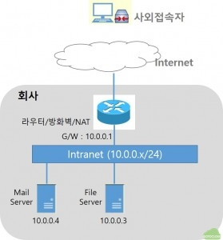

그림과 같이 회사 내부에는 메일 서버와 파일 서버가 설치되어 있고, 이 서버들은 회사내부에서만 사설 IP인 10.0.0.x 대역으로만 연결되어 회사 외부에서는 접속이 불가능하게 되어 있다. 그리고 회사 내부와 인터넷은 10.0.0.1이라는 게이트웨어를 통해 연결이 되며 방화벽과 NAT 기능을 같이 수행하고 있다. 이 때 회사 내부에서는 외부로 인터넷이 연결이 되지만 인터넷에서 회사 내부로의 접속은 차단되어 있는 상태이다. 우리가 흔히 사용하고 있는 공유기를 생각하면 된다. 이러한 환경에서 사내에 VPN 서버를 설치한 후 사외접속자가 VPN을 통해 메일서버와 파일서버를 접속할 수 있는 환경을 구현하고자 한다.

대부분의 회사에서는 메일 서버와 파일 서버에 공인 IP를 부여하고 직접 사외에서 접속할 수 있도록 방화벽에서 개방하는 경우도 있으나 이렇게 할 경우 불특정 다수가 인터넷에서 직접 사내 서버들에 대해서 해킹을 시도할 가능성이 있고, 외부에서 접속을 허용할 서버들이 늘어날 때마다 방화벽을 개방하거나 공인 IP를 할당해야하는 등 여러가지로 불편한 사항이 늘어난다. 따라서 이와 같이 모든 서버를 개방하기보다는 VPN 서버를 설치하고 VPN 서버만 외부에서 접속이 가능하도록 개방한 후에 VPN을 통해서만 사내 서버에 접속이 가능하도록 하는 것이 보안 및 관리 측면에서도 유리하다.

### 2. VPN 서버 준비

먼저 SoftEhter VPN을 설치할 서버를 준비한다. SoftEther VPN은 다양한 운영 체제를 지원하는데, 이 글에서는 Windows 서버(Windows PC도 가능하다)에 SoftEther VPN을 설치하는 예를 설명할 예정이므로 Windows가 설치된 컴퓨터를 준비한 후 Intranet에 연결하고 10.0.0.2라는 사내 IP를 부여한다. 그리고 VPN 서버에 443 포트로 접속이 가능하도록 공인 IP를 부여하고 방화벽에서 개방한다. 이 과정은 방화벽 설정 또는 공유기 등의 설정에서 포트포워딩 등으로 수행할 수 있는데, 여기에 대해서는 방화벽 관리자나 공유기 등의 매뉴얼에 따라서 진행하기 바란다.

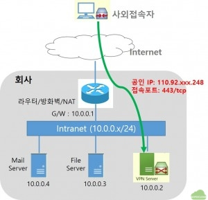

그림과 같이 SoftEther VPN을 설치할 서버는 인터넷에서 110.92.xxx.248이라는 공인 IP를 통해 443 포트로만 접속이 가능한 상태이다. 보안을 위해서 반드시 443포트를 제외한 다른 포트는 개방하지 않도록 한다.

### 3. SoftEther VPN 설치

VPN 서버에 로그인하여 다음의 순서대로 SoftEther VPN을 설치한다.

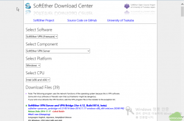

SoftEther VPN 다운로드 페이지에서 Windows 용 VPN 서버를 다운로드 한다.

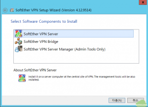

다운로드 후에 설치 프로그램을 실행하면 그림과 같이  VPN Server, VPN Bridge 및 관리툴을 선택하여 설치할 수 있다. SoftEther VPN Server를 선택하면 Server Manager도 같이 설치된다. 별도의 PC에서 관리를 수행하고자 할 경우에는 VPN Server Manager 만 설치할 수 있다.

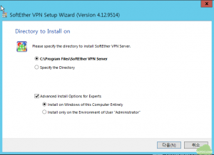

설치할 디렉토리를 선택하고 Advanced Option에서 Advanced Option에서 원하는 옵션을 선택한다.

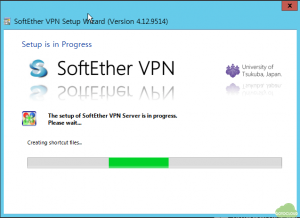

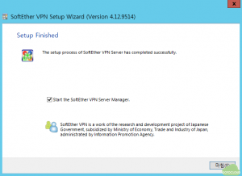

### 4. SoftEther VPN 원격 접속 구성

설치가 진행된 후 완료되면 SoftEther VPN Server Manager를 실행한다.

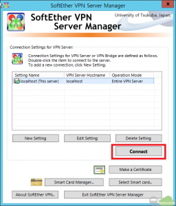

SoftEther VPN Server Manager가 실행되면 그림에서와 같이 localhost에 VPN Server가 설치되어 있음을 알 수 있다. 관리툴에 여러개의 VPN Server를 등록하여 관리할 수 있다. localhost를 선택하고 Connect를 누른다.

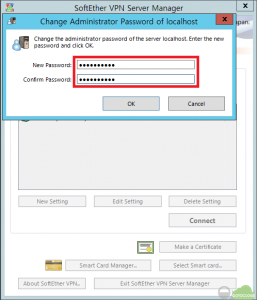

처음 실행 시에 VPN Server 암호를 입력한다.

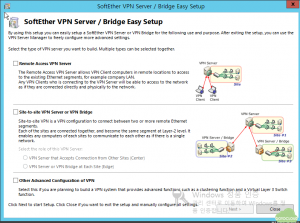

다음으로는 설정 마법사가 나타나는데, 여기에서는 Remote Access VPN, Site-to-Site VPN 등을 설정할 수 있으나, 이 글에서는 직접 설명할 예정이므로 마법사를 사용하지 않고 Close를 선택하고 다음으로 진행한다.

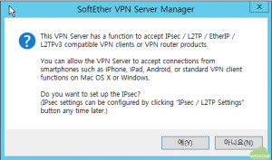

다음으로 SoftEther VPN에서 IPsec/L2TP/EtherIP/L2TPv3를 지원하는 VPN 클라이언트 기능을 사용할 것인지를 선택하는 창이 나타나는데 L2TP 서버 설정에 대해서는 별도로 설명할 예정이므로 “아니오(N)”을 누르고 다음으로 진행한다.

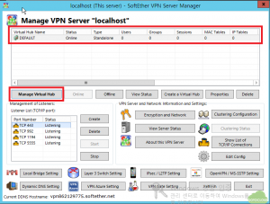

그림과 같이 DEFAULT라는 Virtual Hub가 생성되어 있는데, 이를 선택하고 Manage Virtual Hub를 클릭한다. SoftEther VPN에서는 하나의 VPN Server에 여러 개의 Virtual Hub를 생성할 수 있고, 각각의 Virtual Hub 별로 별도의 사용자와 네트워크 구성이 가능하다.

[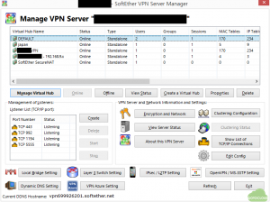](https://gotocloud.co.kr/wp-content/uploads/2015/01/윈도우-1-1.png)SoftEther VPN의 Vitrual Hub 생성 예
위의 그림에는  한 대의 VPN 서버에 다양한 네트워크에 연결할 수 있는 VPN 서버에 대한 예가 나타나 있는데 5개의 Virtual Hub를 생성한 후에 일본으로 연결을 위한 japan, 192.168.9.x 대역 접속 및 Secure NAT등을 위한 Virtual Hub등이 생성되어 있음을 볼 수 있다.

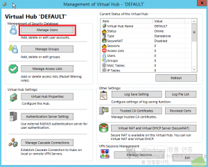

Virtual Hub 관리 화면에서 VPN 원격 접속 사용자 추가를 위해 Manage Users를 선택한다.

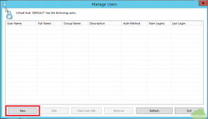

Manage Users화면에서 새 사용자를 추가하기 위해 New를 선택한다.

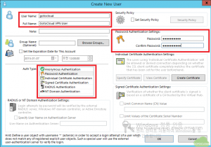

추가하고자 하는 사용자 계정(User Name)을 입력한다. 이 글에서는 gotocloud라는 계정으로 사용자를 생성한다. 다음으로 사용자 인증 방법을 선택한다. SoftEther VPN에서는 암호 없이 접속이 가능한 Anonymous Authentication, 암호 인증을 위한 Password Authentication, 개인 인증서 인증(Indivisual Certificate Authentication), 서명된 인증서 인증(Signed Certificate Authentication), Radius 인증, Active Directory 인증(NT Domain Authentication)을 지원하는데 여기에서는 암호 인증을 선택하고 우측 암호 입력 창에서 gotocloud 계정에 대한 암호를 입력한다.

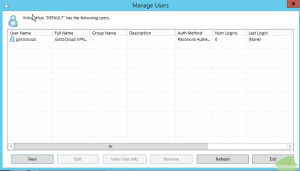

사용자 계정 성생이 완료되면 그림과 같이 계정 정보를 볼 수 있다. 원하는 사용자 만큼 계정을 생성할 수 있으며, 하나의 Virtual Hub에 서로 다른 인증 방식을 갖는 사용자를 생성할 수도 있다.

[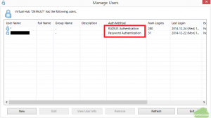](https://gotocloud.co.kr/wp-content/uploads/2015/01/윈도우-2-2.png)서로 다른 사용자 인증 방식 사용자 등록 예
위의 그림은 하나의 Virtual Hub 내에서 암호 인증과 Radius 인증 사용자를 동시에 생성한 예를 보여주고 있다. 그림과 같이 특정 사용자(또는 사용자 그룹)은 Radius 서버에서 VPN 인증을 수행하고 관리자나 테스트 계정 등은 암호 인증으로 분리하는 것이 가능하다.

지금까지의 과정을 완료하면 다음의 그림과 같은 상태가 된다.

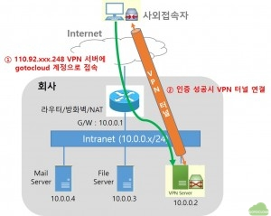

그림과 같이 사외 접속자는 110.92.xxx.248 이라는 공인 IP의 SoftEther VPN 서버에 앞에서 생성한 gotocloud라는 계정으로 VPN 접속을 시도하고, 인증에 성공하면 사외 접속자의 PC와 회사 내의 SoftEther VPN 서버 간에 VPN 터널이 연결되어 둘 사이의 모든 통신은 암호화되어 이루어진다. 이를 통해 사외 접속자는 사내 네트워크에 접속이 가능해진다.

이제 VPN 서버를 통해 접속한 사외 접속자가 회사 내부의 인트라넷인 10.0.0.x 대역에 연결되어 있는 메일 서버와 파일 서버에 접속이 가능하도록 VPN 터널을 인터라넷과 로컬 브리지(local bridge)로 연결해야 VPN을 통해 통신이 가능해진다.

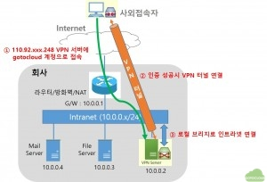

그림의 3번 과정과 같이 VPN 서버와 인트라넷 간에 local bridge 연결이 되면 사외접속자는 VPN 터널을 통해 VPN 서버에 연결되고 local bridge를 통해 인트라넷으로 접속이 가능하게 된다. 이 과정을 SoftEther에서는 다음과 같이 설정한다.

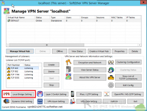

VPN 관리 화면에서 좌측 하단의 Local Bridge Setting을 선택한다.

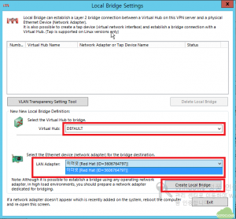

Local Bridge Setting 화면에서 먼저 인트라넷과 Bridge를 연결할 Virtual Hub를 선택한다. 이글에서는 DEFAULT라는 이름의 Virtual Hub를 Bridge로 연결할 것이다. 다음으로 Bridge에 사용할 네트워크 카드를 지정한다. 랜카드 이름은 ethX, 네트워크1과 같이 운영체제에서 네트워크 이름을 지정한 형태로 나타나게 된다. 여기에서는 “Red Hat (ID=3606764797)”이라는 랜카드 이름을 갖고 있다. SoftEther VPN 서버에 여러 개의 랜카드가 있을 경우 물리적으로 10.0.0.x 네트워크에 연결된 랜 카드를 지정한다. 그리고 Create Local Bridge를 눌러 Bridge를 활성화 한다.

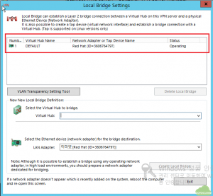

그림과 같이 DEFAULT Virtual Hub는 Red Hat (ID=3606764797) 이라는 이름의 랜카드를 이용해 Bridge가 동작하고 있음을 알 수 있다.

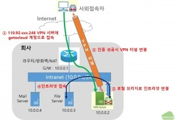

최종적으로 위의 그림과 같이 VPN 터널을 통해 접속한 사외 접속자는 로컬브리지를 거쳐서 인트라넷에 연결된 메일 서버나 파일 서버에 접속이 가능하게 된다.

이상으로 원격 접속을 위한 SoftEther VPN 서버 설치 및 구성이 완료되었다.

### 5. SoftEther VPN 클라이언트 설치 및 VPN 접속

이제 사외 접속자의 PC에 SoftEther VPN 클라이언트를 설치하고 회사 내부의 파일 서버와 메일 서버에 접속을 해보도록 한다.

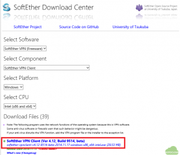

SoftEther VPN 다운로드 페이지에서 Windows 용 VPN 클라이언트를 다운로드하여 설치를 시작한다.

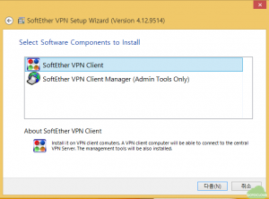

SoftEther VPN Client를 선택하고 다음으로 진행한다. 이 때는 VPN Client Manager도 같이 설치된다. 만약 VPN Client Manager를 선택할 경우 관리툴만 설치된다.

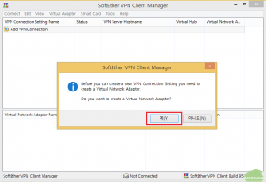

처음 설치가 완료된 후 Add VPN Connection을 선택하면 Virtual Network Adapter를 생성하라는 창이 나타난다. Virtual Network Adapter는 VPN 접속에 사용될 네트워크 어댑터로 나중에 “Virtual Adapter” 메뉴에서 생성할 수도 있다.

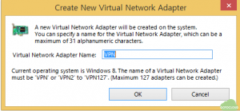

VPN Network Adapter의 이름을 원하는 대로 입력한다. 여기에서는 네트워크 어뎁터 이름을 VPN으로 입력하였다.

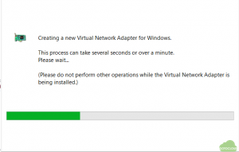

Virtual Network Adapter 생성 화면이 나타나면서 VPN Adapter가 생성된다.

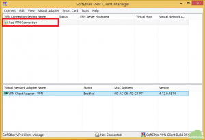

VPN Client Manager 화면에서 하단에 생성된 VPN Client Adapter가 나타난다. Add VPN Connection을 클릭하여 VPN 접속 정보를 입력한다.

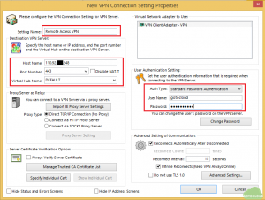

VPN Connection 설정 화면에서  설정 이름(Setting Name)과 VPN 서버의 정보를 입력한다. 우리가 사용할 SoftEther VPN 서버의 주소인 110.92.xxx.248을 입력하고 사용할 포트인 443과 Virtual Hub 이름인 DEFAULT를 선택한다. 그리고 우측에 서버에서 생성한 VPN 사용자 정보인 gotocloud와 암호를 입력한다.

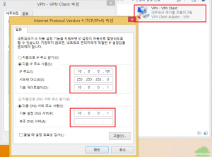

다음으로 Virtual Network Adapter에 VPN 접속 후에 사용할 IP 주소를 설정한다. 윈도우의 네트워크 설정 화면에서 VPN Adpater를 선택하고 회사 내부 네트워크에 접속이 가능한 IP 주소 10.0.0.x 와 서버넷 마스크, 게이트웨어 정보 및 DNS 서버 정보를 입력한다. 이 글에서는 회사 내부 네트워크인 10.0.0.x 대역에 해당하는 주소를 입력하였다. 만약, 사내의 10.0.0.x 대역에 자동으로 IP 할당이 가능한 DHCP 서버가 있을 경우는 “자동으로 주소받기”로 해두면 VPN 접속 후에 사내의 DHCP 서버에서 IP를 할당 받게할 수도 있다.

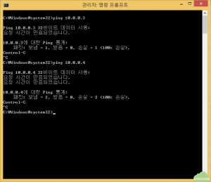

VPN 접속 전에는 외부의 PC에서 내부 메일 서버나 파일 서버의 주소인 10.0.0.x 에 ping을 시도하여도 통신이 되지 않음을 알 수 있다.

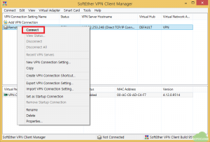

이제 생성한 VPN Connection인 Remote VPN Access를 선택하고 Connect를 누른다.

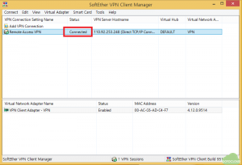

VPN 접속이 성공하면 그림과 같이 Connected라는 상태로 변경되며 VPN 연결이 생성된다.

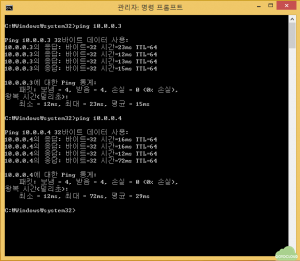

이제 사내 서버인 10.0.0.3과 10.0.0.4에 ping을 시도해보면 접속이 성공했음을 알 수 있다.

이상으로 SoftEther VPN 서버를 회사 내부에 설치하고, 회사 외부에서 원격 접속 VPN을 구성하는 예를 살펴보았다. VPN을 이용하여 원격 접속을 허용할 경우 서버를 인터넷에 개방하지 않고, VPN 서버만을 개방한 후에 안전하게 접속할 수 있게 된다. 특히 SoftEther VPN과 같은 오픈소스 VPN 소프트웨어를 이용하면 별도의 상용 VPN 장비 없이도 손쉽게 VPN 서버를 구축할 수 있을 것이다.

추후에는 이 글에서 설치한 SoftEther VPN 서버를 통해 스마트폰 등에서 접속하는 방법 및 VPN Client에 자동으로 IP 주소를 할당하는 방법 등을 설명하고자 하니 이 글에서 설명한 SoftEther VPN 서버 설정을 잘 익혀두기를 바란다.
