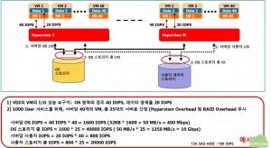
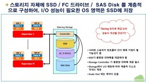
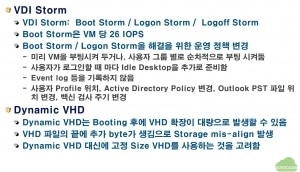
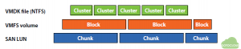
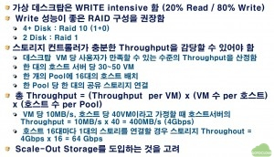

데스크탑 가상화 환경에서 스토리지 구성 시 고려해야할 기본적인 내용을 설명한 자료입니다. 일반적인 클라우드 환경에서도 적용할 수 있는 개념으로 VM에는 OS를 위한  볼륨과 사용자 데이터를 저장하기 위한 데이터 볼륨을 같이 사용한다고 했을 경우, 용도에 따라서 스토리지를 이원화하고 각각에 대해서 사이징을 수행하는 내용을 개략적으로 설명하고 있습니다.

## 1. 데스크탑 가상화 스토리지 I/O 산정

 

위의 그림은 한 대의 Compute 노드에 40개의 VM을 구동하고, 이러한 Compute 노드를 25대를 구성해서 총 1000개의 VM을 구동하고자 할 때, 단순하게 IOPS 총량을 사이징합니다. Windows Desktop OS를  VM으로 구동할 때, 사용자가 참을 수 있는 최소한의 IOPS는 OS영역의 경우 40 IOPS, 데이터 영역의 경우는 20 IOPS 정도라고 알려져 있습니다. 데이터 영역의 IOPS가 낮은 이유는 우리가 데스크탑에서 여러가지 업무를 수행할 경우 (워드 문서를 만들거나, 액셀을 시행하거나, PPT 작업을 할 때) 지속적으로 IO를 발생기키는 것이 아니라 통상적으로 문서를 만들다가 잠시 멈추고 생각을 하고, 다시 IO를 발생시키는 등 패턴이 지속적이지 않으므로 20 IOPS가 하한이라고 합니다. 비교를 위해서 15K RPM의 SAS HDD의  IOPS가 180IOPS 이니 40IOPS가 어느 정도인지는 유추할 수 있을 것입니다.

위의 그림과 같이 디자인할 경우, 서버당 최대 OS IOPS는 40 * 40 이므로 1600 IOPS 이고, 25대의 서버이므로 OS용 스토리지는 40,000 IOPS가 필요합니다. 물론 이렇게 극단적으로 VM IOPS가 요구되는 경우는 이론적으로 모든 VM이 동시에 부팅하여 기동되는 경우밖에는 없다고 보겠습니다. 유사한 방식으로 데이터 스토리지는 20,000 IOPS가 필요합니다. 물론 이 경우도 모든 사용자가 동시에 PPT를 저장하는 등의 작업을 수행할 경우이므로, 역시 실제로는 발생하기 힘든 상황입니다.

## 2. 스토리지 Tiering

최근에서는 많은 벤더들이 Tiering을 지원하는 스토리지를 제공하고 있습니다. 그림 1에서 설명한 바와 같이 OS용 스토리지와 데이터용 스토리지를 분리하지 않고 단일한 스토리지 내에 SSD, FC, SAS, SATA 등 속도가 다른(물론 가격도 다른) HDD를 같이 장착하고, IO 패턴에 따라서 빈번한 IO가 있는 데이터는 고속의 디스크에 저장하고 자주 IO가 일어나지 않는 데이터는 자동으로 느린 디스크로 이전하는 기능을 제공합니다만, 기본적으로 스토리지가 고가이고 여전히 VM의 갯수가 늘어날 경우 스토리지 컨트롤러의 병목이 발생할 수 있으며, Scale-out에 한계가 있습니다.

## 3. 정책적으로 IO 부하를 줄이는 방법

스토리지 설계는 아무리 잘해도 결국 부하가 늘어나면 병목이 발생할 수 밖에 없습니다. 이를 해결하기 위하여 무조건 비싸고 성능 좋은 스토리지만을 장착한다고 해결이 될 수 있는 문제가 아니므로, 가상 머신의 운영 정책을 변경함으로써, I/O 부하를 줄이는 것도 대안이 될 수 있습니다.

VDI 환경에서 I/O 부하가 미친 듯이 발생하는 것을 VDI Storm 이라고 부르는데, 여기에는 Boot Storm / Logon Storm / Logoff Storm 등이 있습니다. Boot Storm 은 가상 머신이 동시에 켜질 때 I/O에 과도한 부하가 걸리는 현상을 말하는데, 일반적으로 VM 당 26 IOPS 이상이 발생하면 VDI Storm을 유발한다고 합니다. Logon Storm은 윈도우의 경우 사용자가 로그인하면 Profile을 불러오고, 바탕화면을 구성하고 시작 프로그램을 실행할 때 발생하는 것으로 역시 동시에 사용자들이 로그인을 수행하면 발생할 수 있습니다. VDI Storm은 주로 월요일 오전에 발생하는 경우가 많으므로 Monday Storm 이라고도 합니다.

이러한 Boot Storm 등을 해결하는 가장 좋은 방법은 동시에 VM을 부팅하는 것이 아니라, 일정한 시간 간격을 두고 그룹별로 몇 개씩 부팅하거나 랜덤하게 VM을 부팅해 두는 것으로 해결할 수 있습니다. (서버 VM은 이럴 경우는 대부분 유지보수 후에 일괄 부팅할 때 밖에 없습니다) 이와 함께, 한 개의 VM이 부팅될 때, 추가로 한 개씩 여분을 더 부팅하는 방법도 있습니다. 그리고 가급적이면 Event Log 등 하드웨어 장애에 대비하여 OS에서 로그를 남기는 것들은 가상머신에서 전부 기록하지 않도록 하는 것도 I/O 부하를 줄이는데 도움이 됩니다.

추가로, Dynamic VHD 등 가상 디스크를 사용할 때마다 증가하도록 구성하는 것보다는 필요한 OS 용량의 가상디스크를 static으로 미리 생성해 두는 것이 I/O 부하를 줄이는데 도움이 됩니다.

 

그리고,  Windows VM의 가상디스크와 물리적 스토리지가  mis-align이 발생할 경우 VM에서의 I/O가 발생할 때마다 물리적 스토리지에서의 추가 I/O를 유발할 수 있으므로, Mis-align이 발생하지 않도록 설정할 필요가 있습니다. 가상환경에서 스토리지 Mis-align에 대해서는 http://www.blueshiftblog.com/?p=300 를 참조하시기 바랍니다.

## 4. 맺는말

 

데스크탑 가상화 환경에서 스토리지를 구성하는데 고려해야할 사항에 대해서 간단하게 살펴보았습니다. 충분한 IOPS와 Bandwidth를 보장하기 위해서는 고가의 스토리지를 사용해야만 하는데, 적절히 compute node 풀을 나누고 풀마다 적당한 비용의 스토리지를 장착하여 스토리지 수량을 늘임으로써 비용을 절감하는 것도 고려할 필요가 있습니다. 물론 관리 포인트가 늘어난다는 것이 부담이 될 수 있습니다.

이상을 요약하자면 스토리지를 구성할 때는 IOPS의 계산과 함께 Bandwidth도 충분하도록 사이징을 해야하면서도 동시에 비용도 고려할 필요가 있다는 것으로 글을 맺고자 합니다.
