### 1. Objectives

In this article, to verify the feasibility of the cellular IP network for drone’s beyond-line-of sight flight, the implementation of the telemetry over cellular IP network will be described

 

### 2. Conceptual design

###

(1) Pixhawk is connected to the cell phone via MAVlink protocol

(2) The Cell phone and the GCS computer are connected to the internet via cellular network such as 3G, LTE

(3) The VPN server located in the internet assigns IP addresses to the cell phone and the GCS computer

- Because almost carriers don’t provide public IP address to the cellular devices, for the direct connection between the cell phone and the GCS computer, the VPN server is used to assign IP addresses

- If the public IP addresses are assigned to the cell phone or the GCS computer, the VPN server may not be needed

(4) The GCS computer can be connected via wire, wireless network to the internet

 

### 3. Preparation for implementation

(1) Pixhawk flight controller and android cellular phone supporting OTG

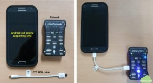

- If the cell phone supports OTG, when the Pixhawk and the cell phone are connected, LED of the Pixhawk blinks

(2) VPN server and client software

- The VPN server software which supports L2TP (Layer 2 Tunneling Protocol) over IPsec is recommended

- The VPN server maybe installed on a separate server located in the internet such as AWS or Azure cloud or maybe installed on the GCS computer which has public accessible IP address

- In this implementation, Softether VPN is used for VPN server and client

Refer https://gotocloud.co.kr/?p=1371 and https://gotocloud.co.kr/?p=1446 for Softether VPN server and client software setup procedures

- L2TP IPsec VPN client setup for an android cell phone is described in https://gotocloud.co.kr/?p=1459

- If you want to use another VPN server and client (such as OpenVPN or any commercial VPN equipment), check whether the VPN server provides public accessible IP addresses to the cell phone and the GCS computer

(3) MAVlink application for an android cell phone

- MAVlink application which supports TCP or UDP connection from the GCS (Mission planner or QGC)

MAVCell-Beta  is used in this implementation

- To get the IP address information of the cell phone, Network Info II  is recommended to be installed

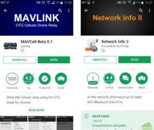

(4) GCS computer connected to the internet

- Mission Planner and VPN client software are installed on the GCS computer

### 4. Instruction

(1) Establish L2TP IPsec VPN connection in the cell phone

- Before you start to setup VPN connection in the cell phone, you should install the VPN server previously. The instructions of the VPN server setup are described in https://gotocloud.co.kr/?p=1371 and https://gotocloud.co.kr/?p=1446

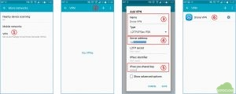

① In the cell phone, go to “System Settings -> More networks” and select “VPN”

② In “VPN” setup menu, click “+” to add new VPN

③ Add VPN name as “Drone VPN” or as what you want. Next, set the VPN type as “L2TP/IPSec PSK”

④ Input the VPN server IP address or domain name

⑤ Input the “IPsec pre-shared key” which is assigned in the VPN server

⑥ You can see the “Drone VPN” in the “VPN” setup

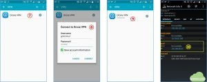

⑦ Click “Drone VPN” added in the previous setup

⑧ To connect “Drone VPN”, input “Username” and “Password” prescribed in the VPN server

⑨ If the VPN connection is established, “Connected” message will be appeared

⑩ After the connection established, execute “Network Info II” app and remember the IP address of “ppp0” assigned by the VPN server. In this example, “192.168.30.10” is assigned by the VPN server. This IP address will be used to connect from the GCS computer through cellular network

(2) Connect the Pixhawk using OTG USB cable and establish MAVlink connection with the cell phone

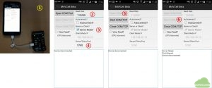

①  Connect the cell phone and the Pixhawk flight controller using OTG USB cable and check the establishment of connection. If the connection is established, LED’s of the Pixhawk start to blink

② In the cell phone, execute the “MAVcell beta” app for the MAVlink connection and set the Baud Rate as 11520

③ Check the “Server Mode?” box

④ Set “5760” in the “Server/Client Port” field

⑤ Push the “Open COM Port” and check the “Open COM Port” button becomes gray

⑥ Push the “Start COM/TCP” port and if successful, the “Start COM/TCP” button becomes gray

(3) Establish the VPN connection using VPN client software on the GCS computer

- Before you start to establish the VPN connection between the cell phone and the GCS computer, you should install the VPN client software on your GCS computer previously. The instructions of the VPN client setup are described in https://gotocloud.co.kr/?p=1371 and https://gotocloud.co.kr/?p=1446

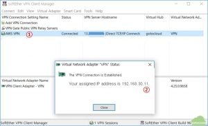

① In the VPN client, click the VPN server tab (AWS VPN in this example) for connecting VPN

② If connected successfully, the VPN server assigns IP address such as “192.168.30.11”

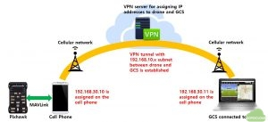

- The VPN connection between the cell phone and the GCS computer by the VPN tunnel is established. Both devices are the member of 192.168.10.x subnet, therefore the Mission Planner on the GCS computer can connect to the cell phone directly through the VPN tunnel

(4) Connect to the Pixhawk in the Mission Planner

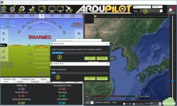

① In the Mission Planner, select the connection type as “TCP” and push “CONNECT” button

② Enter the IP address of the cell phone – “192.168.10.30” assigned in 4-(1) – in the “Enter host name/ip” field

③  Enter the remote port as “5760” as described in 4-(2) section

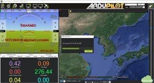

- The connection between the Mission Planner and the Pixhawk is established, the Mission Planner starts to get parameters from the Pixhawk through the VPN network over the cellular network

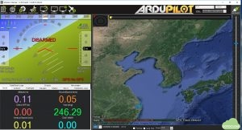

- When the connection is established, the moving of Pixhwak is appeared in the HUD

 

### 5. Test Flight

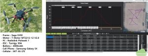

- Waypoints were assigned through the cellular network and arming and mission start commands were executed in the Mission Planner without RC transmitter

- The flight altitude was set up as 30 m high above the home position

- After the waypoint flight, manual flight about 100 m high altitude was carried out

[embeddoc url=”https://gotocloud.co.kr/wp-content/uploads/2018/06/20180617-Cellular-telemetry-test.pdf” viewer=”google”]
