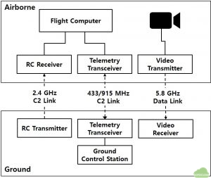
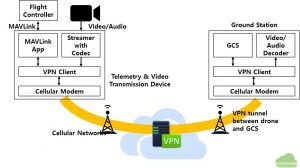
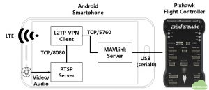
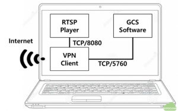
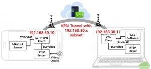
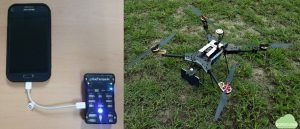
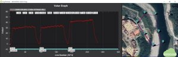
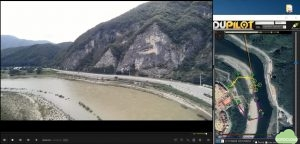
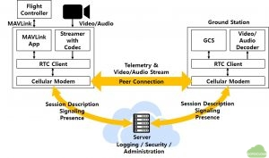
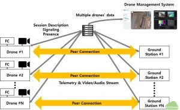

## Abstract

With the increase of drone usage in agriculture, delivery and infrastructure management industries, the need for BVLOS (Beyond Visual-Line-Of-Sight) drone flight also increases. Unlike the current one-to-one communication between the drone and the operator based on radio communication, cellular network including 3G and LTE can overcome the drone’s communication limit to enable BVLOS flight. And it also can enable the continuous telemetry and high definition video stream transmission from the drone to the ground station. In this study, we introduce the conceptual design of integrated system for the communication of the telemetry and the video stream using cellular network between the drone and the ground station. Also we verify the feasibility of the introduced concept design by performing an autonomous waypoint flight and real time video transmission using the Android smartphone and Pixhawk flight controller.

## Introduction

The drone market, which has been growing up in the military fields, is expanding in various commercial and civilian applications such as aerial photography, infrastructure monitoring, precision agriculture and delivery services [1]. With the growth of the drone market in commercial applications, the need for BVLOS (Beyond-Line-Of-Sight) flight of drone also increases. It enables service providers to conduct complex drone operations such as remote take-off or landing which is essential to the remote delivery service, and data over larger areas can be gathered without the operator having to be in close proximity to the drone. Therefore BVLOS flight will be the tipping point for commercial drone industry expansion [2].

However, to achieve BVLOS flight, drone makers and service providers must resolve the regulatory requirements prescribed by authorities and some technical requirements for BVLOS flight. Especially, reliable communication link to transmit C2 (Command-and-Control) information is essential. In addition to the reliable C2 link, to activate various drone services based on BVLOS flight, the stable and fast data link also be required.

Figure 1 shows typical drone communication links for C2 communication and data transmission. C2 communication link known as RC communication between the transmitter and the receiver uses 2.4 GHz ISM (Industry-Science-Medical) frequency band. 5.8 GHz ISM band is commonly used for transmit the video/audio taken by the drone to the receiver of the ground station. To communicate the C2 with telemetry information between the drone and the ground station, 433 MHz or 915 MHz frequency band is commonly used. Using this link, the autonomous waypoint flight is carried out and the drone’s flight status and sensor information are sent to the ground station. To enable BVLOS flight, these communication links need to provide the stable and reliable connections between the drone and the operators in the long range.

Figure 1 Typical drone communication links
For the long range communication, various technologies have been developed and applied. DJI (Dà-Jiāng Innovations) provides LightBridge2 [3] which integrates three different communication links as described in figure 1. Within a distance of up to 2 km, LightBridge2 communicates C2, telemetry data and 1080p 60 fps (frame per second) high definition video stream, using 2.4 GHz frequency. Digital Micro Device released XLRS (eXtend Long Range System) products [4] using 433, 868, 902 and 950 MHz, which support RC and telemetry communication up to 100 km. Dragon Link also provides the up to 60 km C2 communication devices named Dragon Link V3 [5].

In addition to various long range C2 and telemetry communication devices, long range real time video transmission devices have been developed by various companies. Amimon Connex [6] series support 1080p 60 fps video transmission up to the 3 km range and fpv blue showed the 720p video transmission up to 7 km distance under 50 millisecond latency using 50 mW output [7].

In spite of various long range C2 communication and video transmission devices having been developed and being used to the several kilometers drone flight, these devices have the limitation that they are not applicable in beyond radio line of sight area where radio wave disturbance occurs due to mountains or buildings. In order to overcome the limitation of radio wave communication and to achieve the stable and reliable C2 communication and video transmission in the beyond radio line of sight area, the cellular network technology such as LTE is being attempted to the drone communication [8]. To prove the feasibility of the application of LTE to BVLOS flight, Qualcomm has measured LTE performance at less than 400 feet AGL (Above Ground Level) altitude [9] and 3GPP reported that it is feasible to apply LTE network to the low altitude drone flight in spite of some limitations [10]. And using H.264 SVC (Scalable Video Coding), the real time high definition video stream has been transmitted successfully in LTE network environment [11]. As a result of such researches, it is being realized that the application of C2 and data communication using cellular network in BVLOS region.

Despite various cellular network technologies are being applied to the drone, until recently, there were few cases in which three different communication links as described in figure 1 are integrated in one devices using cellular network. Therefore, in this study, we will introduce the conceptual design of the integrated system that, using cellular network, communicates telemetry information and transmits the video stream between the drone and the ground station. Also we will verify the feasibility of the introduced concept design by performing an autonomous waypoint flight and real time video transmission using the Android smartphone and Pixhawk flight controller.

## Conceptual design of telemetry and video transmission

Figure 2 shows the conceptual diagram of the introduced system. On the drone, the telemetry and video transmission device is installed with the flight controller and the high definition camera. The device is composed of four main components, MAVLink [12] application, Streamer, VPN Client and cellular modem. The flight controller and the device are connected by the data communication interface such as UART, USB etc., which is supported by flight controller. And MAVLink protocol is used for the data exchange between both. MAVLink application on the device manages the telemetry data from/to the flight controller and supports TCP or UDP connection from/to the ground station. The video stream from the camera is transmitted to the device by HDMI, USB etc., which is supported by the camera. The Streamer process and encode the video stream to transmit.

Figure 2 Conceptual diagram of communication
Because almost mobile carriers do not provide public IP address to cellular devices, VPN client and server are used for assigning direct accessible IP addresses to the device on the drone and the ground station. The cellular modem supports the physical connection to the internet over cellular network. Similarly, the ground station has four components such as GCS software, video stream decoder, VPN client and cellular modem. When the connection of the drone device and the ground station established, VPN tunnel is made between both devices and they connect each other directly by accessible IP addresses assigned by VPN server.

Figure 3 shows components of the proposed system on the drone. On a Pixhawk flight controller, there are a total of 5 serial ports, and the micro USB port (aka serial0) is used to connect to the smartphone using a USB cable. The MAVLink server handles the telemetry data between the smartphone and the flight controller. And it responds the TCP or UDP connection from the ground station.

Figure 3 Components of the system on the drone
In the proposed device, the MAVLink server opens TCP/5760 port and it servers the connection from the ground station. The video stream is taken by the embedded camera of the smartphone and it is encoded and transmitted by the RTSP (Real Time Streaming Protocol) server application which is installed on the smartphone. The RTSP server provides the video stream to the RTSP client which is installed on the ground station. TCP/8080 port is used in this configuration. Because mobile carriers do not provide public IP addresses to the cellular devices as described above, VPN connection is used for direct connection between the smartphone on the drone and the ground station. To make the VPN connection, the embedded L2TP (Layer 2 Tunneling Protocol) over IPsec VPN client of the smartphone is used. Both the video stream of the RTSP server and the telemetry data of the MAVlink server are delivered to the VPN client and the VPN client processes the direct connection from/to the ground station through the VPN server in the internet.

Figure 4 shows components of the proposed system on the ground station. The GCS software which includes MAVLink processing module connects to the drone using TCP/5760 port through the VPN client. The RTSP player decodes and plays the video stream transmitted from the drone using LTE communication link through VPN client using TCP/8080 port. The ground station only need to be connected to the internet regardless of the connection type such as wire or mobile network. If the ground station maybe connected to the internet by the cellular network such as LTE, there will be no distance limit in the flight of the drone.

Figure 4 Components of the ground station
When the VPN connection between the smartphone of the drone and the ground station is established, the VPN server assigns the IP addresses of the same subnet, for example, “192.168.30.x” to the drone and the ground station. Both devices are members of the same subnet, therefore the ground station and the drone are connected directly through VPN tunnel. Figure 5 shows the result of the established VPN connection of both devices.

Figure 5 Established VPN connection of the system

## Verification of the design

In this study, to verify the feasibility of the proposed design, the android smartphone is installed on the drone and the autonomous waypoint flight is carried out using LTE network. At the same time, the video stream is transmitted to the ground station by LTE network. Figure 6 shows the physical configuration of the proposed system in which the Pixhawk flight controller and the Samsung Galaxy S5 smartphone which is installed on the drone without gimbal, are connected by USB cable. In this study, 680 mm wheelbase sized drone with i-Rotor 5010 360kv motors and Pixhawk 1 flight controller with ArduCopter 3.5.7 is used.

Figure 6 Physical configuration of the system
Figure 7 shows the result of the test flight. In this flight, seven waypoints are assigned and total three times flights are carried out. During the flight, the real time 1280 x 720 HD video with 30 fps is transmitted to the ground station and is played and recorded in the RTSP player of the ground station.

Figure 7 Test flight log and waypoints
In figure 8, the screen shot of the ground station during the flight is shown. In the flight, HD video stream shows the average frame rate as 29~30 fps and the telemetry is transmitted as 115200 baud rate. The LTE transmission speed of video stream is set as 4 Mbps in the test flight.

[Figure 8 Screenshot of telemetry and video stream transmission during the flight](https://youtu.be/hROnEF0GsPU)

## Conceptual design for multi drones and ground stations

In the previous section, we described the conceptual design for the transmission for the one-to-one connection between the drone and the ground station that connect to each other with VPN tunnel. The VPN tunnel is made for assigning public IP addresses to both of the drone and the ground station. RTSP server and MAVLink server are executed on the drone, and the ground station and the drone are connected one by one. Therefore this design has the limitation to adopt to the operation of multiple drones. To support the operation of multiple drones, we propose the conceptual design based on RTC (Real Time Communication).

As shown in figure 9, the drone and the ground station make peer-to-peer connection for data transmission including video stream and telemetry data. The server located in the internet handles session descriptions, server side logging and administrations, and relay the connection for both devices. The typical example of this architecture is the peer-to-peer video conferencing solution based on WebRTC [13] technology.

Figure 9 Conceptual design based on RTC
In addition to the peer-to-peer connection, multiple video stream and telemetry data can be processed at the separate central drone management system as shown in figure 10. Because session descriptions and connection information are stored and processed in the server, each drone’s video stream and telemetry data can be monitored and controlled in the central drone management system as the user’s purpose.

Figure 10 Central drone management system

## Concluding remarks

In spite of various long range C2 communication and video transmission devices based on radio communication having been developed and being used to the several kilometers drone flight, these devices have the limitation that they are not applicable in beyond radio line of sight area where radio wave disturbance occurs due to mountains or buildings. In order to overcome these limitations, the cellular network technology such as LTE is being attempted to the drone communication. Accordingly, we proposed the conceptual design of the integrated system using cellular network for the C2 and telemetry communication and for the video stream transmission. In addition to the proposal of the design, we verified the feasibility of the proposed concept design by performing an autonomous waypoint flight and real time video transmission using the Android smartphone and Pixhawk flight controller. Through the flight test, the feasibility of the proposed design for C2 communication and video stream transmission using cellular network has been proved and it is also confirmed that the cellular network will be useful for C2 communication and data transmission in BVLOS region.

Finally, we proposed the conceptual design of the central drone management system for multiple drones and ground stations management and control using cellular network. In the future research, we are going to prove the feasibility of the central drone management system.

## References

[1] Unmanned Vehicle Advanced Research Center, Unmanned Vehicle Technology Roadmap, Ministry of Science and ICT, Seoul, Korea, 2018, p. 32

[2] ALTIUAS, “What is BVLOS and What Does it Mean to Commercial Drone Users,” https://www.altiuas.com/bvlos-mean-commercial-drone-users

[3] DJI, “Lightbridge2 User Manual,” https://www.dji.com/en/lightbridge-2/info

[4] Digital Micro Device, “XLRS (eXtended Long Range System),” https://d3.xlrs.eu/

[5] Dragon Link, http://www.dragonlinkrc.com/

[6] Amimon, https://www.amimon.com/products/

[7] FPV Blue, “Digital fpv- long range – 50 ms glass to glass latency,” https://fpv.blue/

[8] Lassi Sundqvist, Cellular Controlled Drone Experiment: Evaluation of Network Requirements, MS Thesis, Aalto University, 2015

[9] Qualcomm, “LTE Unmanned Aircraft Systems Trial Report,” 2017, https://www.qualcomm.com/documents/lte-unmanned-aircraft-systems-trial-report

[10] Siva D. M., Xingqin L., Helka-Liina M., Zhenhua Z., Wuri A. H. and Shinpei Y., “An Overview of 3GPP Release-15 Study on Enhanced LTE Support for Connected Drones,” 2018, https://arxiv.org/pdf/1805.00826

[11] Patrick M., Carlo V., Amit P., Prasant M., Philip P. and Enzo M., “Quality-Oriented Scalable Video Delivery using H.264 SVC on an LTE Network,” 2015

[12] Meier, L. “MAVLink: Micro Air Vehicle Communication Protocol,” 2009, https://mavlink.io/en/

[13] WebRTC, https://webrtc.org/

 

(Note) This article will be presented at the 7th Asian/Australian Rotorcraft Forum, Jeju Island, Korea, Oct. 30 – Nov. 1, 2018
