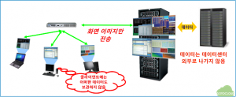
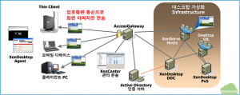
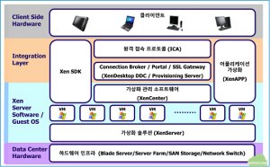
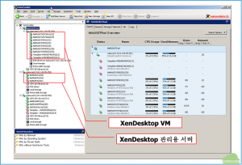
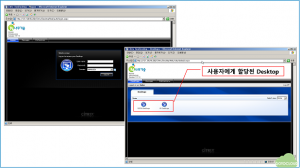
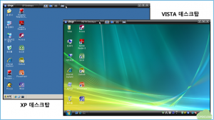
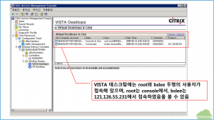
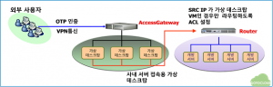
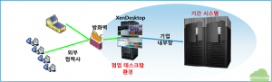
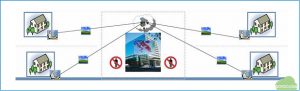

기업의 경쟁력 강화를 위해 가상화 기술을 어떻게 도입할 것인가에 대해 기업 경쟁력 강화를 위한 가상화 전략에서 논한바 있다. 이번 글에서는 앞서 소개한 가상화 기술 중에서 최근 주목을 받고 있는 데스크탑 가상화에 대해서 살펴보고, Citrix에서 데스크탑 가상화 제품으로 제공하고 있는 XenDesktop에 대해서 알아볼 것이다.

 

## 1. 기존 데스크탑 환경의 문제점

대부분 기업체의 IT 인프라 투자는 중요 서버나 스토리지 네트워크 등에 집중되고 있으며, 장애 대응 방안이나 보안 등 IT 운영 관리도 서버 및 스토리지를 중심으로 진행되고 있다. 통상 서버나 스토리지 등 주요 IT 인프라는 99.999%의 가용성(일년에 5분 이내의 다운타임)을 보장을 목표로 투자가 진행되나, 정작 데스크탑에 대해서는 이러한 투자나 관리가 수행되는 기업은 거의 없는 것이 현실이라고 할 수 있다.

알려진 바에 의하면, PC나 노트북 등 데스크탑 환경은 99.5%의 가용성(일년에 43시간의 장애 시간)을 만족하는 수준이며 이로 인해, 일반 기업체의 사용자는 데스크탑 환경의 장애로 인하여 연간 2일의 업무 손실을 초래하고 있다고 한다.

그럼에도 불구하고, 대부분의 기업은 여전히 데스크탑을 사무용품과 동일한 수준으로 관리하고 있으며, 관리 부서도 IT 부서가 아닌 총무 부서 등으로 분산되어 있는 것이 현실이다.

 

구체적으로 현재 기업들이 겪고 있는 데스크탑 환경의 문제점을 살펴보면 다음의 6가지로 요약할 수 있다.

 

- ### 이기종 환경

기업들은 데스크탑을 사용연한(통상 3~5년)에 맞춰서 사용자별로 구매해서 지급하고 있다. 이로 인해서, 기업에서 사용중인 데스크탑은 하드웨어, OS, 어플리케이션 등이 통일되지 못하고 구입 시기에 따라서 다양할 수 밖에 없다. 이로 인하여, 전사적으로 통합된 데스크탑 관리 및 사용 정책 설정이 불가능하다.

 

- ### 높은 관리 비용

IDC의 자료에 의하면 미국 기업들이 데스크탑 한대를 관리하기 위하여 지출하는 총 TCO(Total Cost of Ownership)는 2006년 현재 대당 $6,800에 이른다고 한다. 이 비용 중의 49%는 사용자 관리(OS 및 어플리케이션 설치 등)에 사용되고, 29%는 하드웨어 및 소프트웨어, 11%는 기술 지원 비용, 9%는 관리 비용으로 사용된다고 한다.

 

- ### 비효율적인 관리

IDC에 의하면, 데스크탑 관리 활동의 31%는 하드웨어 유지보수이며, 16%는 헬프데스크 운영, 12%는 사용자 소프트웨어 관리, 7%는 OS 설치, 6%는 업그레이드에 투자되는 것으로 알려져 있으며, 28%는 기타 데스크탑에 관련된 잡무(네트워크 연결, 데이터 복구 등)에 할애되는 등, 투자되는 TCO에 비해 효율적인 데스크탑 관리가 이루어지지 못한다는 것이 현실이다.

 

- ### 보안 취약

최근의 보안 사고의 대부분은 서버나 스토리지 등 데이터 센터 인프라에 대한 공격보다는 사용자 데스크탑에 대한 해킹이나 바이러스로 인해 발생하고 있으며, 사용자 데스크탑의 도난 및 분실로 인한 중요 기업 정보의 유출 사례가 빈번해지고 있다. 이로 인해, 기업은 사용자 데스크탑 환경에 대한 보안 강화에 막대한 IT 예산을 투입하고 있으며, 그 비용은 점점 증가할 것으로 예상된다.

 

- ### 호환성 및 라이선스 불일치

대부분의 기업은 표준 OS와 표준 어플리케이션을 지정해두고 있음에도 불구하고, 사용자들이 임의로 OS를 변경하거나, 버전이 다른 어플리케이션을 설치함으로 인해서, 호환성 및 라이선스 불일치 문제가 발생한다. 이로 인해서 데스크탑의 장애가 발생하고 업무 중단으로 연결되는 경우가 빈번하다. 뿐만 아니라, 기업이 계약하지 않은 어플리케이션을 사용자가 임의로 설치함으로 인한 법적 문제까지 발생하는 경우가 빈번하다.

 

- ### 낮은 자원 활용률

데스크탑 PC나 노트북의 하드웨어 성능은 비약적으로 발전하고 있으므로, 신규로 도입되는 데스크탑 하드웨어의 성능은 이전의 서버나 워크스테이션을 대체하고도 남을 만큼 충분하다. 그럼에도 불구하고, 데스크탑은 정해진 사용 연한을 넘어서게 되면 폐기되고 신규 하드웨어로 교체되는 등, 자원 낭비가 점점 심해지고 있다.

 

## 2. 프리젠테이션 가상화를 이용한 데스크탑 문제점 해결

앞 절에서 살펴본 바와 같이 대부분의 기업은 데스크탑 환경의 중요성을 점차 인식하고 있으며, 상기의 문제점을 효과적으로 해결하고자 하는 방안을 강구하게 되었다. 이와 더불어 많은 IT 벤더 들은 전사의 데스크탑을 효율적으로 운영, 관리할 수 있는 솔루션을 개발하여 제시하고 있다.

이러한 관점에서 최근의 가상화 기술을 데스크탑 관리 및 운영에 적용하고자 하는 시도가 이루어져 왔으며, 이중에서 가장 널리 알려진 기술이 Citrix가 제공하고 있는 프리젠테이션 가상화 또는 SBC(Server Based Computing)로 통칭되는 어플리케이션 가상화와 데스크탑 가상화 기술이라고 할 수 있다.

 

그림 1 프리젠테이션 가상화 기본 개념

프리젠테이션 그림 1과 같이 가상화 기술은 사용자가 수행하고자 하는 모든 어플리케이션 또는 데이터는 서버에 존재하고 사용자 데스크탑은 단지 입출력 장치로만 사용되어, 사용자에게는 서버에서 수행되는 어플리케이션이나 데스크탑 환경이 이미지로만 전송되는 기술이다.

 

## 3. 데스크탑 가상화 – Citrix XenDesktop

프리젠테이션 가상화 기술은 어플리케이션 가상화와 데스크탑 가상화 기술로 구분할 수 있다고 지난 번 글에서 논한 바 있다. 다시 한번 두 기술의 간략한 차이에 대해서 논하면 다음과 같다.

어플리케이션 가상화는 한대의 서버에서 복수의 사용자 어플리케이션이 수행되고 그 어플리케이션에 대한 이미지가 PC로 전송되는 기술인 반면, 데스크탑 가상화는 한대의 서버에 복수의 사용자를 위한 개별 데스크탑 환경을 가상머신으로 각각 제공하고, 각 데스크탑 환경의 수행 이미지를 사용자의 입출력 PC로 전송되는 기술이다.

이번 글에서는 프리젠테이션 가상화 기술 중에서 특히, 데스크탑 가상화 기술에 대해서 논하고, 데스크탑 가상화의 대표적인 솔루션인 Citrix의 XenDesktop에 대해서 알아보기로 하자.

데스크탑 가상화를 도입하는 목적으로는 다음의 네 가지 사항을 들 수 있다.

 

- ###  중앙 집중화된 전사 데스크탑 관리

- ### 어플리케이션 및 데이터의 중앙 집중화

- ### 데스크탑 보안성, 관리 유연성, 신뢰성 확보

- ### 장소 및 클라이언트 접속 환경에 무관한 데스크탑 환경 제공

 

데스크탑 가상화를 통해 전사 데스크탑 환경을 중앙으로 통합함으로써, 사용자 데스크탑에 대해서 IT 부서에서 근접 관리가 가능해질 뿐 아니라, 전사적으로 일관된 데스크탑 정책을 적용할 수 있게 된다. 뿐만 아니라, 사용자 어플리케이션과 데이터도 개별 데스크탑에 저장되는 것이 아니라, 중앙의 서버와 스토리지에 저장되고 실행됨으로써, 보안적인 측면과 더불어 라이선스 불일치 등의 문제점도 한번에 해결할 수 있다.

이와 동시에 사용자 입장에서는, 장소와 클라이언트 환경에 무관하게 자신의 데스크탑을 사용할 수 있게 됨으로써 업무의 연속성을 확보할 수 있을 뿐 아니라, 개발이나 테스트 등을 위한 데스크탑 환경도 손쉽게 제공 받을 수 있어, 데스크탑 설치 및 구성을 위한 시간과 비용을 획기적으로 절감할 수 있다.

뿐만 아니라, 서버 가상화 기술인 XenServer 상에 가상머신의 형태로 데스크탑을 제공함으로써, 직원의 데스크탑 활용도에 따라 서버 및 스토리지 투자가 가능해짐으로써, TCO를 절감이 가능할 뿐 아니라, 사용자 클라이언트는 단말로만 사용됨으로써, 데스크탑 PC의 교체 주기를 연장할 수 있어, 노후 PC로 인한 성능저하 문제를 막을 수 있다.

 

- ### 데스크탑 가상화 구성

 

그림 2 XenDesktop 구성도

그림 2에 XenDesktop 기반의 데스크탑 가상화 구성도가 나타나 있다. 그림에서 볼 수 있듯이, 사용자 데스크탑은 중앙의 데이터 센터의 XenServer 호스트 서버 위에 가상머신 형태로 설치되고, 사용자는 씬클라이언트, 노트북, PC 등 원하는 단말 장치에서 로그인하게 되면, 자신에게 할당된 데스크탑 이미지를 전송 받아서 기존 PC와 동일한 형태로 업무를 수행하게 된다.

 

- ### 데스크탑 가상화 솔루션 스택

구체적으로 데스크탑 가상화를 구성하는 세부 솔루션 스택은 다음과 같다.

 

그림 3 XenDesktop 솔루션 스택

XenDesktop의 구성요소 중 제일 하단은 데스크탑 가상화 환경이 운영되는 하드웨어 인프라로, 서버 및 스토리지, 네트워크 스위로 구성된다. 이러한 하드웨어 인프라가 구성된 후, 데스크탑을 호스팅할 서버에 XenServer 가상화 엔진을 탑재하고 XenServer 위에 사용자가 사용할 Windows XP 또는 Windows VISTA 가상머신을 구성하게 된다. 그리고, XenCenter를 이용하여, XenServer 상에서 운영되는 가상머신 환경을 관리하게 되는데, 여기까지는 일반적인 서버 가상화 환경과 동일하다고 볼 수 있다.

XenDesktop을 구성하기 위해서는 가상화 환경 위에 사용자 인증을 위한 Windows Active Directory 서버인 XenDesktopDmC (Domain Controller)와 사용자 개인별 데스크탑을 할당 해주는 XenDesktopDDC (Desktop Delivery Controller), 그리고 데스크탑을 손쉽게 구성하고 배포할 수 있는 Provisioning Server가 추가된다.

그리고, 어플리케이션 가상화를 같이 적용하기 위해서 XenApp 서버를 XenDesktop 가상머신과 결합할 수 있으며, 사용자가 필요한 프로그램을 개발할 수 있는 XenSDK가 같이 제공된다.

사용자는 위의 데스크탑 가상화 환경으로 접속하게 되면, 자신에게 할당된 데스크탑에 대해 네트워크로 접속하게 되는데, 고속의 이미지 전송을 위해서 ICA 프로토콜을 이용하게 된다.

 

그림 4 가상데스크탑 구성 예

그림 4에 실제로 구축되어 있는 XenDesktop 환경이 나타나 있다. 그림에서 볼 수 있듯이, XenServer 상에 사용자가 접속할 수 있는 XenDesktop 가상 머신이 구성되어 있고, 두번째 서버에는 XenDesktop을 관리할 수 있는 DDC, DmC 및 PVS 서버가 같이 구성된다.

 

- ### XenDesktop 사용 예

그림 5 XenDesktop 로그인

 그림 5에서와 같이 사용자는 자신의 단말에서 Web을 통해 로그인하게 되면, 자신이 사용할 수 있는 데스크탑이 나타난다. 이 때 사용자에게 할당된 데스크탑은 하나일 수도 있고, 정책에 따라서 여러 개(오피스 작업용, 개발용 등)일 수도 있다. IT 부서에서는 사용자의 권한이나 업무에 따라서, 특정한 어플리케이션이 깔려 있는 데스크탑을 종류별로 만들어서 정책에 따라서 데스크탑의 사용권한을 할당할 수 있다.

그림 6 가상 데스크탑 실행 화면

로그인에 성공하게 되면, 그림 6에서와 같이 자신이 사용할 수 있는 데스크탑이 실제 PC와 동일한 형태로 나타나게 된다. 사용자는 전체화면으로 사용할 수도 있고, 복수의 데스크탑을 사용할 경우는 윈도우 형태로 크기를 조절해서 번갈아 가면서 사용할 수도 있다.

그림 7 XenDesktopDDC 접속 현황

그림 7은 사용자가 데스크탑을 사용하기 위해 로그인했을 때, XenDesktopDDC의 관리자 화면에 나타나는 접속현황을 보여주고 있다. 사용자가 데스크탑을 사용하는 동안 그림과 같이 IT 부서의 관리자는 어떤 사용자가 어떤 IP에서 데스크탑을 사용하기 위해 접속했는지를 파악할 수 있고, 동시에 부정한 접속일 경우 강제로 접속을 종료시킬 수도 있다.

뿐만 아니라, 정책적으로 정해진 시간 외에는 데스크탑을 사용하지 못하도록 강제할 수도 있고, 동시에 일정한 시간대 별로 데스크탑 그룹을 선택적으로 부팅할 수도 있게 된다. 이러한 정책 기능을 통해 글로벌 기업 들은 데스크탑 가상화 인프라를 구축한 후, 시간 대가 다른 지역의 사용자들에게 데스크탑을 변경하여 제공함으로써, TCO를 극대화할 수 있게 된다.

 

## 4. XenDesktop 적용 시나리오

이 절에서는 앞에서 개략적으로 설명한 XenDesktop의 실제 적용가능한 업무로 어떤 것이 있는지를 구축 사례와 시나리오를 바탕으로 살펴보기로 하자.

 

- ### 사외에서 사내 서버로의 보안 접속

그림 8 외부 사용자 사내 서버 접속

그림 8의 경우는 XenDesktop을 이용하여 사내 개발서버로 외부 사용자가 접속하는 구성을 설명하고 있다. 사내 개발 서버로 외부에서 접속하는 경우, 현재는 방화벽이나 VPN을 통해 개발 서버 등 사내 서버에 직접 접속하도록 구성하고, 네트워크 단에서 ACL(Access Control List)을 통해 접속을 통제하고 있다.

반면, 그림과 같이 사내 서버를 접속할 수 있는 가상 데스크탑 환경을 XenDesktop으로 구성하고 외부 사용자는 보안 접속을 통해서 가상 데스크탑에 접속한 후, 가상 데스크탑을 통해서만 사내 서버로 접속하도록 ACL을 구성할 경우, 외부 사용자는 네트워크를 통해 사내서버로 들어와서 작업을 할 수만 있고, 가상 데스크탑을 통해서 외부로 데이터를 가져갈 수는 없게 된다.

 

- ### 협력사에서 본사의 ERP 등 기간 시스템으로의 접속

그림 9 협력사 – 본사 협업 환경 구성

대부분의 기업체는 협력사들에게 본사의 구매 시스템 등에 접속을 허용하기 위하여 웹 포탈 형태의 협력사 시스템을 구축하여, 오픈하고 있다. 그런데, ERP나 PLM 등과 연동된 포탈 시스템의 경우 기간시스템의 변경에 맞춰서 매번 포털을 재개발하거나 수정하는데 많은 어려움을 겪게 된다. 이러한 문제점을 해결하는 가장 좋은 방법은 협력사 들에게 기간 시스템을 직접 접속하도록 클라이언트를 제공하는 것이나, 이는 라이선스 문제 뿐만 아니라 보안적인 문제가 항상 존재하게 된다.

이와 같은 문제점을 해결하기 위하여, 협력사가 접속할 수 있는 가상 데스크탑 서버를 구축하고 협력사는 가상 데스크탑 환경으로 접속한 후, 가상 데스크탑에서 기간 시스템에 직접 접속함으로써, 보안문제와 포털 개발에 들어가는 비용을 상당히 줄일 수 있게 된다.

뿐만 아니라, 구매 협력사, 영업 협력사 등 협력사의 유형 별, 또는 국내, 해외 등 지역 별로 데스크탑 그룹을 구성하여, 적합한 데스크탑을 선택적으로 제공함으로써, 업무 효율성도 추구할 수 있다.

 

- ### 업무 연속성 지원 (재택 근무, 사외 근무)

그림 10 업무 연속성 지원 시스템

많은 기업들이 직원들의 외부 출장 혹은 재택 근무 등을 지원하기 위한 시스템을 구축하고 있다. 그러나, 현재의 대부분 사외 업무 지원 시스템은 간단한 사내 메일을 접속하거나, 회사 내부의 포털 등을 VPN을 통해 접속하는 등 제한적인 업무만을 지원하고 있다.

그런데, 만약 전사의 데스크탑 환경을 XenDesktop 기반의 가상화 기반으로 구축하게 되면, 직원은 사내에서 업무하는 데스크탑 환경 그대로, 집이나 출장 중에도 접속하여 사내와 동일하게 업무를 수행할 수 있게 된다. 뿐만 아니라, 사무실의 물리적인 재해(정전, 공사, 테러 등)로 인해 사무실에 출근하지 못하게 되는 상황에서도 데이터 센터로 네트워크가 연결되는 어떠한 공간에서도 업무가 가능한 Virtual Office를 실현할 수 있다.

 

## 5. 결론

이상으로 Citrix의 데스크탑 가상화 솔루션인 XenDesktop의 개념 및 구성, 적용 가능한 사례 등에 대해서 살펴보았다. 본문에서 살펴본 바와 같이 데스크탑 환경을 XenDesktop 기반의 가상환경으로 전환함으로써, 보안, 관리 등 기업이 겪고 있는 수많은 데스크탑 환경의 문제점을 해결할 수 있음을 알 수 있고, 이와 더불어 현재 기업 IT의 핵심 요소로 대두되고 있는 개인의 데스크탑 환경을 전사의 IT 전략에 통합할 수 있게 됨으로써, 기업의 경쟁력을 획기적으로 개선할 수 있을 것이다.

첨언) 이 글이 작성된 시점은 무려 4년 전인 2009년 3월이다. 그때만해도 클라우드는 고사하고 가상화라는 것도 생소하던 시점인데 내용을 보니 지금과 크게 달라진게 뭐가 있을까 하는 생각에 여기에 옮겨놓는다. 읽는 분들은 2009년으로 돌아가서 그 때의 IT  환경을 떠 올리면서 읽어주셨으면 한다. 이 글에서 예로 든 Citrix XenDesktop은 버전 3.0 이었던걸로 기억하는데, 최근에는 5.5가 나오고 계속 업그레이드 되면서 기능이 개선되고 있지만 기본적인 구성 및 사례는 크게 변함이 없다.
