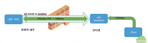

#

## 목적

Inbound 접속은 차단되어 있고, outbound 접속만 허용되는 방화벽 내부에 설치된 서버에 방화벽 외부에서 ssh, rdp 등으로 접속하기 위해서는 방화벽에서 내부 서버에 대해서 inbound 접속을 허용해야 한다. 그러나, 방화벽 해제가 허용되지 않는 경우 내부 서버에 방화벽 외부에서 reverse ssh 터널을 통해 접속할 수 있다. 이 문서에서는 방화벽 내부 서버에 reverse ssh를 이용하여 외부에서 접속하기 위한 설정 방법을 RDP를 예시로 설명한다.

## Reverse SSH 구성 예시

아래의 그림은 인터넷 영역에 ssh jumpbox를 구동하고, 방화벽 내부 서버의 3389/tcp (RDP) 포트와 ssh jumpbox의 3151/tcp 포트를 reverse ssh 터널로 연결하고 방화벽 외부의 인터넷 영역에 있는 client에서 ssh jumpbox의 3151/tcp 포트를 통해 내부서버의 3389포트로 RDP 접속하는 구성 예를 보여주고 있다.

## SSH jumpbox 설정

- 인터넷 영역에 ssh jumpbox 서버를 구동한다. 이 글에서는 AWS 클라우드에 t2.micro 인스턴스를 jumpbox로 사용한다. jumpbox의 공인 IP(에를 들어 3.5.6.7)를 기억해 둔다.

- 서버 구동 후에 jumpbox 서버의 방화벽을 security group에 구성한다. 먼저 reverse ssh 터널을 연결하고자 하는 내부 서버의 outbound 네트워크의 공인 IP 어드레스(일반적으로 방화벽의 공인 IP 어드레스로 예를 들어 210.123.134.145)에 대해 ssh 접속(22/tcp)을 허용한다. ssh jumpbox에 인터넷에서 RDP 접속에 사용할 포트(이글에서는 3151/tcp)를 허용한다.

- SSH jumpbox의 ssh 설정에서 ssh forwarding을 허용한다. /etc/sshd/sshd_config에서 GatewayPorts와 AllowTcpForwarding을 변경한다.
[ec2-user@ip-172-31-10-254 ~]$ sudo vi /etc/sshd/sshd_config

GatewayPorts yes
AllowTCPForwarding yes

- 시간이 지나도 Reverse ssh 접속이 끊어지지 않고 유지되도록 /etc/sshd/sshd_config의 Keepalive 설정을 활성화한다.
[ec2-user@ip-172-31-10-254 ~]$ sudo vi /etc/sshd/sshd_config

ClientAliveInterval 300  
ClientAliveCountMax 5

- sshd를 재시작한다.
[ec2-user@ip-172-31-10-254 ~] $ sudo systemctl restart sshd

- ssh 사용자 계정 생성 및 ssh key 생성
ssh jumpbox에 reverse ssh 접속에 사용할 사용자 계정(예를 들어 reversessh)을 생성하고 ssh privte key를 생성한다.
[ec2-user@ip-172-31-10-254 ~]$ sudo useradd reversessh
[ec2-user@ip-172-31-10-254 ~]$ sudo su - reversessh
[reversessh@ip-172-31-10-254 ~]$ ssh-keygen -t rsa

- 방금 생성한 ssh public key인 id_rsa.pub를 authorized_keys로 복사한다.
[ec2-user@ip-172-31-10-254 ~] $ cp ~/.ssh/id_rsa.pub ~/.ssh/authorized_keys

## 방화벽 내부 서버에서 reverse ssh 터널 연결

방화벽 외부에서 접속하고자 하는 내부 클라이언트에 jumpbox에서 생성한 ssh private key id_rsa 파일을 reversessh.pem이라는 이름으로 다은로드한다. Putty와 같이 ppk 포맷의 private key를 사용하는 client 프로그램에서는 다운로드 받은 pem 파일을 ppk 포맷으로 변경한다.
먼저, ssh private key의 권한을 변경한다. 리눅스 서버에서는 다음과 같이 변경한다.

chmod 400 reversessh.pem
윈도우에서는 다음의 명령어로 권한을 변경한다.

icacls.exe reversessh.pem /reset
icacls.exe reversessh.pem /grant:r "%username%":(R)
icacls.exe reversessh.pem /inheritance:r
위의 명령어에서 username은 reverse ssh 터널을 구성할 윈도우 사용자 이름이다.

SSH private key를 사용하여 내부 서버에서 아래의 명령어로 jumpbox에 ssh로 접속하여 reverse ssh 터널을 연결한다.

ssh -i reversessh.pem -f -N -R <remote port>:localhost:<internal port> reversessh@<jumpbox-ip-address>
위에서 는 인터넷에서 jumpbox에 접속할 때 사용할 포트이고, 는 방화벽 내부 서버의 실제 포트이다. 예를 들어 3151:localhost:3389라면 내부 서버의 3389 포트에 외부 인터넷에서 3151 포트를 사용하여 접속한다는 의미이다. 즉, 내부 서버의 <internal port>와 jumpbox의 “` 간에 터널이 연결된다는 의미이다.

ssh -i reversessh.pem -f -N -R 3151:localhost:3389 reversessh@3.5.6.7
위의 명령어를 내부 윈도우 서버에서 실행하여 내부 서버의 3389/tcp 포트를 jumpbox (3.5.6.7) 에 ssh로 접속하여 3151tcp와 터널을 구성한다.
ssh가 연결되어 있는 상태에서 외부 인터넷 상의 아무 Windows PC에서 RDP 클라언트로 3.5.6.7:3151 RDP 접속을 수행한다.
Reverse ssh 터널이 정상적으로 설정되었다면, 내부 서버에 RDP 접속이 가능하게 된다.

## Reverse ssh 자동 실행

내부 서버에서 시스템이 시작될 때마다 자동으로 reverse ssh 터널이 연결되도록 설정한다.

- 리눅스 서비스 등록reverse ssh를 시스템 서비스인 reversessh.service로 등록하고 활성화한다. 이때 useri는 reverse ssh 터널을 접속을 수행할 내부 리눅스 서버의 사용자 계정이며 reversessh.pem은 적절한 위치에 저장한다.
$ sudo vi /etc/systemd/system/reversessh.service

[Unit] 
Description=Reverse SSH tunnel service 
After=network.target

[Service]
Type=simple
User=userid
ExecStart=/usr/bin/ssh -i /path/reversessh.pem -N -R 3151:localhost:3389 reversessh@3.5.6.7
Restart=always
RestartSec=10

[Install]
WantedBy=multi-user.target
서비스를 활성화하고 시작한다.
$ sudo systemctl enable reversessh.service
$ sudo systemctl start reversessh.service

- 윈도우에서 시스템 시작시 reverse ssh 터널 연결
윈도 서버 시작 시 reversessh가 자동 시작되도록 시작-실행(R)에서 shell:startup을 실행한 후 폴더에 reversessh.bat 파일을 다음과 같이 생성한다.
ssh -i c:pathreversessh.pem -N -R 3151:localhost:3389 reversessh@3.5.6.7

이 글에서는 Inbound 접속은 차단되어 있고, outbound 접속만 허용되는 방화벽 내부에 설치된 서버에 방화벽 외부에서 접속하기 위해 jumpbox 서버를 구성하고 reverse ssh 터널을 구성하는 방법을 설명하였다. reverse ssh를 통해 ssh, rdp 뿐만 아니라 방화벽 내부의 서버에서 실행되는 어떠한 서비스에 대해서도 접속이 가능하다. 이를 통해 방화벽을 외부 인터넷에 개방하지 않더라도 안전하게 내부 서버에 접속이 가능하다.
