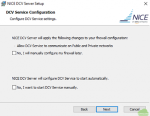
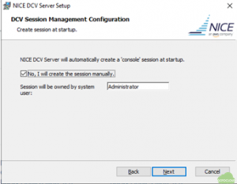
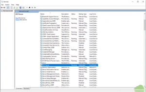
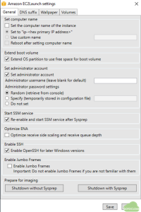
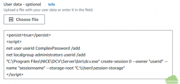

# Objectives

This document explains the AWS AMI build procedure of the NiceDCV 2023 server on Windows server 2022 for the AWS x86_64 instances. In this AMI, the NiceDCV is configured and automatically started at the Windows instance launch time. At launch time, the user can create a DCV user with their own password. After the instance is started, the user can login the DCV session using the NiceDCV client.

# Install NiceDCV server

- Launch a Windows Server 2022 instance in AWS. The c6i.xlarge instance is recommended. After the instance is started, login the Windows instance using RDP.

- After login, download and install the NiceDCV Virtual Display Driver.

- Install NiceDCV Server 2023. During installation, allow the DCV service in the firewall and configure the automatic start of the DCV service.

Check that the manual creation of the console session. The console session will be created manually by the User-data script at the instance launch time.

- Check the DCV server is started automatically in the Windows Services of the Task manager.

# Enable the session-storage

Session-storage is a folder on the NICE DCV server that clients can access when they’re connected to a specific NICE DCV session. By the session-storage service in the DCV server, the file transfer between the client and the server during the DCV session is connected.

- Create a folder which will be used for the session storage-storage. For example, C:Userssession-storage

- Open the Registry Editor and navigater to the HKEY_USERS/S-1-5-18/Software/GSettings/com/nicesoftware/dcv/session-management/automatic-console-session key and select the storage-root parameter.

- In the navigation pane, open the contect menu (right-click) session-management/automatic-console-session. Then choose New, String. And set the Name as storage-root

- Open the session-root parameter and set the value as the folder name which was crated in the above such as C:Userssession-storage

- To start the session-storage, specify the --storage-root option at the session creation time.

# Setup the snapshot using EC2Launch V2

To create a AMI, install the latest updates and configure the EC2 Launch V2 settings.

- Install the latest update in the Windows Server 2022.

- From the Start menu, run the All Programs -> EC2Launch settings and configure parametes as following

- 

- Check the Extend OS partion to use all disk spaces of the instance

- In the Set administrator account, select the Random password for the Administrator. Using the ssh key, the random password can be decrypted after the instance is started

- Check the Enable SSH parameter to log in using the ssh command to the Windows Power Shell

- After configure parameters, click Shutdown with Sysprep. Create an AMI using the stopped instance.

# Launch an instance with User-data

To log in to the DCV session after the Windows server is started, the DCV user should be configured in the User-data field at an instance launch time. The example of User-data is following

<persist>true</persist>

In the above script, userid with the ComplexPassword is created in the Windows server and the sessionname DCV session is automatically created. The user can login as the userid with password using the DCV client. The password should be satisfied for the Windows security policy.
And, in the security group setting, 8443/tcp should be allowed in the in-bound connection.
