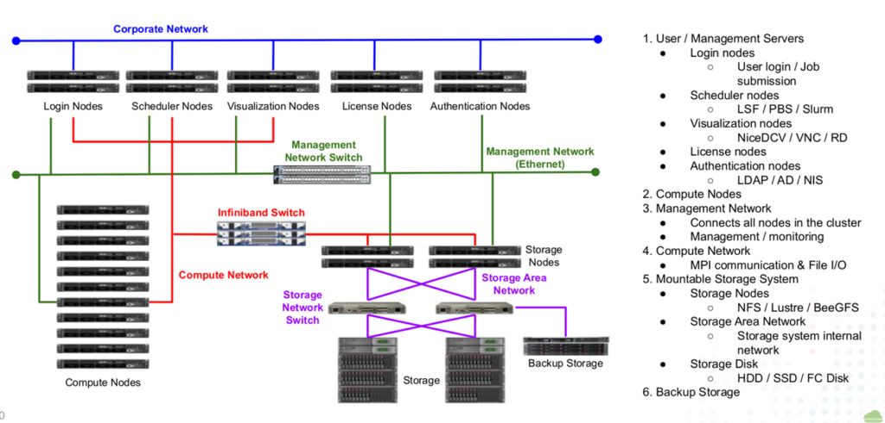
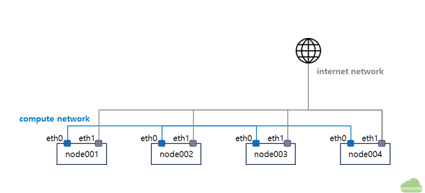

# Typical HPC configuration

# Test Configuration

- All nodes have two NICs (In AWS, one NIC is used)

eth0: compute network for MPI and NFS

- eth1: Internet access for update

- node001 : login, NFS and compute node

- OS : Ubuntu 22.04 server minimal

# Launch instances in AWS

- Launch Ubuntu 22.04 instances with public IP address

- Edit inbound rules in the security group

Allow ssh access from the internet

- Allow all inbound traffic between private IP address range

- Record hostnames and IP addresses
hostname
private IP
public IP

node001
–
–

node002
–
–

# Headnode setup

## Enable Password login for root

- Login to headnode using id ubuntu and setup root password
$ sudo passwd

- Change account to root and enable password login for root
$ apt-get -y install no vim csh
$ su -

# vi /etc/ssh/sshd_config
PasswordAuthentication yes
PermitRootLogin yes

# systemctl restart sshd

- Check that root login to headnode using ssh

## btools for Cluster management

- Install btools script in the headnode

btools is a series of scripts to automate the execution of commands
$ su -
root@node001:~# apt-get -y install git
root@node001:~# cd /root
root@node001:~# git clone https://github.com/zachsnoek/btools
root@node001:~# cd btools
root@node001:~/btools# ./install-btools.sh
root@node001:~/btools# cd /usr/local/sbin
root@node001:/usr/local/sbin# sed -i "s/bin/sh/bin/bash/g" *

- In the ubuntu OS, #!/bin/sh command in the btools files does not work. #!/bin/sh to #!/bin/bash using sed command.

## Hostname setup

- Add all hostnames in /usr/local/sbin/bhosts
root@node001:~# vi /usr/local/sbin/bhosts

node002
node003
...

- Append all nodes’ ip addresses in /etc/hosts
root@node001:~# vi /etc/hosts

127.0.0.1 localhost
192.168.200.1 node001
192.168.200.2 node002

## root login without asking password

- Create a ssh key and copy to all compute nodes for root login without password
root@node001:~# ssh-keygen -t rsa

root@node001:~# ssh-copy-id root@node002
root@node001:~# ssh-copy-id root@node003

- Execute btools commands without asking root password
root@node001:~# bexec hostname

***** node002 *****
node002
***** node003 *****
node003

## NFS server setup

- Head node /home is shared to all compute nodes by NFS

- Install NFS server package and start NFS service in headnode
root@node001:~# apt install -y nfs-kernel-server nfs-common
root@node001:~# systemctl enable nfs-server
root@node001:~# systemctl start nfs-server
root@node001:~# systemctl status nfs-server
● nfs-server.service - NFS server and services

- Export /home to all compute nodes
root@node001:~# vi /etc/exports
/home 192.168.200.0/24(rw,no_root_squash)
root@node001:~# exportfs -a
192.168.200.0/24 is the ip address range of NFS network. Change your IP range

# Compute nodes setup

## Sync headnode file to compute nodes

- bpush command copies headnode file to all compute nodes
bpush <headnode file> <destiation directory>

- Copy headnode /etc/hosts file to all compute node using bpush command
root@node001:~# bpush /etc/hosts /etc/
***** node002 *****
***** node003 *****
***** node004 *****

- Check /etc/hosts file is sync to all compute nodes using bexec command
root@node001:~# bexec "cat /etc/hosts"

## NFS client setup

- Install NFS client package in all compute nodes using bexec
root@node001:~# bexec "apt-get install -y nfs-common"

- Check the NFS setup by mount /home of headnode
root@node001:~# bexec "mount -t nfs node001:/home /home"
root@node001:~# bexec "df | grep home"
***** node002 *****
node001:/home  3844551680        0 3649184768   0% /home
***** node003 *****
node001:/home  3844551680        0 3649184768   0% /home

- Edit /etc/fstab of all compute nodes to mount at boot time using bexec
root@node001:~# bexec "sed -i -e '$a node001:/home /nome nfs defaults 0 0' /etc/fstab"

# Additional works

- /etc/bash.bashrc of Ubuntu disables non-interactive shell commands by default

mpirun can not be run in compute nodes

- [ -z “$PS1” ] && return of /etc/bash.bashrc should be commented out

- Edit /etc/bash.bashrc to enable remote command to be executed
root@node001:~# sed -i '/&& return/s/^/#/' /etc/bash.bashrc
root@node001:~# bexec "sed -i '/&& return/s/^/#/' /etc/bash.bashrc"

- Disable StrictHostKeyChecking in all compute nodes

root@node001:~# vi /etc/ssh/ssh_config
StrictHostKeyChecking no
root@node001:~# bpush /etc/ssh/ssh_config /etc/ssh/

---

# Final work

- Update and install packages in all nodes
root@node001:~# apt-get -y update
root@node001:~# apt-get -y install net-tools iputils-ping wget git vim build-essential flex libz-dev csh rsync
root@node001:~# bexec "apt-get update"
root@node001:~# bexec "apt-get -y install net-tools iputils-ping wget git vim build-essential flex libz-dev csh rsync"

- Install Intel OneAPI for compilers and MPI for all nodes
# wget -O- https://apt.repos.intel.com/intel-gpg-keys/GPG-PUB-KEY-INTEL-SW-PRODUCTS.PUB
| gpg --dearmor | sudo tee /usr/share/keyrings/oneapi-archive-keyring.gpg > /dev/null
# echo "deb [signed-by=/usr/share/keyrings/oneapi-archive-keyring.gpg]
https://apt.repos.intel.com/oneapi all main" | sudo tee /etc/apt/sources.list.d/oneAPI.list
# apt update
# apt install -y intel-basekit intel-hpckit

Execute above commands using bexec for all nodes

# User Creation

- Create a user account in head node and assign initial password
root@node001:~# adduser nextfoam

- Sync the account information to all compute nodes using bsync
root@node001:~# bsync

- Create a MPI hostfile and copy to user’s home directory
# vi /root/mpihosts
node001:32
node002:32
# cp /root/mpihosts /home/nextfoam
# chown -R nextfoam.nextfoam /home/nextfoam/mpihosts

- Send account information and initial password to user by e-mail etc.

## What users need to do after login

- Change password after login
nextfoam@node001:~$ passwd
Changing password for nextfoam.
Current password:
New password:
Retype new password:
passwd: password updated successfully

- Create a ssh key to access compute nodes
nextfoam@node001:~$ ssh-keygen -t rsa

- Copy public key id_rsa.pub to authorized_keys for not password asking
nextfoam@node001:~$ cp ~/.ssh/id_rsa.pub ~/.ssh/authorized_keys
