GOTOCLOUD 사이트를 운영하기 위해서 어떻게 서버를 마련할 것인가 고민하다가 최근에 유행하는 클라우드 서비스 업체를 통해 클라우드 서버를 하나 신청해서 사이트를 만들어보기로 결심했다. 클라우드 서비스를 제공하는 업체로는 가장 유명한 미국의 아마존 EC2 부터 국내의 KT의 UCloudBiz, SKT가 운영하는 TCloudBiz, LG U+의 CloudN 이외에도 이노그리드의 Cloudit 등 클라우드 전문업체에서 클라우드 서버라는 상품을 제공하고 있다. 업체마다 가격도 다르고 장단점도 있지만 대부분이 회원을 가입하고, 결제 정보를 입력한 후에 클라우드 콘솔이라는 셀프 서비스 포탈에 접속해서 클라우드 서버를 생성하는 과정은 대동 소이한 듯 하다. 물론 업체 별로 서로 다른 솔루션과 하드웨어 기반으로 구축이 되어 있겠지만 자세한 내용은 여기서 설명하지 않고, 적당한 업체를 선택하여 클라우드 서버를 하나 만들어 보기로 하자.

클라우드 서비스 업체를 선정할 때 고려할 사항으로는 일단 서버 용량에 따른 가격, 네트워크 트래픽은 얼마를 무료로 제공하느냐, 고객 대응이 잘되느냐 (물론 이건 써봐야 알지만…), 사용이 편리하냐 등이 있겠지만 써보지 않고서는 알 수 없고 한번 써보고 나면 다른 업체로 옮기는 것도 쉽지 않으므로 상당한 고민이 따를 수 밖에 없다. 일단 필자의 기준으로는 웬지 미국 회사는 너무 멀어서 느릴 듯 해서 제외하고 국내 업체 중에서 KT는 콜센터의 악몽이 되살아나서 제외, SKT는 비쌀 것 같아서 제외, LG U+은 뭔가 항상 2% 부족한 듯 해서 제외하고 나니 마땅한 업체가 없다는 것이 고민되었다.

그래서 여기 저기 조사를 하다 보니 앞에서 언급한 Cloudit 이라는 서비스는 회원 가입한 후 결제 정보만 입력하면 2주간 무료로 사용할 수 있고 상담을 해보니 2주 후에 계속 사용하지 않을 경우는 결제가 안된다고 해서 여기서 서버를 하나 신청해 보기로 했다. (2주 무료에 혹한 점도 있지만 가격도 나머지 업체에 비해서는 꽤 저렴했다.)

일단 사이트에 로그인해서 회원 가입부터 서버 생성까지 진행하는 과정을 지금부터 정리해볼 생각이다.

## 1. Cloudit 에 회원 가입하기

먼저 Cloudit 홈페이지인 http://www.cloudit.co.kr 에 접속하면 다음과 같은 메인 페이지가 나타난다.

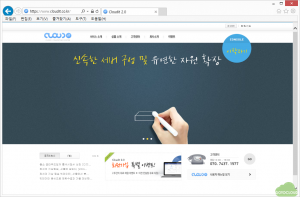

하단 중간에 보면 2주간 무료 체험이라는 회원 가입 특별 이벤트가 있는데 여기를 눌러서 일단 특별 이벤트의 내용을 확인해보자.

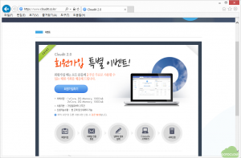

가입일로 부터 2주간에 1 vCore, 2G Memory, 100G Disk 또는 2 vCore, 2G Memory, 100G Disk를 최대 2개까지는 준다는 이벤트이다. 일단 2 vCore, 2G Memory, 100GB 디스크면 나쁘지 않은 사양으로 생각되어 한번 신청해보기로 하고 회원가입하기 버튼을 클릭한다.

회원가입을 선택하면 약관동의, 회원정보입력, 메일인증 등을 거치게 되어 있고 정보를 입력한 후에 메일을 확인하면 회원가입이 완료된다. 자세한 내용은 홈페이지 하단에 있는 Cloudit 사용자 메뉴얼 보기를 참조하기 바란다.

정상적으로 회원 가입을 완료하면 로그인이 성공했다는 화면이 보이는데 여기에서 Console 시작하기 버튼을 클릭한다.

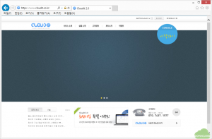

그러면 이번에는 납부자 정보를 입력하라고 나오는데 앞에서 회원 가입한 사항과 달리 여기에는 신용 카드 정보를 입력해야만 클라우드 서버 생성을 위한 Console에 접속이 가능하다고 한다. 상담을 해보니 2주 후에 업체에서 직접 전화를 해서 계속 사용 여부를 확인한 후 결제 정보로 결제가 진행된다고 하고 그 때 사용하지 않겠다고 하면 생성한 서버를 삭제하면 결제가 이루어지지 않는다고 한다. 신용 카드가 없는 사람은 상담을 통해 다른 방법으로 Console을 사용할 수 있도록 해준다고 한다.

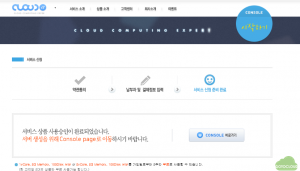

일단 신용카드 정보를 모두 입력하고 나면 위의 그림과 같이 CONSOLE 바로가기 버튼을 볼 수 있고 여기를 클릭하면 다음과 같은 클라우드 서버 관리를 위한 화면이 나타난다.

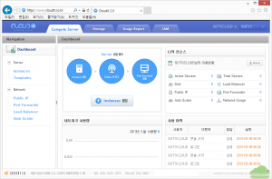

여기는 Server 생성 절차, 나의 리소스, 네트워크 사용량, 사용 이력 등을 볼수 있는 Dashboard 화면이 나타나 있는데, 아직 아무것도 한게 없어서 이용 현황은 모두 0으로 나타남을 알 수 있다.  위에는 Compute Server, Storage, Usage Report, IAM 등이 있는데 각각의 기능에 대해서는 메뉴를 눌러보면 확인할 수 있다. Cloudit의 기능과 특징에 대해서는 클라우드 지원 센터의 자료에 잘 설명되어 있다.

Compute Server는 사용중인 클라우드 서버 현황이나 서버 신청 등의 역할이고, Storage는 회원에게 웹하드와 같은 공유 파일 서버를 제공하는 기능이다. Usage Report는 사용이력 등을 보여주고 IAM은 내가 가입한 회원 아이디 아래에 추가로 사용자 그룹이나 계정을 추가해서 관리해주는 기능을 말한다. 즉 회사에서 회원을 가입하고 나서 직원들에게 다시 아이디를 생성해주고 그 직원은 자기 아이디로 로그인해서 서버를 관리하면 된다. 자세한 내용은 홈페이지의 서비스 소개 및 상품 소개를 참조하기 바란다.

## 2. 서버 생성하기

회원 가입을 완료하고 결제 정보까지 입력하여 Console 로그인에 성공했으므로 Console에서 서버를 생성한다.

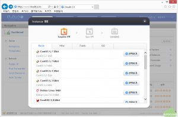

Console 화면의 Server 생성 절차에 있는 Instance 생성을 클릭하면 위의 그림과 같이 Cloudit 에서 지원하는 OS 별로 템플릿을 선택할 수 있다. 원하는 운영 체제 템플릿을 선택하고 다음으로 진행한다. 여기에서는 CentOS 6.3 64 bit를 선택하였다. 윈도우를 선택하게 되면 OS 비용을 별도로 지불해야한다.

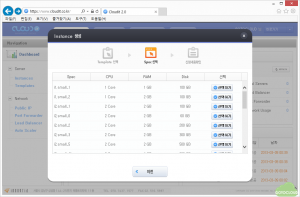

다음으로 생성할 서버의 사양을 선택하는 화면이 위와 같이 나타난다. 여기서는 생성할 서버의 vCore 개수, 메모리, 디스크를 선택할 수 있다. 2주간 무료로 제공하는 사양이 1 vCore, 2G Memory, 100GB Disk 또는 2 vCore, 2G Memory, 100GB Disk 이므로 둘 중의 하나를 선택한다. 다른 사양을 선택하면 과금이 바로 된다고 하니 주의해서 무료로 제공하는 i2.small_1 (2 vCore, 2G Memory, 100 GB)를 선택한다.

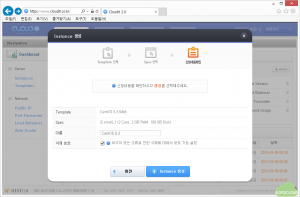

그 다음으로 생성할 서버의 이름을 입력하고 삭제 보호를 체크한다. 삭제 보호 기능은 실수로 서버가 삭제되는 것을 방지하는 기능이니 반드시 선택한다. 그리고 Instance 생성을 클릭하면 사용할 서버가 생성과정이 나타나고, 몇 분 안에 서버 생성이 완료된다.

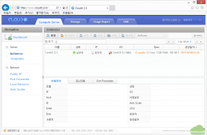

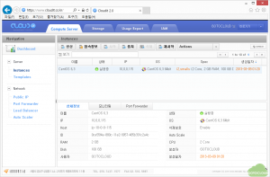

서버 생성이 완료된 후 생성된 서버를 선택하면 하단에 생성된 서버의 상세 정보가 나타난다. 여기에서 생성한 서버의 IP 주소는 사설 IP인 10.0.0.115로 부여되어 있는데, 이 주소를 공인 IP와 연결하는 과정은 다음 절에서 설명할 것이다.

## 3. 네트워크 설정

다음으로 생성한 서버에 접속하기 위한 설정을 진행한다. 인터넷 상에서 서버를 운영하기 위해서는 공인 IP (Public IP)를 고정 IP로 생성한 서버에 부여해야 한다. IP 주소에 대해서는 공인 IP, 사설 IP, 고정 IP, 유동 IP에서 설명한 내용을 참조하기 바란다.

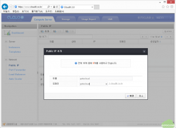

먼저 공인 IP를 할당받기 위해 Console 화면의 왼쪽에 있는 Network에서 Public IP 메뉴를 클릭한 다음에 상단의 추가를 선택하면 그림과 같이 Public IP 추가 창이 나타난다. 여기에 부여할 공인 IP의 이름과 도메인 이름을 원하는대로 입력하고 확인을 누른다.

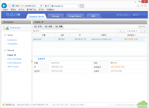

그림과 같이 180.182.51.132 라는 주소와 도메인 네임인 gotocloud.l.cloudit.co.kr 이라는 주소가 부여되었음을 알 수 있다. 별도로 고유한 도메인을 신청하지 않더라도 gotocloud.l.cloudit.co.kr 이라는 이름으로도 이 서버에 접속할 수 있다.

다음으로 부여받은 공인 IP를 생성한 서버에 연결하는 과정으로 진행한다. Console 화면의 Network에서 Port Forwarder를 선택한 후 추가 버튼을 누르면 Port Forwarder 추가 창이 나타난다.

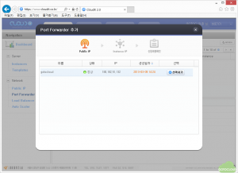

방금 부여받은 공인 IP인 gotocloud를 선택하면 다음의 Instance IP 화면이 나타난다.

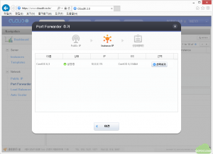

여기에서 생성한 서버를 선택한다. 여러 대의 서버를 생성하였을 경우 원하는 서버를 선택하면 된다. 선택하기를 누르면 다음과 같이 정보를 입력하는 창이 나타난다.

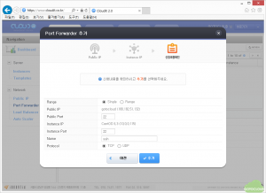

Public Port에 22, Instance Port에 22를 입력하고 Name에는 ssh라고 입력한다. 22번 포트는 리눅스 서버에 관리자가 ssh라는 Secure Shell에 접속하기 위한 포트이다. 다음으로 추가를 누르면 그림과 같이 Port Forwarder가 생성되었음을 알 수 있다.

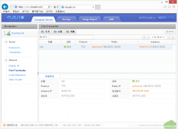

마찬가지로 웹접속을 위한 80 번 포트도 동일한 방식으로 추가한다.

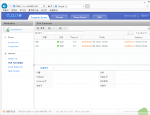

위와 같이 http와 ssh 포트가 Port Forwarder로 생성되었음을 볼 수 있다. 이 내용을 잠시 설명하자면 다음과 같다. 공인 IP, 사설 IP, 고정 IP, 유동 IP에서 사설 IP에 대해서는 인터넷에서 접속할 수 없다고 했고 공인 IP에 대해서만 인터넷에서 접속할 수 있다는 점을 설명했다. 따라서 Port Forwarder에서 생성한 내용은 다음과 같은 역할을 수행한다.

- Public (180.182.51.132:80) -> Instance (10.0.0.115:80)

이는 인터넷에서 180.182.51.132라는 주소로 80번 포트로 접속하게 되면 이 접속을 클라우드에서 생성한 서버인 10.0.0.115의 80번 포트로 연결하라는 의미이다.

- Public (180.182.51.132:22) -> Instance (10.0.0.115:22)

이는 인터넷에서 180.182.51.132라는 주소로 22번 포트로 접속하게 되면 이 접속을 클라우드에서 생성한 서버인 10.0.0.115의 22번 포트로 연결하라는 의미이다.

즉 위와 같이 Port Forwarder 설정을 통해서 공인 IP와 사설 IP를 포트 단위로 연결하게 되므로 사설 IP가 부여된 서버를 외부에서 접속이 가능하도록 하는 것이다. 서비스 별로 사용하는 포트는 여기에서 알아볼 수 있다. 만약 telnet 접속이 가능하도록 할 때는 23번 포트를 Port Forwarder에서 추가해주면 된다.

## 4. 서버 접속

이제 서버를 생성하고 접속할 수 있는 네트워크 설정을 완료했으므로 이제 서버에 접속해보도록 하자.

Console에서 왼쪽의 Instance 메뉴를 클릭하고 생성한 서버를 선택한 다음에 접속 정보라는 버튼을 클릭하면 다음과 같은 창이 나타난다.

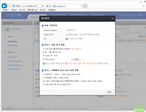

리눅스 서버 접속 방법에 먼저 ssh 접속 클라이언트를 다운받으라고 되어 있다. putty라는 프로그램을 http://winape.tistory.com/194 에서 다운로드해서 설치해 둔다. 그리고 접속방법 4)의 Password 옆에 있는 확인을 눌러서 초기 암호를 알아낸다. 확인을 클릭하면 사용자 암호를 입력하라는 창이 나오고 여기에 암호를 입력하면 다음과 같이 초기에 설정된 암호를 볼 수 있다.

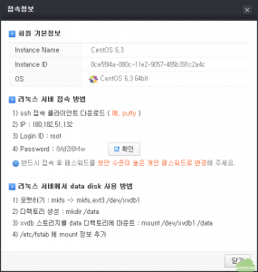

암호를 잘 기억해두고 설치한 ssh 클라이언트인 putty를 실행한다.

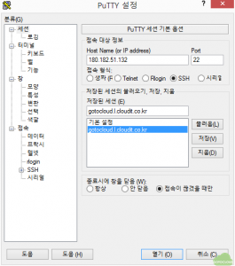

설정 화면에서 IP 주소와 저장된 세션에 이름을 입력하고 저장을 누른 다음 아래의 연결을 누르면 다음과 같이 서버에 접속된 화면이 나타난다. login as : 에 관리자 아이디인 root를 입력하고 password에 접속 정보 창에 있는 초기암호를 입력한 후 로그인한다.

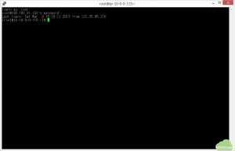

로그인에 성공하면 그림과 같이 명령을 입력할 수 있다. 로그인에 성공하면 passwd라는 명령어로 암호를 기억하기 쉬운 것으로 변경한다.

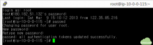

 

이상으로 Cloudit 이라는 클라우드 서비스 업체에서 클라우드 서버를 생성하는 과정을 순서대로 정리해봤다.

요약하자면 다음의 순서대로 나만의 서버를 생성할 수 있다.

> 회원 가입 -> 결제 정보 입력 -> 서버 생성 -> 공인 IP 할당 -> 포트 포워딩 -> 접속

생각보다 짧은 시간에 몇 번의 마우스 클릭으로 원하는 서버를 만들 수 있다는 점에서 상당히 편리하다는 것을 알 수 있다. 서버가 필요한 분들도 한번 시도해보기 바란다.
