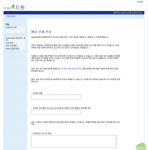

메일 서버를 직접 구축해서 메일을 보낼 경우 특정한 주소로는 메일이 차단되는 경우가 있다. 대표적으로 윈도우 라이브 메일은 동적 IP 대역으로 등록된 경우 또는 특정 서버가 포함된 대역 전체가 스팸 대역으로 정해져 있는 경우에 그 대역으로부터 발송되는 메일에 대해서 전달하지 않는다. 이를 해결하기 위하여 메일 서버의 IP를 제공하는 회선 공급 업체나 서버 호스팅 업체에 이에 대해서 메일 발송이 가능하도록 요청하거나 스팸으로 등록된 대역을 풀어달라는 요청을 해야하는데 생각보다 여러가지로 쉽지 않은 과정이다.

회선 공급 업체나 서버 호스팅 업체를 통하지 않고 직접 윈도우 라이브 메일에 메일 서버의 IP 대역이 정상적인 IP 대역임을 확인한 후 메일 전송이 가능하도록 요청할려면 다음의 방법을 따르면 된다.

MSN 지원 사이트(https://support.msn.com/eform.aspx?productKey=edfsmsbl2&ct=eformts&scrx=1) 에 접속하면 아래와 같은 화면이 나타난다.

위의 사이트에 다음의 정보를 입력한다.

- 연락처 이름: 요청자의 이름을 입력한다.

- 연락처 전자 메일 주소: 요청 결과를 회신받기 위한 메일 주소를 입력한다.

- 아웃바운드 IP 또는 범위: 해제를 요청하는 IP 주소를 xxx.xxx.xxx.xxx/24 와 같은 CIDR 형식으로 입력한다. IP 대역이 여러개가 있을 경우에는 xxx.xxx.xxx.xxx/28; yyy.yyy.yyy.yyy/28 과 같이 ; 로 분리하여 입력한다.

필요한 정보를 입력한 다음에 확인을 누른 후에 회신을 기다린다.
