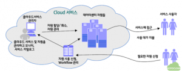
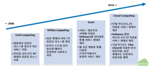
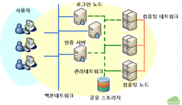
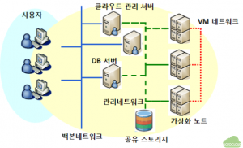
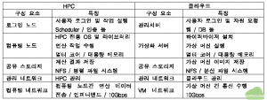
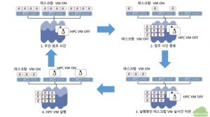

### 클라우드 인프라에서의 고성능 컴퓨팅

### (High Performance Computing on Cloud Infrastructure)

### 1. 서론

인류가 발명한 도구 중에서 현재 우리의 생활에 가장 밀접한 영향을 미치는 것으로 컴퓨터(Computer)를 들 수 있다. 컴퓨터라는 이름에서도 알 수 있듯이 컴퓨터는 계산(Compute)을 수행하는 도구를 통칭하는 것이다. 우리가 흔히 세계 최초의 컴퓨터라고 알고 있는 애니악(ENIAC, Electronic Numerical Integrator And Computer)의 개발 목적이 대포의 정확한 탄도 계산이었다는 것을 생각하면, 컴퓨터의 용도는 일차적으로 연산이라고 보는 것이 타당할 것이다. 이차 대전 종전 후 애니악은 난수연구, 우주선 연구, 풍동설계, 일기예보 등에도 이용되었다는 것만을 봐도 현재 우리의 생활에 가장 큰 도움이 되는 정보기술(IT) 분야의 가장 중요한 핵심 요소는 바로 연산을 수행하는 컴퓨터라고 봐도 무방할 것이다.

이와 같이 컴퓨터의 근본적인 목적인 고성능 컴퓨팅(High Performance Computing, HPC)이라는 분야는 지난 수십년 동안의 IT 기술 발전의 선도 역할을 수행해 왔음에 틀림이 없다. HPC 기술 발전의 결과물로 고성능 멀티 코어 프로세스, 저전력 서버 기술, 인피니밴드와 같은 고성능 네트워크 기술, 대용량 저장을 위한 스토리지 시스템 기술 등이 현실화되었으며, 이는 HPC 분야 뿐만 아니라 클라우드로 통칭되는 현대의 모든 IT 기술의 기반이 되었다고 해도 과장이 아니다.

그럼에도 불구하고 HPC는 대부분의 일반인뿐만 아니라 IT 분야 종사자들에게도 특별한 과학 기술 분야나 대용량 고속 연산을 필요로하는 소수의 전문가들에게만 필요한 분야라는 생각이 널리 퍼져 있는 것이 현실이다. 최근의 IT 분야의 가장 큰 화두는 클라우드, 빅데이터 등으로 알려져 있고 이에 대해서는 IT 종사자들은 누구나 한번은 들어보고 실제로도 클라우드 프로젝트를 기획하거나 진행하고 있지만 이러한 클라우드와 빅데이터 등이 HPC와는 전혀 별개라고 생각하는 경향이 많은 듯하다.

이 글에서는 HPC와 클라우드는 결코 별개의 개념이나 기술이 아니라는 관점에서 클라우드에서 구현 가능한 HPC 분야가 어떤 것이 있는지를 살펴본 후에 HPC와 클라우드가 구성 인프라와 요소 기술 측면에서 어떤 유사점과 차이점이 있는지를 알아볼 것이다. 그리고 이를 바탕으로 실제 구현 가능한 클라우드에서의 HPC 사례에 대해서 논하고자 한다.

### 2. 클라우드에서의 HPC

2.1 클라우드 컴퓨팅의 정의

클라우드에서 HPC를 구현하는 방안에 대해서 알아보기 전에 먼저 클라우드 컴퓨팅에 대해서 간략하게 살펴보기로 하자. 클라우드 컴퓨팅에 대해서는 여러 문헌에서 정의를 내리고 있는데, 그 중에서 몇 가지를 예로 들고자 한다.

- 가트너: 인터넷 기술을 활용하여 다수의 고객들로부터 높은 수준의 확장성을 가진 자원들을 서비스로 제공받는 컴퓨팅의 한 형태

- 포레스트 리서치: 표준화된 IT 기반 기능들이 IP 네트워크를 통해 제공되며, 언제나 접근이 허용되고 수요의 변화에 따라 가변적이며 사용량이나 광고에 기반한 과금 모형을 제공하는 웹 또는 프로그램적인 인터페이스를 제공하는 컴퓨팅

- 위키피디아: 인터넷에 기반한 개발과 컴퓨터 기술의 활용을 뜻하는 것으로 인터넷을 통해서 동적으로 규모화 가능한 가상적 자원들이 제공되는 컴퓨팅

- IBM: 웹 기반 어플리케이션을 활용하여 대용량 데이터베이스를 인터넷 가상 공간에서 분산처리하고 이 데이터를 PC, 휴대 전화, 노트북 PC, PDA 등 다양한 단말기에서 불러오거나 가공할 수 있게 하는 환경

위와 같이 클라우드에 대한 다양한 정의에도 불구하고 각 내용에서 공통적인 내용을 보자면 “네트워크를 통해 원하는 때에 원하는 자원을 이용하고 비용을 지불”하는 것으로 클라우드 컴퓨팅의 정의를 내릴 수 있다. 따라서 이글에서는 클라우드 컴퓨팅을 다음과 같이 정의하고자 한다.

- 하드웨어, 소프트웨어, 데이터 등 IT 자원을 네트워크를 통해 표준화된 “서비스” 형태로 제공하는 IT 사용방식인 동시에 비즈니스 모델

- 클라우드로 제공되는 IT 자원에 대해 사용자는 “언제, 어디서나, 어떤 단말을 통해서든 (Anytime, Anywhere, AnyDevice) 원하는 만큼을 사용하고 사용량에 따라 비용을 지불하는 모델

그림 1 클라우드 컴퓨팅 개념
위의 그림에서 볼 수 있듯이 클라우드 자원에 대해서는 언제 어디서나 사용자는 원하는 시점에 IT 자원을 신청하고 사용할 수 있게 된다. 이러한 관점에서 보자면 HPC를 제공하는 대부분의 슈퍼컴퓨터도 사용자가 원하는 시점에 HPC 자원을 신청하고 사용량에 따라 비용을 지불한다는 관점에서 클라우드와 기본적인 개념과 동일한 역할을 수행한다고 봐야할 것이다.

2.2 클라우드 컴퓨팅 발전 단계

2000년대 초반 고성능 컴퓨팅을 포함한 IT 분야에서 현재의 클라우드 못지않게 많은 관심을 끌었던 주제는 그리드(Grid) 컴퓨팅이라고 할 수 있다. 특히 대용량 HPC 자원 제공을 위해 다양한 컴퓨팅 자원을 연결해서 사용해보고자 하는 시도로 그리드 컴퓨팅에 대한 많은 연구가 진행되었는데, 이러한 그리드 컴퓨팅의 개념이 클라우드로 어떻게 확장되어 왔는가에 대해서는 다음의 그림에 잘 요약되어 있다.

그림 2 클라우드 컴퓨팅 발전 단계
대용량의 컴퓨팅 리소스를 필요로 하는 서비스 자원이나 인터넷 상의 PC 형태의 컴퓨팅 리소스를 연결하여 원하는 계산을 수행하자는 목적으로 시작된 그리드 컴퓨팅은 유틸리티 컴퓨팅이라는 단계를 지나 SaaS (Software- as-a-Service) 단계를 넘어 클라우드 컴퓨팅으로 확장되었다고도 볼 수 있다. 즉, 고성능 컴퓨팅 발전을 위한 기술인 그리드는 클라우드와 전혀 별개의 기술이 아니라 클라우드가 그리드를 포괄하는, 즉 다시 말하여 클라우드가 HPC를 포괄하는 개념이라는 것이 위의 그림으로 알 수 있다.

HPC와 클라우드의 연관성을 잘 보여주는 사례로 다음과 같은 사례를 들 수 있다.

- 사례 : 모 기업에서 근무하는 M 연구원은 신제품 설계 때마다 늘 컴퓨팅 파워 부족에 시달리는데, 연구에 필요한 컴퓨팅 자원 구매 품의를 올릴 때 마다 예산 부족으로 반려되고 있다. 매년 3~4 개월을 위해 컴퓨터를 사면 나머지 시간에는 뭐할 것이냐는 핀잔과 함께… 옆 사업부의 N 연구원도 동일한 고민으로 시달리고 있다. 두 연구원의 불만을 하소연하고 있는 자리에 동참했던 O차장이 “우리 회사의 ERP 장비는 12월부터 2월까지의 결산 기간에는 엄청나게 사용되는데 그 외의 기간에는 한가한데 그 장비를 사용할 수는 없나요?” 라면서 거들었다. 듣고 있던 두 연구원은 곰곰이 생각하더니, IT 부서에서 우리가 필요한 시기에 ERP 장비용으로 들어와 있는 자원의 일부를 제품 개발에 할당해 주면 어떨까 하는 아이디어가 떠올랐고, 이를 위해서 IT 부서에 한 장비로 두 가지 일을 원할 때에 할 수 있는 방안을 강구해달라고 요청하기로 했다.

위의 사례를 실제로 구현하기 위해서 필요한 것은 동일한 장비에서 용도가 다른 두 가지의 시스템을 운영하기 위한 (서로의 일에 영향을 미치지 않고) 가상화 및 프로비저닝인데 이는 클라우드의 필수적인 기술 요소로 이를 통해 클라우드 환경에서 HPC 구현이 가능하다는 것이 위 사례에서 알 수 있는 점이다.

### 3. 클라우드에서의 HPC 구현

이 절에서는 앞에서 설명한 내용을 바탕으로 클라우드에서 구현하기 용이한 HPC 분야와 인프라 구성의 특징 및 사례를 논하고자 한다.

3.1 클라우드에서 구현이 용이한 HPC 분야

먼저 클라우드에 적용하기 용이한 HPC 분야로 금융 공학 분야를 들 수 있다. 기존의 전통적인 HPC 분야인 과학기술 분야와 달리 파생 상품 개발, 환율 계산 및 보험 사의 변액 보험 손해액 산정 등에 있어서 HPC는 중요한 역할을 수행하고 있다. 특히 국내 금융사 중에서 많은 보험사들은 보험 상품의 건전성을 보험 감독 기관에 분기별로 보고하기 위하여 MoSes, MG-ALFA 등을 HPC 상에서 운영하고 있는데, 이러한 금융 분야 HPC 자원과 클라우드 컴퓨팅을 결합하고자 하는 시도가 국내에서도 이루어지고 있다.

이러한 금융 HPC의 주요한 특징은 다음과 같다.

- 다량의 분산 컴퓨팅(Distributed Computing) 자원을 요구한다.

- 몇 시간 내에 끝나는 연산을 수백에서 수천 번 수행한다.

- 특정 시기에 대용량의 컴퓨팅 자원을 필요로 한다.

금융 분야의 HPC는 특정 순간(한국의 경우 금융 감독 기관의 분기별 감사 보고서 요구 시기)에 수많은 CPU 자원을 사용하여 금융 상품 해석을 수행하는데 한 번의 계산이 보통 8시간 정도로 수백에서 수천 케이스를 해석을 수행하는 것이 일반적이다. 그리고 이 때 CPU 자원이 많으면 많을수록 더 정확한 결과 값을 산출할 수 있으며 이를 통해 상품의 건전성 및 이윤이 확보된다고 한다. 이와 유사한 유형의 HPC 분야로는 핸드폰에 필요한 칩의 물성치 산출에 사용되는 몬테카를로(Monte Carlo) 시뮬레이션을 들 수 있을 것이다.

3.2 클라우드와 HPC의 인프라 구성 방안 비교

이 절에서는 클라우드와 HPC 인프라의 구성 방안과 구성 요소의 특징에 대해서 살펴보고자 한다. 먼저 일반적인 고성능 연산에 필요한 HPC 인프라 구성은 다음의 그림에 잘 나타나 있다.

그림 3 일반적인 HPC 인프라 구성
그림 3과 같이 대부분의 HPC 시스템은 몇 대의 로그인 노드, 인증 서버와 실제 연산을 수행하는 멀티 코어로 구성된 수십에서 수백 대의 컴퓨팅 노드 및 공유 스토리지로 구성되어 있으며, 내부 네트워크로 관리 네트워크와 고속의 연산 데이터 교환을 위한 컴퓨팅 네트워크로 구성된다. 특히 낮은 네트워크 지연(low latency)을 보장하는 인피니밴드가 컴퓨팅 네트워크로 많이 사용되고 있다. 그러나 금융 분야 HPC와 같은 다량의 분산 컴퓨팅이 요구되는 HPC에서는 컴퓨팅 네트워크로 1Gbps나 10Gbps의 이더넷으로 구성하여도 연산에 큰 영향을 받지 않는다는 특징이 있다.

다음으로 일반적은 클라우드 인프라 구성을 살펴보고자 한다. 그림 4에 일반적인 클라우드 컴퓨팅 인프라 구성이 나타나 있다. 대부분의 클라우드 컴퓨팅 환경은 몇 대의 클라우드 관리 서버, 인증 및 클라우드 환경 구성을 저장하는 DB 서버, 가상 머신이 구동되는 멀티 코어로 구성된 수십에서 수백 대의 가상화 서버 및 가상 머신(VM)의 이미지를 저장하기 위한 공유 스토리지로 구성된다. 그리고 내부 네트워크로 클라우드 관리를 위한 관리 네트워크, 가상 머신 간의 서비스 통신을 위한 VM 네트워크가 포함된다. 클라우드 인프라에서의 네트워크는 일반적으로 높은 대역폭을 지원하는 10Gbps 이더넷이 사용된다.

그림 4 일반적인 클라우드 인프라 구성
그림 3의 HPC 인프라 구성과 그림 4의 클라우드 인프라 구성을 비교해 보면 HPC의 인피니밴드 네트워크를 제외하고는 두 가지가 구성 방법이나 구성 요소 측면에서 대단히 유사하다는 것을 알 수 있다. 다시 말하면 클라우드 인프라 구성이나 HPC 인프라 구성이나 인프라 측면에서는 유사한 구성형태를 갖는다고 볼 수 있다.

표 1 HPC와 클라우드 비교
표 1에는 HPC와 클라우드의 주요 구성 요소의 특징을 비교 하였다. HPC와 클라우드의 가장 큰 차이점은 인피니밴드의 사용 여부 및 대용량 파일 시스템으로 병렬 파일 시스템과 분산 파일 시스템을 각각 주로 채용한다는 것을 들 수 있다. 그리고 클라우드의 가상화 서버에는 HPC의 컴퓨팅 노드와는 달리 가상 머신의 하이퍼바이저가 기본적으로 설치됨을 알 수 있다.

3.3 클라우드에서 HPC 구현 사례

앞의 절에서 설명한 내용을 바탕으로 클라우드에서 구현하기 용이한 금융 분야 HPC의 특징을 요약하면 다음과 같다.

- 다량의 분산 컴퓨팅(Distributed Computing) 자원이 특정 시기에 필요

- 한 번의 연산은 일정 시간 동안 수행

- 각 연산 노드 간에는 네트워크 통신이 불필요

- 병렬 파일 시스템이 필요하지 않은 결과 값만 저장

이와 동시에 위의 HPC를 구현하기 위한 클라우드의 특징은 다음으로 요약할 수 있다.

- 클라우드에서 실행되는 가상 머신은 일정 시간에 On-Off 수행

- 멀티 코어 및 대용량 메모리를 보유한 가상화 서버로 구성

이와 같은 특징을 갖는 클라우드 구성 사례로 가장 적합한 것으로는 금융 기관이나 연구소에서 많이 구축하여 운영하고 있는 데스크탑 클라우드(VDI, Virtual Desktop Infrastructure)를 들 수 있다. 데스크탑 클라우드에서는 직원들의 주간 업무 시간에만 대부분의 가상 머신이 운영되고 퇴근 후에는 대부분의 가상 머신이 종료된다는 특징을 갖고 있다.

따라서 데스크탑 클라우드가 구축되어 있는 금융 기관이라면 퇴근 후부터 익일 출근 전까지의 일정 시간 동안을 위에서 논한 금융 분야 HPC 가상 머신을 운영한다면 막대한 비용을 들여 구축한 클라우드 인프라를 HPC에도 사용할 수 있게 되어 인프라 효율성 증대에 큰 기여가 가능할 것이다.

이러한 개념을 바탕으로 실제 데스크탑 클라우드에서 HPC를 운영하는 과정은 다음의 그림으로 설명할 수 있다.

그림 5 데스크탑 클라우드에서의 HPC VM 실행 과정
위의 그림에서 주간 업무 시간에는 클라우드 환경에서 업무용 데스크탑 VM이 실행되고 HPC VM은 종료 상태로 공유 스토리지에 저장되어 있다. 업무 시간이 끝나면 퇴근한 직원의 데스크탑 VM은 종료 상태로 공유 스토리지로 저장되고 계속 실행되는 데스크탑 VM은 하이퍼바이저의 실시간 이전(live migration)을 통해 한쪽 가상화 서버로 집중된다. 이 상태에서 비어 있는 가상화 서버에 HPC VM이 시작되고 연산이 수행된다. 그리고 다시 출근 시간이 되면 HPC VM은 종료되고 데스크탑 VM이 실행되는 과정을 반복하게 된다.

물론 연산에 사용되는 HPC VM은 물리적인 전용 HPC 컴퓨팅 노드에서 수행될 경우에 비해 하이퍼바이저 오버헤드로 인해 약 3~5% 정도의 성능 저하는 발생할 수 있다. 그러나 원래 HPC 장비가 아닌 클라우드를 활용함으로써 더 많은 컴퓨팅 리소스를 확보할 수 있기 때문에 충분히 이러한 오버헤드는 상쇄되고도 남을 것이다.

이 개념은 실제 구현이 검토된 사례로 데스크탑 클라우드를 구축한 수많은 금융 기관 또는 연구기관 등에서 도입가능한 시나리오라고 볼 수 있을 것이다. 물론 이를 위해서는 추가적으로 HPC 작업 스케줄러와 클라우드 프로비저닝 툴의 연동, 하이퍼바이저 오버헤드 감소, 가상 머신 자원 동적 배치 기술 등의 개선이 필요하지만 이에 대해서는 클라우드 분야에서 계속 연구되고 있는 기술이므로 조만간 실현될 것이다.

### 4. 결론

이 글에서는 현재 널리 확산되고 있는 클라우드에서 HPC를 구현하는 방안에 대해서 개략적으로 살펴보았다. HPC는 연구와 수치해석 분야에서만 필요로하는 기술로 알려져 있고, 클라우드는 IT 서비스에서 주로 필요한 기술로만 알려져 있지만, 기본적인 인프라 구성과 요소 기술은 유사하다는 관점에서 클라우드에서 HPC를 구현하고자 하는 시도는 충분히 실현 가능하다. 이를 통해 클라우드와 HPC 인프라를 통합함으로써 궁극적으로 원하는 시간에 원하는 컴퓨팅 자원을 사용할 수 있다는 클라우드의 개념에 HPC도 포함될 수 있다는 것이 이 글에서 강조하고자 하는 점이다.

이 글에서는 현재까지의 대표적인 구현 사례로 금융 분야 HPC를 금융 기관에 구축되어 있는 데스크탑 클라우드에서 수행하는 것을 들었으나 서버가 주로 운영되는 일반적인 클라우드 환경에서도 가상 머신의 재배치 기술 및 프로비저닝 툴과 HPC의 작업 스케줄러의 연동 기술 발전을 통해 충분히 유사한 형태로 HPC를 적용하는 것이 가능할 것으로 판단된다. 이와 더불어 분산 컴퓨팅 분야 외에도 하이퍼바이저의 PCI Passthrough 기능의 발전과 더불어 인피니밴드와 같은 고속 네트워크 디바이스를 VM에서 직접 액세스가 가능해진다면 MPI 기반의 병렬 프로그램 수행 환경도 클라우드에서 구현이 가능할 것으로 생각된다.

주) 이 글은 모 학회지에 클라우드와 HPC의 융합에 관한 기고글을 인용한 내용이다.
