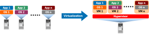
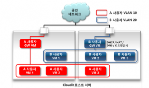
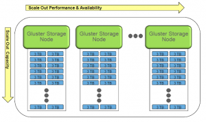
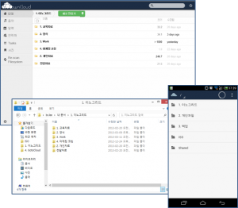
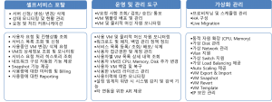
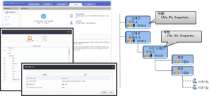

## 3. 클라우드 컴퓨팅 기반 기술

앞에서 설명한 클라우드 컴퓨팅 개요에 이어 이 절에서는 클라우드 컴퓨팅을 구현하는데 필수적으로 사용되는 기반 기술에 대해서 논하고자 한다. 클라우드 컴퓨팅의 기반이 되는 기술에는 하이퍼바이저(hypervisor)로 알려져 있는 서버 가상화 기술, 가상 라우터(Virtual Router)를 기반으로 한 네트워크 가상화 기술, 스토리지 클라우드를 위한 분산 스토리지 및 파일 동기화 기술, 클라우드 운영 관리를 담당하는 Stack 기술 및 사용자 권한 관리, 셀프 서비스 포탈 등이 포함된다. 이 외에도 다양한 IT의 기반 기술이 클라우드 컴퓨팅에 사용되고 있으나, 클라우드 컴퓨팅 인프라를 구성하고 클라우드 서비스를 제공하기 위해서는 여기서 언급한 기반 기술이 필수적이라고 할 수 있다.

### 3.1 서버 가상화 – Hypervisor

서버 가상화는 독립적인 CPU, 메모리, 네트워크 및 운영 체제를 갖는 여러 대의 가상 머신(Virtual Machine)들이 물리적인 서버의 자원을 분할해서 사용하는 기술을 의미한다. 물리적 하드웨어 상에서 가상 머신에 대한 운영을 담당하는 플랫폼을 하이퍼바이저(Hypervisor)라고 통칭하며 VMM (Virtual Machine Monitor)라고도 부른다.  서버 가상화 기술은 1960년 대부터 메인프레임의 논리적 파티션(Logical Partition)이라는 형태로 적용되기 시작하여 Unix 상에서도 널리 활용된 기술이며 최근에 와서는 VMware의 ESX 서버, Xen, KVM, Hyper-V 등 x86 서버의 가상화에 널리 이용되고 있다.

그림과 가상화 기술은 여러 대의 서버에서 실행되던 OS와 어플리케이션을 하나의 고성능 서버에 통합하여 가상 머신으로 운영하는 것을 의미한다. 가상화에 대한 전반적인 설명은 기업 경쟁력 강략화를 위한 가상화 전략을 참고하기 바란다.

### 3.2. 네트워크 가상화 – 가상 라우터(Virtual Router)

다음으로 클라우드 컴퓨팅의 구현 기술 중에서 가상화와 큰 차이를 보이는 것으로 네트워크 가상화 기술을 들 수 있다. 서버 가상화와 클라우드 컴퓨팅의 차이에 대해서는 서버 생성이라는 관점에서 서버 가상화 솔루션과 클라우드 솔루션 비교라는 글에서 논한 바 있는데 서버 생성 외에도 네트워크 가상화와 이를 위한 가상 라우터(Virtual Router) 지원이르는 관점에서 큰 차이를 보인다. 클라우드 환경에서는 다양한 사용자가 원하는 때에 원하는 IT 자원을 제공받게 되는데, 이 때 각 사용자 별로 네트워크를 격리하고 격리된 네트워크가 인터넷과 통신을 하도록 하는 가상 라우터가 가장 중요한 역할을 하게 된다.

위의 그림에서 볼 수 있듯이 클라우드 상에서 A라는 사용자가 자신이 사용할 가상 머신을 생성하게 되면 이에 대해서는 사설 IP가 VLAN으로 자동으로 할당된다. 이렇게 할당된 사설 IP 대역의 A 사용자 가상머신은 자신에게 할당된 가상 라우터인 Gateway VM A를 통해서 인터넷과 통신을 수행하게 되며, 마찬가지로 B 사용자는 자신의 VM 간에만 격리(isolatiton)된 VLAN으로 통신을 주고 받으며 Gateway VM B를 통해서 인터넷과 연결된다. 이 때 물리적인 네트워크 인터페이스는 공유하더라도 각 사용자 간의 VM은 서로 다른 사용자의 VM과 통신이 격리되어 서로 통신이 차단된다. 이 때 가상 라우터는 격리된 사용자 별 VLAN 대역 내에서 내부 VM의 IP에 대한 할당을 수행하는 DHCP 서버, 외부 통신을 위한 NAT,  VLAN에 속한 VM의 DNS 서비스 및 필요시에 로드밸런싱 기능까지를 수행하게 되며, 격리된 VLAN은 가상 스위치(Virtual Switch)를 통해 연결된다. 이와 같은 네트워크 격리 및 가상 라우터 지원을 포괄하는 기능을 네트워크 가상화라고 한다.

### 3.3 분산 스토리지 및 파일 동기화

클라우드 디스크(또는 스토리지 클라우드) 서비스에서는 사용자 별로 일정량의 저장 공간을 인터넷 상에서 제공하고 있다.  이러한 서비스에서는 사용자의 수가 증가함에 따라 스토리지 용량은 수 테라바이트에서 수십, 수백 테라바이트에 이르게 되는데, 단일한 스토리지로는 이와 같은 대용량 저장 공간을 제공하는 것이 불가능하게 된다. 따라서 단일 스토리지를 네트워크로 연결하여 대용량의 저장 공간을 제공하는 분산 스토리지가 필요하게 된다. 분산 스토리지의  개념은 다음의 그림에 잘 나타나 있다.

분산 스토리지에서는 그림과 같이 단일한 스토리지 서버를 선형적으로 연결하여 용량이 늘어나는 형태로 구성되며 이를 지원하는 파일 시스템으로 분산 파일 시스템(Distributed File System)이 널리 개발되어 왔다. 분산 스토리지를 통해 클라우드에서는 Scale-out NAS 형태로 파일 서버를 네트워크를 통해서 연결하고 이를 논리적으로 하나의 스토리지처럼 사용하게 된다. 클라우드에서 많이 사용되는 대표적인 분산 스토리지 기술로는 Google File System,  GlusterFS, OpenStack Swift 외에도 많은 기술이 개발되어 있다. 이에 대해서는 클라우드 컴퓨팅을 위한 분산 파일 시스템 기술 동향이라는 글을 참고하기 바란다.

스토리지 클라우드에서는 대용량의 분산 스토리지에 데이터를 저장하고 다양한 디바이스(모바일, 컴퓨터, 태블릿 등)에서 이를 다운로드하고 사용하기 위하여 파일 동기화 기술도 필수적으로 요구된다. 우리가 흔히 사용하고 있는 네이버의 N 드라이브, 다음 클라우드, Dropbox와 같은 클라우드 디스크 서비스에서는 로컬 디바이스의 특정 폴더의 파일을 클라우드 스토리지에 자동으로 업로드하고 변경된 파일을 동기회해주는 클라이언트 어플리케이션이 제공되는데 이와 같은 클라이언트의 주요한 기능이 로컬 파일과 스토리지 클라우드의 데이터를 동기화하여 항상 같은 내용으로 유지시켜주는 것이다. 이를 통해 다음의 그림과 같이 웹을 통해서 파일을 엑세스할 수 도 있을 뿐 아니라 PC의 데이터와 동기화 시키고 동시에 이를 모바일에서 다운로드하거나 모바일 장치에서 생성한 사진 등을 자동으로 클라우드에 저장하게 된다.

### 3. 4 클라우드 운영 관리 – Stack

서버 가상화 기술, 네트워크 가상화 기술 및 분산 스토리지 기술이 클라우드 구성 아키텍처 상에서 가상화 Layer의 기본이 되는 기술이라고 한다면 Stack은 프로비저닝 및 클라우드 서비스 관리 Layer를 포괄하는 기술이라고 할 수 있다. Stack의 주요 기능은 가상 서버의 생성 및 관리, 가상 네트워크 관리, 사용자 및 그룹 관리, 클라우드 운영 관리 및 미터링을 포함한 클라우드 통합 모니터링을 포괄하는 기술이라고 할 것이다. 클라우드에서 Stack이 수행하는 주요 기능이 다음의 표에 나타나 있다.

클라우드에서 Stack 역할을 수행하는 대표적인 솔루션으로 CloudStack, OpenStack 등 오픈소스 기반의 클라우드 Stack 솔루션을 들 수 있고, 상용으로는 Microsoft의 System Center 2012, VMware의 vCloud 외에도 국산 기술인 Cloudit 등이 여기에 해당된다.

일반적으로 Stack에는 사용자와 관리자를 위한 셀프 서비스 포털이 포함되는데, 셀프 서비스 포털에서는 사용자가 직접 가상 자원 생성과 네트워크 할당을 직접 수행하고 관리자는 클라우드 전체에 대한 운영 관리 및 모니터링을 수행한다. 셀프 서비스 포탈을 통한 서버 생성에 대해서는 클라우드 서버 생성을 참조하기 바란다.

셀프 서비스 포탈 및 계정 관리와 더불어 클라우드에서 가장 중요한 기술 중의 하나가 권한 관리이다. 클라이드에서는 관리자에서부터 클라우드를 사용하는 일반 사용자에 이르기까지 각 구성원 및 그룹의 권한을 세분화하고 권한에 따라서 클라우드에서 수행할 수 있는 역할을 명확하게 구분할 수 있어야만 한다. 예를 들어 일반 사용자는 자신이 생성한 가상 자원에 대해서만 권한을 가져야 하며 다른 사용자의 자원에 대해서는 접근이 불가능해야 한다. 마찬가지로 각 그룹 관리자는 자신의 그룹에 속해 있는 사용자에 대해서만 관리가 가능해야한다. 반면 클라우드 최고 관리자는 클라우드 전체에 대한 관리 권한을 가져야한다. 그럼에도 불구하고 클라우드 관리자가 사용자의 가상 머신 자체의 관리자(VM Administrator)의 권한을 가져서는 안된다는 점도 중요한 클라우드 기술 요구 사항이라고 볼 수 있다.

위의 그림에 사용자 권한 관리에 대한 예가 나타나 있다. 이와 같이 사용자의 권한에 대한 세부적인 관리 기술도 클라우드를 구성하는 주요 기반 기술 중의 하나이다.

이 절에서는 클라우드를 구성하는 주요 기술인 서버 가상화, 네트워크 가상화, 분산 스토리지와 파일 동기화, Stack, 셀프 서비스 포탈 및 권한 관리에 대해서 살펴 보았다. 대부분의 클라우드 솔루션에는 위의 기술은 공통적으로 포함되어 있으며 이러한 기반 기술 외에도 추가적인 다양한 IT 기술이 포함되어 클라우드가 완성된다. 다음 절에서는 지금까지 설명한 내용을 개념과 기술을 기반으로 실제 클라우드 서비스 구현에 대해서 설명하고자 한다.
