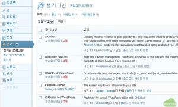
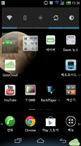
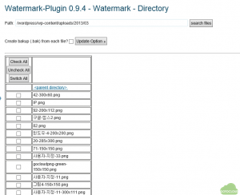
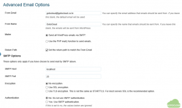
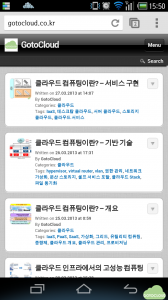
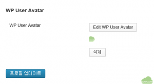

워드프레스는 기본 패키지 이외에도 수많은 플러그인을 통해 다양한 부가 기능을 구현할 수 있다. 워드프레스 플러그인에 대해서는 워드프레스 플러그인 홈페이지에 잘 나와 있으며 무료 플러그인 뿐만 아니라 유료 플러그인도 많이 제공되고 있다. 이 글에서는 GOTOCLOUD 사이트에서 사용중인 플러그인에 대해서만 간략하게 정리하고자 한다.

현재 설치되어 있는 워드프레스 플러그인은 관리자로 로그인한 후 알림판 -> 플러그인 -> 설치된 플러그인에서 살펴볼 수 있다. GOTOCLOUD에서 사용중인 플러그인은 다음과 같다.

- Captain Favicon : 워드프레스 Favicon을 생성해주는 플러그인이다. 플러그인 추가에서 favicon이라고 검색하면 나오는 플러그인 중에서 선택하여 설치해봤는데, 모바일에서는 favicon이 잘 나타나는데 익스플로러에서는 여전이 favicon이 안보인다. 설정문제인지 좀더 살펴볼 필요가 있을 듯 하다.

그림처럼 모바일에서 GotoCloud 사이트의 favicon을 볼 수 있다.

- Marekkis Watermark-Plugin : 워드프레스에 추가되는 그림에 사용자가 지정한 워터마크를 추가해주는 플러그인이다. 대부분의 플러그인이 그림을 추가하는 순간 워터마크가 추가되는데, 이 플러그인은 기존에 업로드되어 있는 사진에 대해서도 일괄 워터마크를 추가할 수 있다는 장점이 있다.

그림처럼 이미 등록되어 있는 이미지를 선택하여 워터마크를 삽입할 수 있다. 그림에서 오른쪽 하단에 있는 GotoCloud 로고가 삽입된 워터마크이다.

- Simple Visitors Counter : 사이트를 방문한 사용자 수를 표시해주는 플러그인이다. Google Analystics와 같이 사이트 분석 도구를 연결할 수도 있는데 이 플러그인은 별도의 설정 없이 바로 사용자 수를 보여준다는 점에서 굉장히 심플하다.

- WP-Mail-SMTP : 댓글이 달리거나 핑백이 있을 때 메일을 발송해주는 플러그인이다.

그림처럼 워드프레스에서 발송되는 메일의 주소와 이름을 지정할 수 있고, 메일 발송 프로그램으로 서버의 SMTP를 사용하거나 워드프레스 프로그램에 포함된 PHP 메일을 사용할 것인지를 지정할 수 있다. 그리고 SMTP를 사용할 경우 메일 서버의 주소 및 포트를 지정할 수 있다. 메일 서버를 구축하지 않았을 경우 Google 메일 등을 통해 메일을 발송할 수 있다.

- WPtouch : 워드프레스 모바일 테마를 자동으로 보여주는 플러그인이다. 플러그인 검색에서 mobile로 검색하면 다양한 모바일 플러그인이 나오는데, 그 중에서 별도의 설정 없이 알아서 모바일에서 접속할 경우 테마를 변경해서 보여준다.

- WP User Avatar : 사용자의 아바타를 표시해주는 플러그인이다. 사용자 프로파일 편집 페이지에서 그림과 같이 아바타 이미지를 등록하면 된다.

