개인용 클라우드 – 1. 메일 서버 설치에서 오픈 소스 기반의 메일 서버인 iRedMail 설치 과정을 설명하였다. 앞의 글에서도 언급하였듯이 단순히 메일 서버만을 설치하고 메일 서비스만을 이용하는 것이 이글의 목적이 아니라 메일 서비스를 중심으로 구글이나 마이크로소프트와 같이 개인용 클라우드 서비스를 오픈 소스 기반으로 사설 클라우드 환경으로 통합하는 것이 목적이라는 것을 염두에 두고 설치된 메일 서버를 구성하기로 한다.

## 1. 사전 준비 사항

메일 서버 구성을 위해서 다음 사항이 미리 준비되어 있다고 가정한다. 이 글에 따라서 메일 서비스를 구성하고자 하는 독자는 이글에서 설명하는 필요 사항에 대해서 미리 준비해두고 따라해보기 바란다.

- iRedMail 서버 : iRedMail 이 설치된 서버 (개인용 클라우드 – 1. 메일 서버 설치 참조)

- 공인 IP 주소 : 메일 서비스를 위하여 메일 서버에 필요한 공인 IP를 할당받아 서버에 설정한다. 이 과정은 개인용 클라우드 – 1. 메일 서버 설치에서 설명한 과정을 따른다.

- 도메인 : 메일을 수신할 조직의 도메인을 확보한다. 도메인은 신청기관에 요청하여 미리 받아둔다. 이 글에서는 gotocloud.kr 이라는 도메인을 예제로 사용할 것이다.

- DNS (Domain Name Service) 서버 : 메일 교환 레코드(MX Record) 설정이 가능한 DNS 서버 또는 DNS 등록이 가능한 도메인 제공 업체의 DNS 서비스

위의 사항을 준비한 후 메일 서버 구성을 진행하기로 한다.

## 2. 네임 서버 설정

할당받은 도메인과 공인 IP 주소 및 메일 서버로 사용할 호스트 네임을 다음과 같이 정하고 네임 서버에 등록한다.

- 도메인 : gotocloud.kr

- 공인 IP 주소 : 123.123.123.123 (반드시 사용자가 할당 받은 IP를 입력해야 한다)

- 호스트 네임 : mail.gotocloud.kr

메일 서버 호스트 네임은 서버 내에서 설정된 호스트 네임인 mail.local을 사용하는 것이 아니라 외부에서 메일 서버로 접속할 수 있는 mail.gotocloud.kr을 지정한다. 위의 설정에 대해서 네임 서버의 TYPE/MXP, HOST 및 RECORD에 다음과 같이 추가한다.

> TYPE / MXP         HOST                                    RECORD
> A                              mail.gotocloud.kr               123.123.123.123
> MX      10               @.gotocloud.kr                    mail.gotocloud.kr

위에서 “A     mail.gotocloud.kr         123.123.123.123“는 mail.gotocloud.kr 이라는 호스트 네임의 IP 주소가 123.123.123.123라고 네임 서버에 지정해 주는 항목이다. 다음으로 “MX   10    @.gotocloud.kr     mail.gotocloud.kr”은 gotocloud.kr 도메인으로 오는 모든 메일은 mail.gotocloud.kr 서버로 전달하라는 항목이다. 위와 같이 설정할 경우 userid@gotocloud.kr 이라는 메일이 수신되면 MX 레코드에 따라서 메일을 mail.gotocloud.kr 서버의 주소인 123.123.123.123으로 전달하게 된다. MX 다음의 10은 우선 순위를 지정하는 필드로 메일 서버가 여러 대가 있을 경우 우선 순위에 따라서 메일 서버에 전달된다.

네임 서버 설정이 정상적으로 완료되면 주소창에 https://mail.gotocloud.kr 을 입력하면 다음과 같이 RoundCube 웹메일 로그인 창이 나타나면 된다.

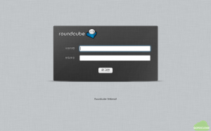

## 3. iRedMail 설정

### 3.1 메일 서버 관리툴 접속 및 관리자 암호 변경

메일 서버 설정을 위해 https://mail.gotocloud.kr/iredadmin 을 주소창에 입력하여 관리 툴을 실행한다. 로그인 창에 설치 시에 지정한 iRedMail 관리자 계정인 postmaster@gotocloud.local 과 암호를 입력한다. 여기에 대해서는 개인용 클라우드 – 1. 메일 서버 설치를 참조하기 바란다. 로그인에 성공하면 다음과 같은 관리 화면이 나타난다.

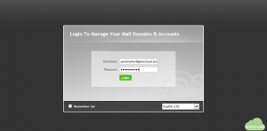

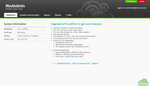

상단 메뉴에서 Admins 탭을 선택한 후 postmaster 계정에서 Edit account profile을 클릭하면 postmaster@gotocloud.local  관리자 계정의 프로파일이 나타난다.

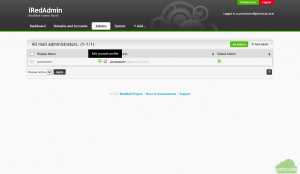

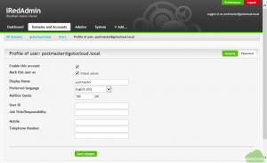

먼저 우측 상단의 Password를 선택하여 postmaster@gotocloud.local 계정의 암호를 변경한다.

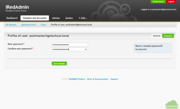

### 3.2 gotocloud.kr 도메인 추가

메일 서버 관리자 postmaster@gotocloud.local 의 암호를 변경한 다음 메일 서버에서 사용할 실제 도메인인 gotocloud.kr 도메인을 추가하고 gotocloud.kr 도메인의 관리자를 다음의 과정으로 추가한다.

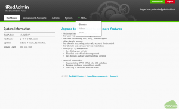

위의 그림과 같이 관리툴에서 +Add… 탭의 Domain 을 선택한다.

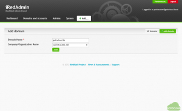

Add domain 창이 실행되면 Domain Name에 gotocloud.kr 과 Company/Organization Name에 조직의 이름을 원하는대로 입력한 후 Add를 누른다.

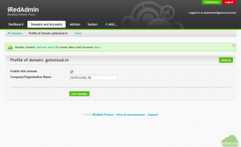

Add를 누르면 위의 그림과 같이 생성된 gotocloud.kr 도메인의 프로파일이 표시되며 이 도메인을 활성화할 것인지를 체크한 후 Save changes를 눌러서 저장한다. iRedMail은 여러 개의 도메인을 추가할 수 있는 기능을 지원하므로 gotocloud.kr 이외에 다른 메일 도메인을 추가하고자 할 경우에는 위의 과정을 반복하면 된다.

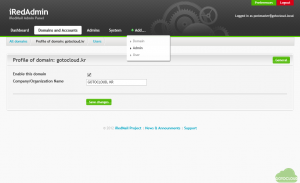

다음으로 gotocloud.kr을 관리하기 위한 관리자 계정을 추가한다. +Add… 탭의 Admin을 선택하여 관리자 추가 화면을 실행한다.

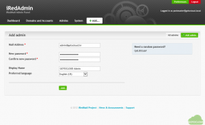

관리자 추가 화면에서 admin@gotocloud.kr 이라는 계정을 gotocloud.kr 도메인 관리자 계정으로 생성하고 암호 및 표시 이름을 위와 같이 입력한 후 Add를 눌러 추가하면 아래의 그림과 같이 admin@gotocloud.kr의 프로파일이 표시된다.

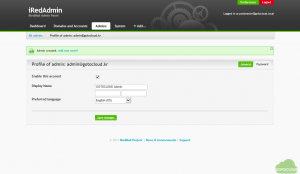

Admins 탭을 선택하면 아래와 같이 전체 관리자인 postmaster@gotocloud.local과 방금 생성한 GOTOCLOUD Admin 두 개의 관리자 계정이 생성되어 있음을 알 수 있다.

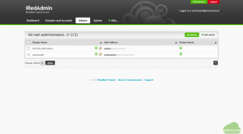

위에서 보면 admin@gotocloud.kr 도 Global Admin으로 생성이 되는데 iRedMail Pro 버전에서는 도메인 별로 관리 권한을 분산 시킬 수 있다. 이 글에서는 Free 버전이므로 admin@gotocloud.kr 도 postmaster@gotocloud.local 과 동일한 권한을 갖는다는 제약이 있지만 관리 효율성과 향후 Pro 버전 도입을 통한 도메인 별 관리를 위해서 도메인 별로 관리자를 생성하는 과정을 설명하였다. 한 메일 서버에서 여러 개의 도메인을 지원하면서 도메인 관리자를 별도로 지정하고자 할 경우에는 Pro 버전을 사용하기 바란다.

### 3.3 gotocloud.kr 사용자 추가

이제 gotocloud.kr에 메일 사용자를 다음의 과정으로 추가한다. https://mail.gotocloud.kr/iredadmin을 주소창에 입력하고 관리자로 생성한 admin@gotocloud.kr로 로그인한다. 앞에서 설명한 바와 같이 gotocloud.kr에 대한 관리는 admin@gotocloud.kr 을 사용하도록 한다.

로그인 후 +Add… 탭의 User를 눌러 사용자 추가 화면을 실행한다. 원하는 사용자 계정을 아래의 그림과 같이 생성한다. 여기에서는 gotocloud@gotocloud.kr 이라는 계정을 생성하는 과정을 설명하고 있다.

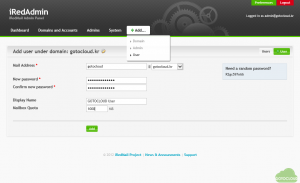

사용자 추가 화면에서 메일 주소, 암호 및 표시 이름과 메일 용량을 지정하고 Add를 누르면 다음과 같이 생성한 계정에 대한 상세 프로필이 표시된다.

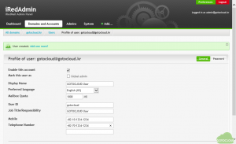

위의 상세 프로필에서 필요한 정보는 모두 입력하면 LDAP 서버에 정보가 저장되어 추후 웹메일 등에서 사용자 주소록에서 상세한 정보를 볼 수 있다. 그리고  메일 계정과 별도로 User ID를 생성하면 이를 이용하여 LDAP으로 연동된 다른 서비스에 로그인할 수 있으므로 User ID 입력을 권장한다. 사용자 계정에 관리자 권한을 부여하고자 한다면 Global admin 을 체크한다. 관리자 권한이 없을 경우에는 관리툴에 로그인할 수 없다.

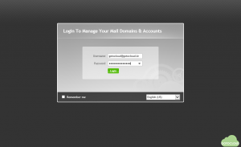

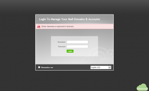

위의 그림과 같이 일반 사용자 계정인 gotocloud@gotocloud.kr 로는 관리툴에 로그인을 시도할 경우 로그인 할 수 없다는 메시지가 출력된다.

이상으로 gotocloud.kr 도메인의 메일 사용자 추가 과정을 설명하였고 추가 사용자는 이 과정을 반복하여 생성할 수 있다.

### 3.4 사용자 계정 메일 테스트

마지막으로 생성된 메일 사용자 계정이 정상적으로 동작하는지 확인한다. https://mail.gotocloud.kr 을 주소창에 입력한 후 웹메일 로그인 창에 앞에서 생성한 gotocloud@gotocloud.kr 로 로그인한다.

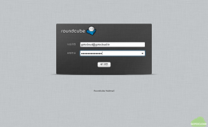

로그인에 성공하면 다음의 그림과 같이 웹메일 화면이 나타난다.

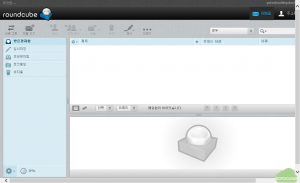

메일 쓰기 버튼을 선택하여 아래와 같이 메일을 작성한 후 “메일 지금 보냄”을 눌러서 메일을 발송한다.

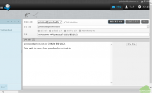

보낸 편지함에 아래의 그림과 같이 발송된 메일이 저장되어 있다.

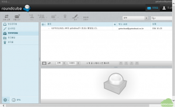

메일이 정상적으로 발송되면 수신 측에서 다음과 같이 메일이 도착되었음을 알 수 있다.

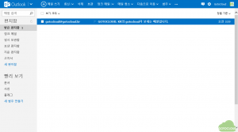

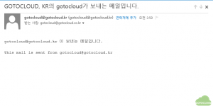

메일에 대해서 회신하여 메일이 정상적으로 수신되는지를 확인한다. 다음과 같이 회신된 메일이 정상적으로 도착하면 메일 서버 설정 및 사용자 메일이 제대로 동작함을 확인할 수 있다.

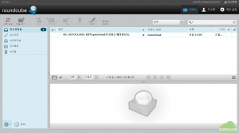

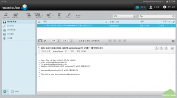

위의 그림과 같이 회신한 메일이 정상적으로 수신되었음을 볼 수 있다.

이상으로 iRedMail 서버에 사용할 도메인을 추가하고 메일 송수신이 가능하도록 네임 서버를 설정한 다음 메일 도메인 관리자와 사용자 계정을 생성한 후 메일을 주고 받는 과정을 설명하였다. 이 글에서 설명한 내용을 바탕으로 iRedMail을 기반으로 자체 메일 서버를 구축한 후 메일 서버를 활용할 수 있을 것으로 기대한다.

앞으로 이 글에서 설명한 메일 계정을 이용하여 다른 클라우드 서비스에 연동하는 방안에 대해서 계속 설명할 예정이니 메일 서버 설치와 구성을 시도해보기를 바란다.
