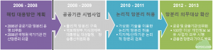
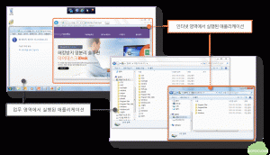
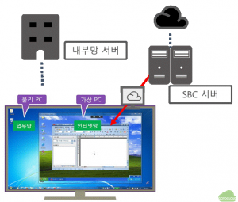

1. 망분리 동향

망분리에 대한 이야기를 시작하기에 앞서 1990년 대 후반 대전의 모 연구소를 방문했을 때의 일화를 먼저 소개하고자 한다. 국가적인 중요 연구를 수행하는 그 연구소는 원천적으로 인터넷이 차단되어 있어 내부에서만 컴퓨터들이 연결되어 있었다. 수년 뒤 다시 방문했을 때는 부서별로 한 대씩의 컴퓨터가 인터넷에 연결되어 있고, 부서별 보안담당자가 CD를 보유하고 인터넷에서 다운받은 정보에 대해서 CD로 구워서 연구원에게 전달한 후 파기하는 정책을 수행하여 연구원들이 인터넷을 사용할 수 있게 되었다고 기뻐했던 기억이 떠오른다. 세 번째로 방문했을 때는 연구원들이 특이한 PC를 사용하고 있었다. PC에 “딸깍이”라고 부르는 스위치가 있어서 스위치를 돌릴 때마다 컴퓨터가 재부팅하면서 인터넷이 되었다가 다시 돌리면 컴퓨터가 재부팅하면서 내부망이 연결되는 구조로 변경이 되는 획기적(?)인 장비였다.

이와 달리 그 연구소의 인근에 있는 모 연구원에서는 2010년에 책상마다 컴퓨터가 두 대씩 지급하면서 부서별로 프린터도 한대씩 추가로 설치하고 모니터도 추가로 지급하여 한대는 내부망에 다른 한대는 인터넷에 연결하여 사용하기 시작했다. 이와 동시에 인터넷에서 오는 메일을 수신하는 인터넷 메일서버와 연구원 내의 메일서버 간에 메일을 이동할 수 있는 메일 연계 솔루션을 구축하여 서로 다른 망을 연결하여 인터넷과 내부망을 사용하고 있다.

그리고 모 대기업의 사내 새마을 금고의 사례도 기억이 나는데, 그 기업 새마을 금고는 특이하게 네트워크가 삼중으로 연결되는 곳에서 영업을 하는 곳이었다. 인터넷 망, 기업 내부망 및 금융망이라고 하는데, 각각에 연결되는 망을 분리하여 연결하기 위하여 가장 먼저 금고 직원의 책상부터 새로 구입해야 했다고 한다. 책상이 좁아서 여러 대의 PC를 놓기가 힘들었기 때문이라고 한다.

한편 국내 굴지의 게임 서비스 회사의 관리자 책상에 놓여있던 네 대의 컴퓨터도 본 기억이 있다. 이 관리자는 인터넷 망, 게임 서비스 망, 게임 개발망 및 사내 업무망에 연결된 각각의 PC를 통해 네 군데의 망에 접속하여 관리를 수행하고 있었다. 여기도 좁은 책상에 관리자는 수많은 모니터와 컴퓨터를 옮겨가며 사용하는 중이었다.

위와 같은 사례를 보면서 해당 기관의 보안 담당자와 종사자가 얼마나 철저하게 보안을 강화하고자 노력하고 있는지에 대한 존경심과 더불어 저렇게 하기 위해서 얼마나 많은 불편과 노력을 투자했을까 하는 안타까움이 동시에 밀려왔던 기억이 떠오른다. 뿐만 아니라, 저렇게라도 하지 않고 있는 수많은 다른 기관은 얼마나 많은 정보 유출 사고와 사이버 공격에 무방비로 노출될까 하는 우려감도 밀려오곤 했던 씁쓸한 기억 또한 떠오르곤 한다.

위와 같이 자체적으로 노력하여 나름의 망분리를 진행했던 기관과는 달리 2008년 옥션, 2011년 네이트 등은 악성코드를 통한 내부 PC의 감염으로 수 천 만 건의 고객정보가 대량으로 유출되는 사고가 발생했으며 2012년 농협 사태, 2013년 3월의 사이버테러 수준의 전산망 대란으로 인한 방송사, 금융사의 3만 5천 여대의 PC 파괴 사례로 인해 전국민이 받았던 충격은 아직도 생생하게 기억 속에 남아 있다. 최근에는 국내의 대형 카드사에서 외부 공격에 의한 유출이 아니라 협력업체 직원이 고객의 정보를 불법적으로 유출하여 문제가 된 사례도 있다.

정부에서는 이러한 정보 보안 사고를 방지하고자 다양한 정책과 법률 등을 제정하여 배포하고 있다. 2006 년부터 해킹 대응 방안 계획을 통해 공공기관의 물리적 망분리 운영 의무화를 추진했으며 2010년에는 가상화 기술을 기반으로 한 논리적 망분리를 허용하여 물리적 망분리에 비해 적은 투자로 망분리를 확산할 수 있는 기반을 제공하고 있다. 그리고 2012 년부터 망분리 의무 대상을 확산하여 올해부터는 많은 기관과 기업이 망분리를 통해 인터넷망과 내부망을 분리하여 정보보호를 강화할 것으로 기대된다.

<그림 1> 공공 및 민간 기관 망분리 의무 확산

| 금융회사 IT 부문 모범 규준 | …금융회사 등은 단말기(개인용 컴퓨터 포함)에 주요 정보를 보관하지 않도록 하고… |
| --- | --- |
| 정보통신망법 시행령 제 15조 | 개인정보처리시스템에 접속하는 개인정보 취급자 컴퓨터 등에 대한 외부 인터넷망   차단 |
| 방통위 고시 제 2012-50호 | …정보통신서비스 제공자 등은 개인정보   취급자의 컴퓨터 등을 물리적 또는 논리적으로 망분리 하여야… |
| 금융위원회 고시 전자금융감독 규정 제 15조 | 내부 통신망과 연결된 단말기에서 인터넷   등 외부통신망 접속 금지 |

<표 1> 망분리 관련 규정 및 법령

2. 망분리 방식

앞의 사례에서 언급하였듯이 인터넷 망과 내부망을 분리하는 망분리 방식은 크게 물리적 망분리와 논리적 망분리로 나눌 수 있다. 물리적 망분리는 물리적으로 두 대의 PC를 사용하여 한 대는 내부망에 연결하고 다른 한 대는 인터넷 망에 연결하면서 두 대의 PC 간의 연결을 완전히 차단하는 방식이다. 물리적인 망분리를 위해서는 인터넷 망과 내부망을 별도로 구성해야 하며 필요할 경우 망별로 프린터 및 주변 기기를 연결해야 한다. 이와 함께 각각의 PC 간의 데이터 공유를 방지하기 위한 USB 및 CD 통제 등 매체 제어 솔루션을 도입해야 한다.

논리적 망분리는 가상화 기술을 이용하여 한 대의 PC에서 마치 두 대의 PC를 사용하는 것과 동일한 효과를 제공하는 기술을 뜻하며 클라이언트 기반 가상화 기술을 이용하는 CBC(Client Based Computing) 방식과 서버 기반 가상화 기술을 이용하는 SBC(Server Based Computing) 방식의 망분리로 구분할 수 있다.

<그림 2> 2-CBC 방식의 논리적 망분리
<그림 2>는 CBC 방식의 논리적 망분리 사례 화면으로 CBC 방식에서는 사용자의 PC에서 인터넷 접속을 위한 웹브라우저를 실행하게 되면 노란색 테두리에 싸여 있는 웹브라우저에서는 인터넷에 연결이 되고, 업무영역에서 실행된 웹브라우저에서는 인터넷 연결이 차단되는 방식으로 동작하게 된다. 웹브라우저 뿐만 아니라, 정책적으로 허용된 어플리케이션은 인터넷 연결이 가능하게 하고 차단된 어플리케이션은 연결을 차단함과 동시에 어플리케이션 별로 파일 등을 공유할 수 없도록 구성된다.

<그림 3> SBC 방식의 논리적 망분리
<그림 3>은 SBC 방식의 논리적 망분리로 인터넷 접속을 위한 가상 PC를 SBC 서버에서 구동하고 그 PC의 화면만 물리 PC로 전송하여 인터넷 망을 사용한다. 인터넷 접속을 위한 가상 PC는 화면만 PC에서 구동이 되므로 내부망에 연결된 물리 PC와 가상 PC 간에는 정보 교환이 차단되는 방식으로 구현된다. 논리적 망분리는 물리적인 망분리와 달리 한대의 PC에서 두 개의 망에 별도로 접속이 가능하게 되므로 네트워크와 프린터 등 주변 기기는 기존의 구성을 그대로 이용할 수 있다는 장점이 있다.

3. 어떤 방식을 선택할 것인가?

앞에서 설명한 물리적 망분리, CBC 기반 망분리, SBC 기반 망분리 방식 중에 어떤 방식을 선택할 것인지는 보안성과 경제성 및 편의성 등 세 가지 관점에서 검토하는 것이 필요하다.

알려진 바와 같이 물리적인 망분리는 보안 관점에서 보면 외부의 공격으로부터는 완전히 안전하다고 생각할 수 있다. 그러나 물리적으로 2대의 PC를 분리하더라도 각 PC간의 의도된 사용자의 정보 이동 및 유출에 있어서는 상당히 취약할 수 있다. 예를 들어 내부 사용자가 업무용 PC에서 자료를 USB로 다운 받아서 인터넷 PC에 연결한 후 외부로 전송하는 것을 방지하기 위해서는 두 PC 모두에 매체 제어 솔루션을 필수적으로 설치하고 이에 대해서 통제를 수행해야 한다. 뿐만 아니라 사용자가 의도적으로 두 대의 PC에 별도의 네트워크 카드를 설치한 후에 직접 네트워크를 연결하여 두 PC간에 데이터를 주고 받는 사례도 있을 수 있다. 이를 방지하기 위해서는 근본적으로 PC가 개봉되었거나 허가 받지 않은 네트워크 카드 등을 설치하는 것을 감지할 수 있는 방안도 마련해야만 한다. 또한 망을 분리하는 것과는 별개로 내부 업무망 PC 자체에 대한 암호화 및 보안 강화는 별도로 수행해야 한다.

SBC 기술은 태생이 보안 솔루션이 아니므로 인터넷 접속용 가상 PC와 물리적인 PC간의 USB 등 디바이스 공유에 대해서만 기본적으로 SBC 솔루션의 정책 관리 기능으로 부분적으로 통제한다. 따라서 다양한 보안 정책 설정과 확인을 위한 프로세스를 정립하지 않거나 관리자의 운영이 미숙할 경우 홀이 존재할 가능성이 발생하며 홀을 통한 인터넷 망과 내부망의 연결에 대해서 모니터링 할 수 있는 방안과 추가 보안 방안을 마련해야 한다. 이와 함께 물리적인 PC에서 USB 등을 통해서 내부 자료를 유출하고자 할 경우를 방지하기 위한 화면 캡쳐 방지 및 매체제어 솔루션은 SBC 솔루션과는 별도로 구축해야 한다.

CBC 방식은 기본적으로 보안 솔루션 관점에서 출발하여 매체제어, 화면 캡쳐 방지 및 보안 정책 관리, 내부 저장소 암호화 등을 포함한 경우가 대부분이므로 보안 방식에 대해서 추가로 도입할 솔루션이 앞의 두 가지 방식에 비해서는 많지 않다. 그러나, 솔루션 별로 메모리 해킹 방지, 디바이스 방지 및 부정 사용 가능성에 대해서는 솔루션 별로 보안 수준을 검토하는 것이 필요하다.

경제성에 있어서 물리적 망분리는 알려진 바와 같이 기본적으로 두 대의 PC 및 모니터, 별도의 네트워크 장비, 추가적인 프린터 등 주변 장치 등이 필수적이며 최근 이슈가 되고 있는 전력 비용 등도 경제성에 많은 영향을 끼친다. 뿐만 아니라 두 대에 설치할 소프트웨어, 매체 제어 등 개별 보안 솔루션 및 허가되지 않은 네트워크 카드 장착 등을 감지하기 위한 모니터링 솔루션 등을 추가로 도입해야 한다. 이와 함께 두 대의 PC를 사용하기 위한 공간 비용도 제약사항으로 고려해야 하므로 경제성 측면에서는 가장 불리하다고 할 수 있다.

SBC 방식은 기본적으로 가상 PC를 구동하기 위한 서버와 SBC 솔루션 비용이 가장 큰 영향을 끼친다. 일반적으로 2개의 CPU를 장착한 서버 당 약 30명 정도의 사용자를 할당하게 되며 개별 OS를 설치하기 위한 스토리지 공간에 따라서 SBC는 평균 일인당 100만원~200만원 사이의 비용이 발생한다고 알려져 있다. 이와 별도로 물리적인 PC의 매체 제어 솔루션 등 비용과 더불어 SBC 서버를 운영하기 위한 별도의 운영 관리 비용도 포함될 수 밖에 없다. 또한 물리적 망분리와 동일하게 OS 및 소프트웨어에 대한 추가 비용이 발생한다.

CBC 방식은 앞의 두가지 방식에 비해서는 비용면에서 가장 큰 장점을 가질 수 있으나 현재 운영 중인 다양한 PC에 대한 호환성 검증 등에 대한 PC 단말 관리 비용이 발생할 수 있다.

편의성은 세가지 방식에서 모두 PC 사용 프로세스를 점검하고 사용자의 어플리케이션의 활용 형태 등을 고려하여 망분리 전 후로 사용자의 업무 수행에 지장이 없는지를 사전에 충분히 검토할 필요가 있으며 이에 대해서는 프로젝트를 진행하기에 앞서 현황 파악과 구축 방향 및 사용 어플리케이션 검증을 통해 편의성에 영향이 없도록 진행하는 것이 필수적이다.

4. 맺음말

최근 화두가 되고 있는 망분리에 대한 사례와 동향, 기반 기술 및 고려 사항에 대해서 간단히 살펴 보았다. 어떠한 방식의 망분리를 택하든 도입에 앞서 보안성, 경제성 및 편의성에 대한 충분한 검토가 필요하며 이러한 고려와 더불어 외부로부터의 공격을 막을 것인가 내부에서의 유출을 막을 것인가를 사전에 결정하는 것이 성공적인 망분리 구현의 지름길이 될 것이다.
